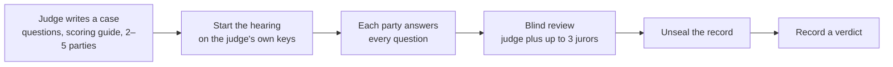

# Model Court

**Put AI to the test.** Compare AI setups (models, prompts, settings) on your own questions through
blind human review, then record a decision backed by the actual responses, ratings, automatic checks,
cost and speed.

**Live:** https://model-court.app.space · **Docs:** [docs/README.md](docs/README.md) · **Status:**
deployed, build `274470e` (Nov 19, 2026)

## How a hearing works



Until the record is unsealed, nobody reviewing sees which model or prompt wrote an answer, what it cost,
how fast it was, or how it did on the automatic checks. Answers are shuffled and labelled A to E.

| Role | Who | Can |
|---|---|---|
| **Judge** | The person who creates the case | Supply keys, start hearings, review, unseal, record the verdict |
| **Juror** | An invited reviewer (an account, or a guest link with no account) | Score each answer blind; their scores are **the jury's findings** |

The judge's own review is scored separately and never mixed into the jury's findings, because the
judge chose the parties. Code and the API keep the original terms: owner = judge, configuration = party,
run = hearing, generation = testimony, reveal = unseal.

> [!IMPORTANT]
> **Strictly BYOK.** The judge's own OpenAI, Anthropic or Google key pays for every call. There is no
> platform credit, sponsored call or billing choice. Jurors never need keys. The public sample
> (`/sample`) is a hand-written fixture that makes no provider request.

## What you can compare

| Kind of case | Parties answer | Checked automatically (shown after unsealing) |
|---|---|---|
| Questions with a scoring guide | Free text, optionally as the next turn of a conversation | – |
| Summaries | A summary under a word limit | Length, required points, invented numbers |
| Classification | One label from a fixed set | Accuracy against the answer key |
| Field extraction | Fields matching a JSON Schema, from text or a PDF | Schema valid, required fields, field-by-field match |
| Answers from sources | An answer citing numbered sources | Cited sources exist, quotes appear in them, required sources cited |
| Tool use | A short tool loop against canned responses | Required and forbidden tools, valid arguments, steps used, final answer |

Every hearing also reports cost (an estimate from a dated price table), latency, tokens and failures per
party. Optional repeats show how consistent a setup is. A case can be saved as a scenario and re-heard
with new parties, and hearings of the same scenario can be compared over time. Imported human answers
or existing transcripts can sit beside generated ones. An optional AI grader (the special master) runs
only on the judge's key, and its agreement with the jury is shown first.

## Status

| Area | State |
|---|---|
| Deployed | v1, v2 and roadmap items 1–7 plus follow-ups D-113 to D-120 ([roadmap](docs/roadmap.md)) |
| Live provider checks | One real call each on OpenAI GPT-6 Luna and Anthropic Claude Haiku 5.5 (Nov 17) |
| Off until a paid smoke check is recorded | Conversations, field extraction, PDF documents, tool use, every Gemini route |
| Live party cap | 3 (the code allows 5) |
| Backups | Built (D-117), off until `BACKUP_PUBLIC_KEY` is set |
| Tests | 679 unit tests and 296 integration tests, each integration test run on local D1 and on the real `ModelCourtStore` Durable Object, plus 42 Playwright tests including signed-in flows with two test accounts. Provider HTTP is stubbed: no test can make a paid call |
| Not yet exercised live | A full signed-in hearing with a juror |

Evidence is in [docs/verification.md](docs/verification.md); every decision and deviation is in
[docs/decisions.md](docs/decisions.md).

## Keeping your API key safe

- Use a **dedicated Model Court–only key** with a low monthly spend cap. Admin or organization keys are
  refused, and so is a key pasted on another provider's card.
- Saved keys are encrypted at rest and **expire after 7 days** unless renewed. Removing or expiring a key
  stops any queued work that would use it.
- **After testing, remove the key in Settings and rotate or delete it at the provider.** Removing it here
  doesn't revoke it there.
- Turn on two-factor authentication for the account you sign in with and for your provider accounts.

More in [docs/security.md](docs/security.md).

## Local setup

Requirements: Node 24 (`.nvmrc`) and npm 11.6 or later. With npm 10, prefix installs with `npx npm@11.6.2`.

```bash
npx npm@11.6.2 ci
```

```bash
npm run check
```

`npm run check` covers type checking, lint, unit tests, integration tests on both stores and the smoke
tests. It needs no keys and makes no paid call.

Running the full app locally needs a DeepSpace sign-in:

```bash
npx deepspace auth login
```

```bash
npx deepspace dev start
```

## Tests

| Command | Covers |
|---|---|
| `npm run test:unit` | Pure rules: scoring, validation, prompts, adapters, kits and checks, cost and speed, backup sealing |
| `npm run test:integration` · `npm run test:integration:store` | The real API and services on local D1, then on the real Durable Object store, with real JWT verification; provider HTTP, the job queue and notices stubbed |
| `npx deepspace test run smoke` | Playwright on a local dev server: public pages, the sample, accessibility (axe) |
| `npx deepspace test run all` | Also the signed-in specs, which need DeepSpace test accounts (`npx deepspace test accounts create …`); a setup project clears their cases first |
| `npm run smoke:providers` | **Paid**, manual: real calls per provider and mode (`single`, `multi`, `json`, `pdf`, `tools`); keys typed into a hidden prompt |
| `npm run backup -- open <file>` | Opens a downloaded backup offline and checks it; `trial-restore` restores it into a fresh local store |

## Deploy

Deploys run only when Avery says so. The procedure, every configuration value, the migration rules
(0009 and 0015 rebuild tables and need a backup first) and the backup and restore steps are in
[docs/runbook.md](docs/runbook.md).

## Repository map

| Path | Holds |
|---|---|
| `src/domain` | Pure rules: limits, registry, kits and checks, rubric, prices, snapshots |
| `src/server` | The API, services, the store and its migrations, provider adapters, crypto |
| `src/pages`, `src/components` | Routes and UI |
| `tests/integration`, `tests/*.spec.ts` | API tests on both stores; Playwright specs |
| `scripts` | Secrets provisioning, the provider smoke test, the backup tool |
| `docs` | Maintained docs ([index](docs/README.md)); `docs/archive` holds finished plans and specs |

## Limits

| Limit | Value |
|---|---|
| Questions per case | 1–5 |
| Parties per hearing | 2–5 (3 on the live app), at most 15 answers per juror |
| Samples per answer | 1–3 |
| Output tokens | 512, plus reasoning headroom where reasoning can't be turned off |
| Invited jurors | 3 |
| Attempts per answer | 2 (no automatic paid retry) |
| Calls | 20 per user per day; 100 per day and 500 in total per deployment |
