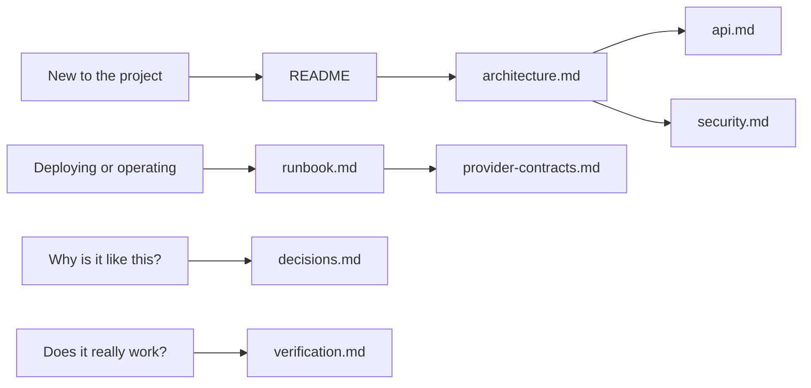

# Model Court documentation

The maintained docs, and where to start for each kind of question.

| Doc | Read it for | Kept up to date by |
|---|---|---|
| [../README.md](../README.md) | What Model Court is, its status, local setup | Every release |
| [architecture.md](architecture.md) | How the system works: components, data flow, blinding, kits, providers, migrations | Every change to the design |
| [api.md](api.md) | The `/api/v1` reference: endpoints, fields, errors | Every API change |
| [security.md](security.md) | Threat model, key handling, blinding, review history, open risks | Every security-relevant change |
| [provider-contracts.md](provider-contracts.md) | What each provider receives, adapter versions, live checks | Every provider or route change |
| [runbook.md](runbook.md) | Configuration, deploys, migrations, backups, restores, rollback | Every operational change |
| [roadmap.md](roadmap.md) | What was delivered and what comes next | Each planning round |
| [decisions.md](decisions.md) | Every decision and deviation, D-01 onward | Append-only, with each change |
| [verification.md](verification.md) | Evidence: agent checks (part A) and Avery's own checks (part B) | Each check |
| [submission.md](submission.md) | The submission note and checklist | Before submitting |
| [archive/](archive/) | Finished plans, specs, design notes and reviews (history, not maintained) | Never |

## Where to start

## Conventions for these docs

- Plain words. Court terms (judge, party, hearing, testimony, record) are display strings; the code
  and the API use owner, configuration, run, generation and reveal. [architecture.md](architecture.md)
  maps them.
- Facts come from the code and are checked against it. A claim about the live app names the check in
  [verification.md](verification.md) that supports it.
- A new decision gets a row in [decisions.md](decisions.md). The maintained docs then describe the
  result; they don't repeat the history.
- Diagrams are Mermaid, so GitHub renders them and they stay editable as text.
