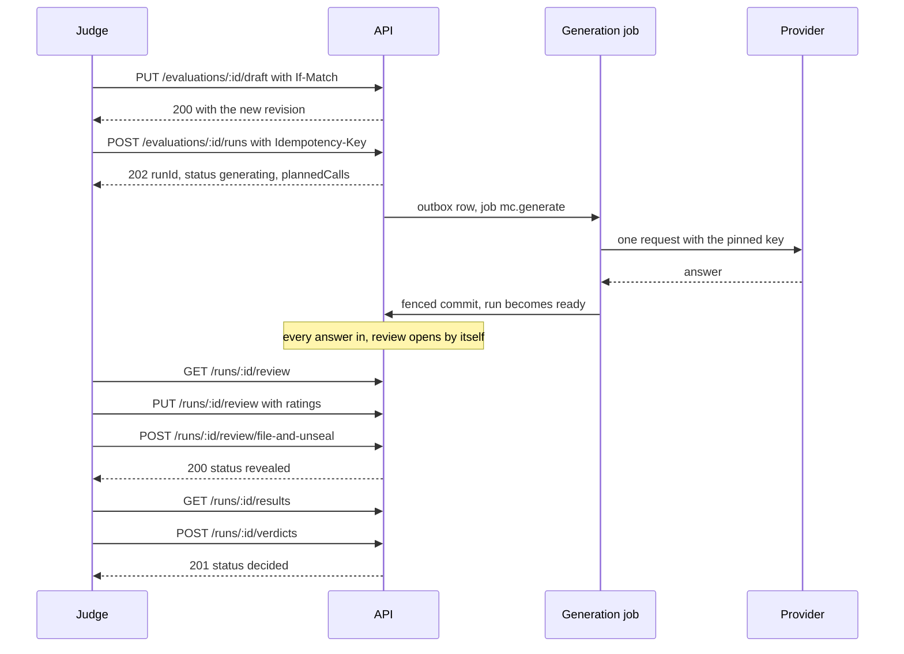
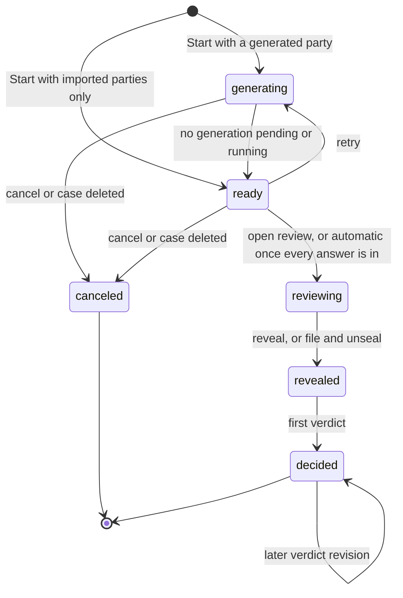

# API reference (`/api/v1`)

Model Court's HTTP API is a Hono app mounted at `/api/v1` ([`src/server/api.ts`](../src/server/api.ts)).
Request bodies are validated by the zod contracts in [`src/domain/contracts.ts`](../src/domain/contracts.ts);
business rules live in [`src/server/services/`](../src/server/services/); the envelope, error codes and
header helpers are in [`src/server/http.ts`](../src/server/http.ts). `docs/decisions.md` is the record of why
each piece is the way it is; decision numbers (D-nn) are given where they explain a rule.

Terminology: the UI calls the `owner` the **judge** and `invited` reviewers **jurors**. Field names, enum
values and error codes keep the original terms (`owner`, `reviewer`, `configuration`, `run`); only display
strings (session labels such as `Juror 1`, and messages) use the new ones. A *case* is an evaluation, a
*hearing* is a run, and a *party* is a configuration.

## Conventions

### Authentication

| Caller | How | Reaches |
|---|---|---|
| Signed-in user | `Authorization: Bearer <platform JWT>`, verified on every request | Every route, subject to the role checks below |
| Guest juror (D-41) | Cookie `__Host-mcj-<runId>` set by the two guest routes | Only `GET /runs/:id`, `GET` and `PUT /runs/:id/review`, `POST /runs/:id/review/submit`, `GET /runs/:id/results` and `GET /runs/:id/documents/:caseKey` (UUID question key) of its own hearing. Every other route is 401 |
| Anyone | No credential | `POST /invites/redeem-as-guest`, `POST /juror/resume`, and `GET /healthz` outside `/api/v1` |

A token whose user id is in the reserved guest namespace (`mcj_`) is refused with 401. Roles are resolved per
case ([`src/server/access.ts`](../src/server/access.ts)): **judge** (the owner), **juror** (a signed-in or guest
reviewer with a session on that hearing), or nobody. Invisible, deleted and missing resources all answer the
same 404.

### Envelopes and headers

- Requests and responses are JSON unless a row says otherwise. Unknown fields are rejected (422).
- Success: `{"data": …, "requestId": "req_…"}`.
- Error: `{"error": {"code", "message", "retryable", "fields?", "details?"}, "requestId"}`. `fields` is a
  list of `{path, message}` from validation; `details` carries the extra facts a row names.
- Every response carries `requestId` (also as `X-Request-Id`) and `Cache-Control: private, no-store`.
- `GET /evaluations/:id` (judge), `GET /runs/:id` and `GET /runs/:id/review` return an `ETag` with the
  revision to send back in `If-Match`.
- Mutations from another origin are refused (403 `FORBIDDEN`). Cookie-authenticated guest mutations must
  prove same origin: `Origin` is ours, or `Sec-Fetch-Site: same-origin` when `Origin` is absent.

### Revisions (`If-Match`)

`If-Match: "<revision>"` guards every write to a versioned row. Missing is 428 `REVISION_REQUIRED`, a value
that is not a quoted number is 400 `BAD_REQUEST`, and a stale revision is 409 `REVISION_CONFLICT`.

| Required for | Revision sent |
|---|---|
| Draft save, draft restore, delete case | Case revision |
| Imports, documents, sources (put and delete) | Case revision |
| Retry, cancel, open review, reveal, verdict | Hearing revision |
| Rating save, rating submit, file and unseal | The caller's review session revision (`sessionRevision`) |
| Renew key, replace key (`replacesCredentialId`), remove key | Key revision |

### Idempotency keys and receipts

`Idempotency-Key: <uuid>` is **required** (400 `BAD_REQUEST` when missing or not a UUID) for: save key, start
hearing, retry, invite, submit review, file and unseal, reveal, verdict, duplicate case, and start the special
master. The server stores a receipt per caller, operation and key for 24 hours
([`src/server/receipts.ts`](../src/server/receipts.ts)):

- the same key and the same payload replay the original response;
- the same key with a different payload is 409 `IDEMPOTENCY_CONFLICT`;
- the same key while the first request is still running is 409 `IDEMPOTENCY_CONFLICT` with `retryable: true`;
- a duplicate whose original committed concurrently always replays the original receipt (D-14).

The key-save receipt matches replays with a keyed digest, so it never holds the API key.

### Body limits

| Body | Cap | Over the cap |
|---|---|---|
| Any JSON body | 128 KiB | 413 `PAYLOAD_TOO_LARGE` |
| Key save | 16 KiB | 413 |
| A draft inside a body | 96 KiB of JSON | 422 `VALIDATION_FAILED` |
| PDF upload (raw bytes) | 4 MiB; `Content-Length` required | 411 `BAD_REQUEST` without it, 413 above the cap, 400 if the stream is longer than declared |

Malformed JSON or invalid UTF-8 is 400 `BAD_REQUEST`.

### Error codes

| Code | Status | Meaning |
|---|---|---|
| `BAD_REQUEST` | 400 (411 for a PDF without `Content-Length`) | Malformed JSON, a bad `If-Match` or `Idempotency-Key`, an invalid cursor, an export format other than `json` or `csv`, a bad scenario-file query |
| `UNAUTHENTICATED` | 401 | No valid token, or a guest cookie on a route it does not reach |
| `FORBIDDEN` | 403 | Cross-origin mutation, or an action the caller's role does not allow |
| `NOT_FOUND` | 404 | Missing, deleted or not visible to the caller |
| `REVISION_CONFLICT` | 409 | `If-Match` is stale, or a source changed under the draft at Start |
| `STATE_CONFLICT` | 409 | The hearing or key is in the wrong state; `details` names the reason where a row says so |
| `IDEMPOTENCY_CONFLICT` | 409 | Same key, different payload (or still in progress) |
| `INCOMPLETE_REVIEW` | 409 | Submit or file without every score; `details.issues` lists what is missing |
| `INVITE_UNAVAILABLE` | 409 | Any invalid, used, revoked or expired invitation, always with the same message |
| `ACTIVE_RUN_EXISTS` | 409 | The case already has an unfinished hearing |
| `PAYLOAD_TOO_LARGE` | 413 | Over a body cap |
| `VALIDATION_FAILED` | 422 | The body fails its contract; `fields` gives the paths |
| `KEY_PROVIDER_MISMATCH` | 422 | A key pasted on another provider's card (fixed message) |
| `UNSUPPORTED_CONFIGURATION` | 422 | Start readiness failed; `details.issues` lists readiness issues |
| `CREDENTIAL_MISSING` | 422 at Start, 409 on retry | No usable key for a provider the hearing needs |
| `REVISION_REQUIRED` | 428 | `If-Match` is missing |
| `QUOTA_EXHAUSTED` | 429 | A count cap: cases, hearings per case, provider calls, document storage |
| `RATE_LIMITED` | 429 | Too many requests; `Retry-After` and `retryAfterSeconds` say when to try again |
| `GENERATION_DISABLED` | 503 | Live generation is switched off on this deployment |
| `CREDENTIAL_WRITES_DISABLED` | 503 | Saving keys is paused (`retryable: true`) |
| `NOT_READY` | — | Declared in the type but not raised by any route today |
| `INTERNAL` | 500 | Unexpected error; quote the request ID |

### Rate limits

| Bucket | Limit | Applies to |
|---|---|---|
| Reads | 120 per minute per caller | Every authenticated `GET`, guests included (D-42) |
| Mutations | 30 per minute per caller | Every authenticated non-`GET` request |
| Generation | 5 per minute per caller | `POST /evaluations/:id/runs`, `POST /runs/:id/retries`, `POST /runs/:id/special-master` |
| Key saves | 5 per minute per user | `POST /credentials` |
| Key checks | 6 per minute per user | `POST /credentials/:id/check` |
| Document uploads | 20 per hour per user | `PUT /evaluations/:id/documents/:caseKey` |
| Hearing document reads | 30 per minute per caller, besides the 120 reads | `GET /runs/:id/documents/:caseKey` |
| Guest join | 10 per hour per IP | `POST /invites/redeem-as-guest` |
| Guest resume | 5 per hour per IP and per guest | `POST /juror/resume` |

A limited request is 429 `RATE_LIMITED`. Without a `CF-Connecting-IP` header the per-IP limit is skipped and
the per-guest limits still apply.

### Generation outcome codes

Generations, attempts and steps carry an outcome code that only the judge sees. The plain-words text for
each is `ERROR_TEXT` in [`src/lib/error-text.ts`](../src/lib/error-text.ts):
`PROVIDER_AUTH_FAILED`, `PROVIDER_ACCESS_DENIED`, `PROVIDER_MODEL_UNAVAILABLE`, `PROVIDER_QUOTA_EXHAUSTED`,
`PROVIDER_RATE_LIMITED`, `PROVIDER_UNAVAILABLE`, `PROVIDER_REJECTED_REQUEST`, `PROVIDER_SCHEMA_REJECTED`,
`PROVIDER_DOCUMENT_REJECTED`, `PROVIDER_BLOCKED`, `PROVIDER_REDIRECT_REFUSED`, `PROVIDER_TIMEOUT`,
`PROVIDER_NETWORK_ERROR`, `PROVIDER_CANCELED`, `PROVIDER_LEASE_EXPIRED`, `INVALID_PROVIDER_RESPONSE`,
`OUTPUT_TOO_LARGE`, `EMPTY_OUTPUT`, `TOOL_PROTOCOL_ERROR`, `TOOL_TRACE_TOO_LARGE`, `CREDENTIAL_REVOKED`,
`CREDENTIAL_EXPIRED`, `CREDENTIAL_UNAVAILABLE`, `CANCELED`, `DELETED`. The special master adds
`GRADER_INVALID_OUTPUT`.

## A hearing through the API

The judge-alone path: the judge is the only rater and files and unseals in one step. With a jury the judge
instead creates invites, jurors redeem them and submit, and the judge calls `POST /runs/:id/reveal`.

## Hearing status

Run status values come from `RUN_STATUSES` in [`src/domain/transitions.ts`](../src/domain/transitions.ts).
Each transition is one guarded batch that re-checks its preconditions at commit time. Removing, expiring or
revoking a pinned key fences its queued work, which can also move `generating` to `ready`.

| Command | Allowed in |
|---|---|
| Retry, cancel | `generating`, `ready` |
| Open review | `ready` |
| Invite | `ready`, `reviewing` |
| Redeem invite, save review, submit review, reveal, file and unseal | `reviewing` |
| Verdict | `revealed`, `decided` |
| Results, export, special master | `revealed`, `decided` |

## Health

| Method | Path | Who | Body or notes | Success |
|---|---|---|---|---|
| GET | `/healthz` (outside `/api/v1`) | public | `{build, ready, storeOk, generationEnabled}`; no secrets or provider configuration. `ready` is false when a setting is missing or malformed | 200 |

## Catalog and quota

| Method | Path | Who | Body or notes | Success |
|---|---|---|---|---|
| GET | `/catalog` | signed in | Model routes, limits, the price table and the switches; never says which routes a hearing selected | 200 |
| GET | `/quota` | signed in | Read-only provider-call caps (D-59): `{user, globalToday, globalLifetime, available, resetsAt}`, each allowance with limit, used and remaining; `resetsAt` is the next UTC midnight | 200 |

Catalog fields:

| Field | Content |
|---|---|
| `providerRegistryVersion` | The registry version |
| `priceTable` | `{version, readOn, sources}` of the table in effect today; later-dated tables wait for their day (D-108) |
| `generationEnabled`, `credentialWritesEnabled` | The deployment switches |
| `providers` | `[{id, name}]`: `openai`, `anthropic`, `google` ("Google") |
| `models[]` | `key, provider, modelId, label, line, contextTokens, providerMaxOutputTokens, reasoning, retiresNotBefore, docsUrl, enabled` (live-checked), `verifiedAt, multiTurnVerifiedAt` (D-39), `structuredVerifiedAt, pdfVerifiedAt` (D-86), `toolsVerifiedAt` (D-99), `adapterVersion` |
| `limits` | `maxCases`, `configurations` (deployment party cap, default 3, at most 5), `maxTestimoniesPerHearing: 15`, `samplesPerAnswer` (the deployment max, 1 to 3), `minConfigurations`, `maxOutputTokens`, `reasoningHeadroomTokens`, `maxAttemptsPerGeneration`, `credentialTtlDays`, the deployment's call caps, and `extraction` (the extraction limits) |

The catalog lists nine Gemini models, all `enabled: false` until their live check (D-108).

## Credentials

BYOK provider keys. Responses carry metadata only, never the key or its ciphertext. One active key per
provider per user.

| Method | Path | Who | Body or notes | Success |
|---|---|---|---|---|
| GET | `/credentials` | own | `{items: [metadata]}` | 200 |
| POST | `/credentials` | own | Idempotency-Key. `{provider, label, apiKey, consentToStorage: true, replacesCredentialId?}`; If-Match (the old key's revision) when replacing. A second active key for a provider without `replacesCredentialId` is 409 `STATE_CONFLICT` | 201 metadata |
| POST | `/credentials/:id/renew` | own | If-Match, empty body. Resets `expiresAt` to now + `CREDENTIAL_TTL_DAYS`; 409 once expired or removed | 200 metadata |
| POST | `/credentials/:id/check` | own | Empty body. One free list-models request with the stored key, made server-side (D-59). `{result: "valid"\|"invalid"\|"restricted"\|"unreachable", reason, checkedAt, credential}` | 200 |
| DELETE | `/credentials/:id` | own | If-Match. Revokes the key: deletes the ciphertext and fences queued work pinned to it | 204 |

Metadata: `{id, provider, label, status: "active"|"revoked", revision, createdAt, expiresAt, lastUsedAt,
lastUsedRunId, lastCheckedAt, lastCheckResult}`.

Key-save refusals, all before anything is stored or sent:

- organization admin keys (`sk-admin-`, `sk-ant-admin`) are 422 `VALIDATION_FAILED`;
- a key that clearly belongs to another company (`sk-ant-`, `AIza`, `sk-or-`, `sk-proj-`, `sk-svcacct-`
  or `sk-` on the wrong card) is 422 `KEY_PROVIDER_MISMATCH` with a fixed message (spec 07 §8.2, D-107);
- while `CREDENTIAL_WRITES_ENABLED` is off, 503 `CREDENTIAL_WRITES_DISABLED`. Removal always works.

`provider` accepts `"google"` everywhere it is an enum: here, in `credentialIdsByProvider` on Start and
retries, and on the special master.

## Evaluations and drafts

| Method | Path | Who | Body or notes | Success |
|---|---|---|---|---|
| GET | `/evaluations` | own or joined | Cursor pagination `?cursor&limit` (at most 50, default 20). `{items, nextCursor}` | 200 |
| POST | `/evaluations` | signed in | `{title, taskDescription, draft?, origin?: {kind: "scenario_file"\|"certified_record"}}`. Without `draft` it seeds the example draft; with one it is validated like a save (D-71). `origin` needs `draft`. Counts against the 10-case quota (429 `QUOTA_EXHAUSTED`) | 201 `{id, revision: 1, draft}` |
| GET | `/evaluations/:id` | judge or joined juror | Judge: draft, hearings and the owner fields below; juror: title and the hearings they joined | 200, with `ETag` for the judge |
| PUT | `/evaluations/:id/draft` | judge | If-Match. A full replacement of the draft (fields below) | 200 `{revision, draft?}` (`draft` for extraction and grounded kits) |
| DELETE | `/evaluations/:id` | judge | If-Match. `{confirmTitle}`. Cancels unfinished hearings and special-master runs and releases their queued units | 202 `{id, deleted: true, cleanup: "scheduled_within_24h"}` (tombstone) |
| POST | `/evaluations/:id/runs` | judge | Start a hearing; see [Runs](#runs) | 202 |

### Draft fields

| Field | Content |
|---|---|
| `comparisonMode` | `"model"` or `"configuration"` |
| `cases[]` | 1 to 5 questions: `{key, title, input, reference, expectedBehavior, messages?, language?, kitFields?}` |
| `cases[].messages` | Conversation so far (D-39): `[{role: "user"\|"assistant", content}]`, alternating, starting with the user and ending with the assistant, at most 10 messages and 8,000 characters |
| `cases[].language` | Optional language tag, 1 to 35 characters (D-36) |
| `cases[].kitFields` | Per-question kit fields; see [Task kits](#task-kits) |
| `configurations[]` | 2 to 5 parties. A model party `{kind?: "model", key, label, modelKey, systemPrompt, maxOutputTokens: 512}`, or an imported party `{kind: "imported", key, label, provenance}` (D-38) |
| `configurations[].provenance` | `{sourceType: "human_baseline"\|"transcript_export"\|"other", description, collectedOn?, redacted}` |
| `rubricVersion` | Optional: `reference-qa-v1` (default), `safety-v1`, `writing-v1` (D-35), or a kit rubric: `summary-v1`, `classification-v1`, `extraction-v1`, `grounded-v1`, `tools-trajectory-v1` |
| `samplesPerAnswer` | Optional 2 or 3 (D-65); absent means once. 422 when every party is imported, or above the deployment's `MAX_SAMPLES_PER_ANSWER` (re-checked at Start) |
| `kit` | Optional `{version, settings}`; absent means general answers (`general-v1`) |

Party limits (spec 07, D-110): up to 5 parties and at most 15 testimonies (parties × questions, imported
parties included). More is 422 `VALIDATION_FAILED` on `configurations` with the plain message, at save,
restore, duplicate and Start. Review labels are `A` to `E`; sessions created before this change hold `A` to `C`.

### Judge view of a case

The judge's branch of `GET /evaluations/:id` adds these fields. The juror branch is unchanged by all of them.

| Field | Content |
|---|---|
| `imports` | Imported answers per party (D-38) |
| `documents` | `[{caseKey, kind, delivery, sha256, byteLength, pageCount, available}]` (extraction) |
| `sources`, `sourceTotals` | `[{caseKey, items: [{number, title, origin, text, sha256, updatedAt}]}]` and `{caseChars, limit: 60000}` (grounded) |
| `draftScenarioHash` | 64 hex, `scenario-v1` (D-68) |
| `draftScenarioVersion` | The version the saved draft's questions match, or `null` |
| `nextScenarioVersion` | The number the next new version would get |
| `draftDiff` | `{added, removed: [{key, title}], edited: [{fromKey, toKey, title}], rubricChanged, templateChanged, kitChanged}` against the newest hearing when the draft matches no hearing, else `null` |
| `runs[]` | Each adds `scenarioHash`, `scenarioVersion` (1-based, by first appearance, display only), `number` (1-based position in the case, oldest first), `partyCount` |
| `runs[].parties`, `runs[].changes` | **Only while that hearing is `revealed` or `decided`**, else `null`. `parties: [{key, label, fingerprint, source: "model"\|"imported", provider, modelId}]`; `changes` versus the previous unsealed hearing of the same version: `added`, `removed`, `model` with `from`/`to`, `prompt`, `source`, `provenance`, `answers` |
| `origin` | `{kind: "duplicate"\|"scenario_file"\|"certified_record", fromEvaluationId, fromRunId, scenarioHash, sourceDeleted}` or `null`; ids only for duplicates of the judge's own case; `scenarioHash` computed by the server (D-71) |
| `copyCount` | Live copies of this case |

Nothing in the scenario fields is stored: each value is recomputed from the immutable snapshots. Migration
`0010_case_origin` adds the four nullable `evaluations.origin_*` columns, immutable once set.

## Imports

Answers written elsewhere for an imported party (D-38).

| Method | Path | Who | Body or notes | Success |
|---|---|---|---|---|
| PUT | `/evaluations/:id/imports/:configurationKey` | judge | If-Match. `{items: [{caseKey, text}], confirmMayShareWithJurors: true}`. Replaces that party's answers. Each text at most 16,000 characters and 16 KiB, no control characters. On a field-extraction case each answer must be JSON that fits the field list (422) | 200 `{revision, imports: [{caseKey, sha256, byteLength}]}` |
| DELETE | `/evaluations/:id/imports/:configurationKey` | judge | If-Match. Removes that party's answers | 200 `{revision}` |

The judge's run view adds `imported`; results add `source` and `provenance` on imported parties and
`status: "imported"` plus `sha256` on their responses.

## Documents

The document of one extraction question (spec 04, D-87, D-89).

| Method | Path | Who | Body or notes | Success |
|---|---|---|---|---|
| PUT | `/evaluations/:id/documents/:caseKey` | judge | If-Match. Text: `{kind: "text", text}`, at most 64 KiB UTF-8, no control characters. PDF: `Content-Type: application/pdf`, the raw file and `X-Page-Count: 1–20` (counted by the judge's browser) | 200 `{revision, draft, document: {kind, sha256, byteLength, pageCount, delivery}}` |
| DELETE | `/evaluations/:id/documents/:caseKey` | judge | If-Match. Removes the draft's reference | 200 `{revision, draft}` |
| GET | `/evaluations/:id/documents/:caseKey` | judge | Text as `{kind: "text", text}`; PDF as bytes (headers below) | 200 |
| GET | `/runs/:id/documents/:caseKey` | judge, a juror with a live session on that hearing whose worksheet includes the question, or its guest juror | The hearing's immutable copy; anyone else 404. Counts toward the 120 reads and the 30 document reads a minute | 200 |

Rules:

- Documents are deduplicated per owner by sha256, never across owners. Delivery is `text` for a text
  upload and `pdf_native` for a PDF. "Send the text only" is the text upload of the reviewed text.
- 422 `VALIDATION_FAILED` when the question isn't an extraction question of the saved draft, and for a PDF
  with `details.reason` `not_pdf`, `truncated` or `encrypted`. These come from byte checks only: `%PDF-1.`
  in the first KiB, `%%EOF` in the last, no `/Encrypt` in the last 64 KiB. There is no server-side parsing.
- 429 `QUOTA_EXHAUSTED` with `details.kind: "document_storage"` past 32 MiB per user or 256 MiB in total
  (`MAX_DOCUMENT_BYTES_PER_USER`, `MAX_DOCUMENT_BYTES_GLOBAL`); nothing is stored. 429 `RATE_LIMITED` past
  20 uploads an hour.
- A document a restore left out is 404 with `details.reason: "document_not_restored"`. The same file
  uploaded again puts the bytes back for the draft and every hearing that uses it.
- PDF bytes are returned with `Content-Type: application/pdf`, `Content-Disposition: attachment;
  filename="document.pdf"`, `X-Content-Type-Options: nosniff`, `Content-Security-Policy: sandbox;
  default-src 'none'`, `Cache-Control: private, no-store` and `Cross-Origin-Resource-Policy: same-origin`.
- Backups leave PDF chunks out (`redactions.pdfChunksOmitted`).

## Sources

The numbered sources of one grounded question, replaced as a whole (spec 05, D-93, D-95).

| Method | Path | Who | Body or notes | Success |
|---|---|---|---|---|
| PUT | `/evaluations/:id/sources/:caseKey` | judge | If-Match (428 without, 409 stale). `{sources: [{number, title?, origin?, text}], requiredSources?: number[]}` | 200 `{revision, sources: [{number, title, origin, text, sha256, updatedAt}], draft}` |
| DELETE | `/evaluations/:id/sources/:caseKey` | judge | If-Match. 404 when there are none | 200 `{revision, draft}` |

| Rule | Limit |
|---|---|
| Sources per question | 1 to 10, numbered 1, 2, 3… in order |
| `text` | 1 to 6,000 characters, not blank, kept exactly as written |
| `title` | 1 to 120 characters, one line |
| `origin` (the judge's note) | 1 to 300 characters; never sent to a provider or shown to jurors |
| Per question | 24,000 characters and 100 KiB |
| Per case | 60,000 characters (the service sums the other questions; 422 `VALIDATION_FAILED`) |
| Body | 413 above 128 KiB |

- `requiredSources`, when given, replaces that question's `kitFields.requiredSources` in the same write, so a
  move or removal renumbers "A good answer cites". Each number once, each one of the new sources; 422 on a
  question marked `no`.
- 404 for a question key not in the saved draft; 422 on a case of another kit. A stranger or a juror gets 404
  (D-98).
- Audit `evaluation.sources.put` (`{caseKey, count, chars}`) and `evaluation.sources.delete`
  (`{caseKey, count}`). Titles, notes and text are never logged or audited.
- A draft save that drops a question deletes its sources. Restoring a hearing's questions copies its sources
  back; duplicating a case copies them to the copy.

## Scenarios

Re-hearing, copying and comparing (spec 02). All judge-only: jurors and strangers get 404.

| Method | Path | Who | Body or notes | Success |
|---|---|---|---|---|
| POST | `/evaluations/:id/draft/restore` | judge | If-Match. `{fromRunId, questions: boolean, parties: boolean}` (at least one true). Copies that hearing's frozen questions and rubric (and kit) and/or its parties, comparison mode and repeats into the draft; imported parties get their exact frozen answers back. 404 for a hearing of another case; 422 when the result is not a valid draft for this deployment. No provider call, no budget (D-69) | 200 `{revision, draft, imports}` |
| POST | `/evaluations/:id/duplicate` | judge | Idempotency-Key. `{title, fromRunId?, includeParties, includeImportedAnswers?: true}`: copies the draft, or that hearing's frozen setup, into a new case with fresh question and party keys (default pair without parties; imported answers only with the flag, which needs `includeParties`). Counts against the 10-case quota (429). Never copies hearings, sessions, invites, verdicts, special-master runs or key pins (D-71) | 201 `{id, revision}` |
| GET | `/evaluations/:id/scenario?includeParties=true\|false&fromRunId?` | judge | A scenario file with `Content-Disposition: attachment` (fields below). Audit `scenario.export` (D-71). 400 for a bad query | 200 |
| GET | `/evaluations/:id/comparison?runIds=a,b[,…]` | judge | 2 to 5 distinct hearings of this case, each `revealed` or `decided` (else 409 `STATE_CONFLICT` with `details.sealedRunId`; a malformed list 422; another case's hearing 404). Counts only; no account, session or credential id (D-70) | 200 |

Scenario file: `{format: "model-court-scenario", formatVersion: 1, exportedAt, scenarioHashVersion,
scenarioHash, title, taskDescription, rubricVersion, messageTemplateVersion, kit?, questions: [every question
field but its key], comparisonMode?, parties?: [{label, modelKey, provider, modelId, systemPrompt}],
importedPartiesLeftOut?}`. It carries no case, run, party, credential, session or user id, key, imported
answer, testimony, rating or judgment.

Comparison response:

| Field | Content |
|---|---|
| `evaluationId`, `evaluationTitle` | The case |
| `hearings[]` | `{runId, createdAt, revealedAt, scenarioHash, scenarioVersion, rubricVersion, messageTemplateVersion, raterSource: "jury"\|"judge", raterCount, guestRaterCount, potentiallyUnblindedCount, repeatJurorCount, parties: [{key, label, fingerprint, source, provider, modelId, meanPoints, questions}]}` |
| `questions[]` | `{questionHash, title, presentIn}` |
| `commonQuestionCount` | Questions present in every hearing |
| `comparable` | `{sameQuestions, sameRubric, sameTemplate, sameRaterSource, adapterChanged}` |
| `jurorOverlap[]` | `{runIds, shared, knowable, guests}` |
| `anchors[]` | `{fingerprint, label, byHearing: {<runId>: {configurationKey, meanPoints, questions, raters}}}` |
| `relative[]` | `{runId, configurationKey, label, anchorFingerprint, meanDiff, better, worse, tied, questions, raters}` |
| `caveats` | Plain-words warnings |
| `setupMetrics` | `{<runId>: <results setupMetrics>}` |

## Runs

| Method | Path | Who | Body or notes | Success |
|---|---|---|---|---|
| POST | `/evaluations/:id/runs` | judge | Idempotency-Key. `{draftRevision, credentialIdsByProvider, consentToProviderProcessing: true, acknowledgeProviderCharges: true, expectedScenarioHash?, acknowledgeSendsDocuments?: true}` | 202 `{runId, status, revision, plannedCalls, scenarioHash, plannedCallsAreUpperBound?}` |
| GET | `/runs/:id` | judge, juror, guest | Role-specific projection. The judge's read reconciles expired leases and opens review when every answer is in | 200, with `ETag` |
| POST | `/runs/:id/retries` | judge | If-Match, Idempotency-Key. `{generationIds, acknowledgePossiblePriorCharge: true, credentialIdsByProvider?}` | 202 `{runId, status: "generating", retried, repinned, plannedCalls, plannedCallsAreUpperBound?}` |
| POST | `/runs/:id/cancel` | judge | If-Match. `{reason?}` (at most 500 characters) | 200 `{runId, status: "canceled", revision}` |
| POST | `/runs/:id/open-review` | judge | If-Match. `{acknowledgeExcludedCases}`. Needed only when some answer failed: once every planned answer is in, review opens by itself (audit `review.open` with no actor and `automatic: true`) | 200 `{runId, status: "reviewing", revision, eligibleCaseCount, excludedCaseCount, ownerSessionId}` |

Start:

- `credentialIdsByProvider` gives exactly one saved key per provider the parties use (422
  `CREDENTIAL_MISSING` otherwise). The keys are pinned to the hearing.
- A different `expectedScenarioHash` is 409 `STATE_CONFLICT` with `details: {scenarioChanged: true,
  scenarioHash}` before anything is written.
- `acknowledgeSendsDocuments: true` is required when any question sends a PDF file (422 otherwise).
- The 21st hearing of a case is 429 `QUOTA_EXHAUSTED` (D-69); so is a start over the provider-call caps.
  An unfinished hearing on the case is 409 `ACTIVE_RUN_EXISTS`. Generation switched off is 503
  `GENERATION_DISABLED`.
- A source changed under the draft between the read and the commit fails the start with 409
  `REVISION_CONFLICT` and writes nothing.
- Start creates questions × generated parties × samples generations, so `plannedCalls` includes samples.
  Sample *k* is first dispatched (*k* − 1) minutes after Start. For tool hearings `plannedCalls` is the worst
  case and `plannedCallsAreUpperBound: true` is added.

Retries: at most 45 `generationIds` (15 testimonies × 3 samples, one per sample). Only failed or uncertain
generations with an attempt left can be retried; successful outputs are never replaced. When a pinned key was
removed or expired, the judge passes a current key of the same provider in `credentialIdsByProvider` and the
retry re-pins the hearing to it (D-59); a still-usable pin is never replaced. Without one, 409
`CREDENTIAL_MISSING`.

The judge's run view adds `participants[].guest` (`{name, devices}`), `imported`, `samplesPerAnswer`,
`generations[].sampleNo`, `counts.planned` (every sample), `kit: {version, name}` (`null` for general
answers), and per generation `steps: {used, max} | null` on tool hearings.

### Readiness issues

Start refuses a draft that is not ready with 422 `UNSUPPORTED_CONFIGURATION` and `details.issues`
([`src/domain/snapshot.ts`](../src/domain/snapshot.ts), [`src/domain/kits/types.ts`](../src/domain/kits/types.ts)).

| Issue | Fields | When |
|---|---|---|
| `unknown_model` | `configurationKey` | A party uses a model that is not in the catalog |
| `model_unavailable` | `configurationKey, modelKey` | The model has not passed its live check |
| `model_mode_instructions_differ` | — | Model comparison with different system instructions |
| `model_mode_same_model` | — | Model comparison where two parties use the same model |
| `imported_requires_configuration_mode` | — | An imported party needs configuration comparison |
| `imported_text_missing` | `configurationKey, caseKey` | An imported party has no answer for a question |
| `history_unverified` | `configurationKey` | A conversation question on a route without a multi-turn check |
| `structured_unverified` | `configurationKey, modelKey` | Extraction on a route without a structured-output check |
| `pdf_unverified` | `configurationKey, modelKey` | A PDF question on a route without a PDF check |
| `document_not_restored` | `caseKey` | The question's document is gone or changed under the draft |
| `tools_unverified` | `configurationKey, modelKey` | Tool use on a route without a live tool check |
| `tools_imported_unsupported` | `configurationKey` | An imported party in a tool-use hearing |
| `feature_unsupported` | `configurationKey, modelKey, feature: "json"\|"tools"` | A Gemini party in an extraction or tool-use hearing |
| `kit_input_unsupported` | `caseKey, inputKind, kitVersion` | A question input the kit can't take |
| `kit_document_missing` | `caseKey, kitVersion` | An extraction question without a document |
| `kit_unknown` | `version` | A kit this deployment does not know |
| `kit_sources_missing` | `caseKey, kitVersion` | "Add at least one source to every question. Q1 has none." |
| `kit_required_source_unknown` | `caseKey, kitVersion, number` | "A required source no longer exists: Q1 has no S4. Check "A good answer cites"." |
| `kit_tools_missing` | `caseKey, kitVersion` | A tool-use question without tools |

## Review

The worksheet of the caller's own session: the judge's own review or a juror's.

| Method | Path | Who | Body or notes | Success |
|---|---|---|---|---|
| GET | `/runs/:id/review` | own session (signed in or guest) | The anonymous review DTO (fields below) | 200, with `ETag` = `sessionRevision` |
| PUT | `/runs/:id/review` | own session | If-Match. `{ratings: [{responseId, correctness, completeness, grounding, note, suspectedIdentityClue, fieldFlags?}]}`. Drafts may be partial (scores `0`, `1`, `2` or `null`) | 200 `{sessionRevision}` |
| POST | `/runs/:id/review/submit` | own session | If-Match, Idempotency-Key, empty body. Needs complete ratings (409 `INCOMPLETE_REVIEW` with `details.issues`) | 200 `{sessionId, status: "submitted", sessionRevision, submittedAt}` |

The review DTO is built from explicit allowlists. Parties appear only by label (`A` to `E`); no model,
provider, configuration key or check fact is in any payload before unsealing. It is the same shape at 1 and 3
samples: jurors get the **primary** sample (lowest-numbered success) and nothing else.

| Field | Content |
|---|---|
| `kit` | `{version, name}`, `null` for general answers (D-79) |
| `cases[].messages` | The conversation so far, empty when none |
| `cases[].kitView` | Kit facts for jurors, identical for every party, `null` for general answers; see [Task kits](#task-kits) |
| `cases[].document`, `cases[].sources` | Extraction and grounded hearings only |
| `responses[].extraction`, `responses[].trace` | Extraction and tool hearings only |

Neither the run view nor the review DTO ever carries a check result, a parsed label or a word count.

## Invites and guest jurors

| Method | Path | Who | Body or notes | Success |
|---|---|---|---|---|
| POST | `/runs/:id/invites` | judge | Idempotency-Key, empty body. A one-time URL `…/join#token=…`, valid 24 hours. At most 3 invited jurors per hearing, counting unused invites. A replay returns `{url: null, requiresReissue: true}` | 201 `{inviteId, url, expiresAt, requiresReissue: false}` |
| DELETE | `/runs/:id/invites/:inviteId` | judge | An unredeemed invite only (409 once redeemed) | 204 |
| POST | `/invites/redeem` | signed in | `{token}`. All invalid tokens give the identical 409 `INVITE_UNAVAILABLE` | 200 `{runId, sessionId}` |
| POST | `/invites/redeem-as-guest` | anyone, same origin | `{token, displayName}`. Sets the guest cookie. A request also carrying the judge's or a seated juror's token is refused | 201 `{runId, resumeSecret}` (the resume secret once, on join) |
| POST | `/juror/resume` | anyone, same origin | `{resume}`. Adds a device from a one-time resume link while review is open (at most 3 devices). Refused when this browser already holds another juror's cookie for the hearing | 201 `{runId, resumeSecret?}` |
| POST | `/runs/:id/reviewers/:sessionId/sign-out-devices` | judge | Empty body. Signs out every device of a guest juror, filed or not; the worksheet stays. 404 for a session that is not a guest's | 204 |
| DELETE | `/runs/:id/reviewers/:sessionId` | judge | Unsubmitted invited sessions only, while review is open. Removing a guest revokes the guest and every device | 204 |

Guest cookie (D-41): `__Host-mcj-<runId>`, value `<deviceId>.<secret>`, HttpOnly, Secure, SameSite=Strict,
Path=/, 14 days. The cookie value never appears in a body. Guests get no notices; they poll.

## Unsealing

Unsealing (reveal) closes review, freezes the cohort of submitted reviews in the same transaction
(`reveal_cohort_json`) and makes results, exports and the special master available.

| Method | Path | Who | Body or notes | Success |
|---|---|---|---|---|
| POST | `/runs/:id/reveal` | judge | If-Match (hearing revision), Idempotency-Key. `{acknowledgePendingCount}` must equal the current number of unfinished reviews (409 `STATE_CONFLICT` with `details: {pendingCount, submittedCount}` otherwise). At least one submitted review is required | 200 `{runId, status: "revealed", revision, revealedAt}` |
| POST | `/runs/:id/review/file-and-unseal` | judge, no jury | If-Match is the judge's session revision, Idempotency-Key, `{}`. Files the judge's complete worksheet and reveals in one commit (409 `INCOMPLETE_REVIEW` if it is not complete). 409 `STATE_CONFLICT` with `details.juryPresent` while any juror holds a seat or an unused summons is out | 200 `{runId, status: "revealed", revision, sessionId, sessionRevision, submittedAt, revealedAt}` |

## Results and the record

| Method | Path | Who | Body or notes | Success |
|---|---|---|---|---|
| GET | `/runs/:id/results` | judge, juror, guest; after reveal | Mapping, cohorts, coverage, cost and speed, evidence, verdicts. Before reveal 409 `STATE_CONFLICT` | 200 |

| Field | Content |
|---|---|
| `cases[].messages`, `cases[].language`, `byLanguage` | The conversation (empty when none), the language tag and per-language findings (D-35, D-36) |
| `samplesPerAnswer` | Repeats (D-65) |
| `cases[].responses[].sampleNo` | The primary sample |
| `cases[].responses[].samples[]` | When `samplesPerAnswer > 1`: `sampleNo, primary, status, errorCode, attemptCount, text, truncated, inputTokens, outputTokens, cachedInputTokens, reasoningTokens, durationMs` |
| `cases[].responses[].cachedInputTokens`, `reasoningTokens` | D-64; `null` when not recorded, including every attempt before migration `0008` |
| `priceTable` | `{version, readOn, sources: {openai, anthropic}, predates}` (D-63), every participant |
| `setupMetrics` | `{<configurationKey>: …}`, fields below |
| `kit`, `checks`, `cases[].kitFields`, `responses[].checks` | See [Automatic checks](#automatic-checks) |
| `extraction`, `judgments[].fieldFlags` | Extraction hearings |
| `grounded` | Grounded hearings |
| `responses[].trace`, `responses[].steps` | Tool hearings |
| `coverage` | Unchanged by cost, repeats and kits; counts every sample |

`setupMetrics[<configurationKey>]` (D-63, D-66):

| Group | Fields |
|---|---|
| `source` | Model or imported |
| `calls` | `planned, succeeded, failed, uncertain, canceled, retries, errorCodes, providerCalls, medianPerAnswer` |
| `latency` | `medianMs, slowestMs, n` |
| `tokens` | `medianInput, medianOutput, totalInput, totalOutput, totalCachedInput, totalReasoning, unknownUsage` |
| `cost` | `status: "estimated"\|"partial"\|"no_price"\|"imported", perAnswerMedianMicroUsd, perThousandMicroUsd, hearingMicroUsd, possiblyBilledUnknown, cachedAssumedFull` |
| `consistency` | With repeats only, generated parties only (else `null`): `compared, sameAnswer, medianOverlap, answeredEveryTime, planned, medianLengthSpread, latencySpread, questions: [{caseKey, n, same, overlap, lengthSpread, answeredEveryTime}]`, plus `byKit` for a classification hearing (`{agreement, key: "label"}`) |

Amounts are integer micro-dollars (µUSD), estimated at list prices from the dated table for the hearing's
creation day; `null` means unknown, never 0. Medians and latency use succeeded answers on eligible questions;
totals count every call. A question is eligible when every generated party has at least one succeeded sample.
Setup metrics count only calls that were sent (D-113).

## Verdicts

| Method | Path | Who | Body or notes | Success |
|---|---|---|---|---|
| POST | `/runs/:id/verdicts` | judge, after reveal | If-Match, Idempotency-Key. `{outcome: "selected"\|"tie"\|"inconclusive", selectedConfigurationKey?, rationale, limitations}`; `selectedConfigurationKey` only for `selected`. Appends a revision | 201 `{runId, status: "decided", revision, verdictRevision}` |

## Special master

An advisory AI grader on the judge's own key (D-40). Judge only, after unsealing; jurors get 404. Its output
never reaches the jury's findings, the verdict form or the certified record.

| Method | Path | Who | Body or notes | Success |
|---|---|---|---|---|
| GET | `/runs/:id/special-master` | judge | `{runId, available, maxRuns, graderRuns}` | 200 |
| POST | `/runs/:id/special-master` | judge | Idempotency-Key. `{modelKey, credentialIdsByProvider, consentToProviderProcessing: true, acknowledgeProviderCharges: true}`. Counts toward the generation rate limit. At most 3 grader runs per hearing, one in progress | 202 `{graderRunId, status: "generating", plannedCalls}` |
| POST | `/runs/:id/special-master/:graderRunId/cancel` | judge | Empty body | 200 `{graderRunId, status: "canceled"}` |

- On an extraction or tool-use hearing the start is 409 `STATE_CONFLICT` with `details.reason:
  "kit_unsupported"` ("The AI grader isn't available for tool-use cases yet." for tools).
- On a grounded hearing (D-97) the grader run's config records `graderTemplateVersion: "grader-grounded-v1"`.
  Each grader request carries `rubric`, `question`, `sources: [{id: "S1", title?, text}]` (the hearing's copy,
  every hash re-verified before the send; a mismatch is a definite unsent `INVALID_PROVIDER_RESPONSE` and log
  `grader.sources_mismatch`), `groundingKey: {answerable, requiredSources: ["S1", …]}`, `scoringGuide` and
  `responseToGrade`. Never origin notes, check results, labels or models. The output schema is unchanged.

## Exports

| Method | Path | Who | Body or notes | Success |
|---|---|---|---|---|
| GET | `/runs/:id/export?format=json\|csv` | judge, after reveal | The certified record (D-28). JSON in the usual envelope, or CSV as a file; both with `Content-Disposition: attachment`. Writes a `run.export` audit event | 200 |

- JSON: cases, responses, ratings by juror label, findings, verdicts, versions and
  `certification.contentSha256` over the canonical JSON (an integrity fingerprint, not a signature).
- CSV: UTF-8 with a BOM, one row per rating, formula-neutralized cells (a leading `'` before `=`, `+`, `-`,
  `@`, tab or CR), `X-Content-Type-Options: nosniff`.
- Neither carries keys, credential, session or response ids, invite tokens or user ids.

| Addition | When |
|---|---|
| `versions.priceTableVersion`, `setupMetrics: {priceTable, byConfiguration}` (both under `certification.contentSha256`) | Always; CSV unchanged |
| `run.samplesPerAnswer`, `samples` on each response | Repeats only |
| `versions.kitVersion`, `kit`, `cases[].kitFields`, `responses[].checks`, `checks`, and the sentence "Automatic checks (<kit version>) are reported separately and are not part of the ratings." | Kit hearings only. CSV appends `kit_version, checks_passed, checks_failed, checks_not_applicable, checks_failed_ids` after `exported_at` |
| `extraction`, `ratings[].fieldFlags`; CSV a last `field_flags` column (`invented:/city;ambiguous:/phone`) | Extraction hearings |
| `grounded` | Grounded hearings; CSV unchanged |
| The tool trace and the task, no replay data or provider ids | Tool hearings; CSV unchanged |

General records keep their JSON, fingerprint and CSV header.

## Task kits

A kit is chosen on the draft as `kit: {version, settings}` with per-question `kitFields` (D-75). Fields
without a kit, of another kit's kind, or against the kit's rules are 422 `VALIDATION_FAILED` with field paths.
The judge's case view returns both.

| Kit | `version` | Message template | Default rubric |
|---|---|---|---|
| General answers | absent (`general-v1`) | `qa-v1`, or `chat-v1` when a question carries a conversation | `reference-qa-v1` |
| Summaries | `summarization-v1` | `summarize-v1` | `summary-v1` |
| Classification | `classification-v1` | `classify-v1` | `classification-v1` |
| Field extraction | `extraction-v1` | `extract-v1` | `extraction-v1` |
| Answers from sources | `grounded-v1` | `grounded-v1` | `grounded-v1` |
| Tool use (mock tools) | `tools-v1` | `tools-v1` | `tools-trajectory-v1` |

Results and exports record the kit's template and, unless the judge chose a rubric, its rubric.

### Automatic checks

After unsealing, results add `kit` (`{version, name, settings}`, `null` for general answers) and `checks`
(`null` when the kit has no checks), counted on eligible questions only (D-75, D-76). Before unsealing no
route returns any check fact, for any role.

| Field | Content |
|---|---|
| `checks.kitVersion` | The kit |
| `checks.definitions` | `[{id, label, description}]` |
| `checks.byConfiguration` | `{<configurationKey>: {<checkId>: {pass, fail, na, error}}}` |
| `checks.metrics` | `[{id, label, byConfiguration: {<configurationKey>: {numerator, denominator} \| null}, values?, unit?, caveat}]` |
| `checks.allPassed` | `{<configurationKey>: {numerator, denominator}}` |
| `checks.allPassedSamples` | Counts every succeeded sample; `null` without repeats |
| `cases[].kitFields` | The question's kit fields, or `null` |
| `cases[].responses[].checks` | `[{checkId, status: "pass"\|"fail"\|"na"\|"error", reason, detail}]`, or `null` when the response has no accepted text; also on each `samples[]` entry |

General hearings get neither `kitFields` nor `responses[].checks`.

### Summaries (`summarization-v1`)

| Where | Field | Content |
|---|---|---|
| `kit.settings` | `lengthUnit` | `"words"` or `"characters"` |
| | `maxLength`, `minLength?` | At most 300 words or 2,000 characters; the minimum not above the maximum |
| | `format` | `"any"`, `"paragraph"` or `"bullets"` |
| | `checkNumbers` | Boolean |
| `kitFields` | `kind` | `"summarization"` |
| | `requiredPoints` | `[{text, anyOf: [phrase]}]`, up to 6 points of 1 to 4 phrases |
| | `mustNotMention` | `[phrase]`, up to 8 |
| `kitView` (jurors) | | `{kind: "summarization", lengthLimit, format: "paragraph"\|"bullets"\|null, requiredPoints: [text], mustNotMention: [phrase]}` |

### Classification (`classification-v1`)

| Where | Field | Content |
|---|---|---|
| `kit.settings` | `labels` | `[label]`, 2 to 20, unique after normalizing |
| | `minReasoningWords` | 0 to 50 |
| `kitFields` | `kind` | `"classification"` |
| | `expectedLabel?` | The answer key |
| | `alsoAccept?` | `[label]`, up to 5; needs `expectedLabel` |
| `kitView` (jurors) | | `{kind: "classification", labels, expectedLabel, alsoAccept}` |

With repeats, `setupMetrics[<key>].consistency.byKit` is `{agreement, key: "label"}`.

### Field extraction (`extraction-v1`)

Spec 04, D-85 to D-89.

| Where | Field | Content |
|---|---|---|
| `kit.settings` | `schema` | The field list in the portable subset, at most 16 KiB |
| | `compare` | Per-field comparison rules keyed by pattern, at most 4 KiB, for example `{"/lineItems/*/sku": "alnum", "/total": {"tolerance": 0.01}}` |
| `kitFields` | `kind` | `"extraction"` |
| | `answerKey?` | At most 8 KiB, validated against the field list: Must-be-filled fields present and not null, May-be-empty ones null or left out |
| | `document` | `{sha256, byteLength, delivery: "text"\|"pdf_native", pageCount}`, written by the server from its document table on every draft write and never taken from the client; such a save returns `draft` |
| Review DTO | `cases[].document` | `{kind: "text", text}`, or `{kind: "pdf", pageCount, byteLength, available}` |
| | `responses[].extraction` | `{status: "parsed", fields: [{kind: "group"\|"value", path, label, depth, value?, empty?}]}` with `text` the server's canonical JSON in field-list order, or `{status: "unparsed"}` with the raw text |
| `PUT /runs/:id/review` | `ratings[].fieldFlags` | `[{path, flag: "invented"\|"ambiguous"}]`, at most 100, unique; each path a value row of that answer; 422 on other hearings |
| Results | `extraction` | `{schemaSha256, authoringSchema, wireSchema, compare, fieldOrder, parties: [{configurationKey, answers, validJson, requiredFilled, compared, matched, invented, missed, flaggedInvented, flaggedAmbiguous}], cases: [{caseKey, answerKey, fields: [{path, answerKey, byParty: {<key>: {value, outcome, flags: {invented, ambiguous}}}}]}], documents: [{…, text?}]}` |
| | `judgments[].fieldFlags` | The jurors' flags |

- 422 `VALIDATION_FAILED` with field paths for a refused keyword (for example
  `kit.settings.schema.properties.total.minimum`, with the fix in the message), a bad rule or answer key, or
  an exhibit (`reference`) or a conversation on an extraction question.
- The review DTO never carries the answer key, rules, schema hash or a check.
- Start copies each document to the hearing in the admission batch.
- The catalog adds `structuredVerifiedAt` and `pdfVerifiedAt` per model and `limits.extraction`. Owner-only
  generation codes `PROVIDER_SCHEMA_REJECTED` and `PROVIDER_DOCUMENT_REJECTED`.

### Answers from sources (`grounded-v1`)

Spec 05, D-92 to D-98. The sources themselves are managed through [Sources](#sources).

| Where | Field | Content |
|---|---|---|
| `kit.settings` | | `{}` |
| `kitFields` | `kind` | `"grounded"` |
| | `answerable` | `"yes"`, `"partly"` or `"no"` |
| | `requiredSources` | `number[]`, each once; none when `no` |
| | `sources` | `[{number, sha256, byteLength}]`, written by the server from its own table on every draft write (a client's value is replaced) |
| Review DTO | `cases[].sources` | `[{number, title, text}]`; no origin note, no hash |
| | `cases[].kitView` | `{kind: "grounded", answerable, requiredSources}` |
| Results | `grounded` | `{sources: [{caseKey, items: [{number, title, origin, text, sha256, byteLength}]}]}`; `origin` is `null` for anyone but the judge (D-98) |
| | `responses[].checks` | Ids `cites-something`, `citations-exist`, `quotes-match`, `required-cited`, `refusal`; `checks.metrics` gives each check's pass rate per party |

- `reference` must be `""` and `messages` absent (422 with field paths). A question without kit fields gets
  `{answerable: "yes", requiredSources: []}`. The save response carries `draft` for this kit.
- The snapshot records `messageTemplateVersion: "grounded-v1"`, rubric `grounded-v1` (unless the judge chose
  one), `kit: {version: "grounded-v1", settings: {}}` and each question's source references. The hearing's copy
  of the sources is immutable.
- Generation sends each party one user message under `grounded-v1`: the sources in the judge's order as
  `{id: "S1", title?, text}`, then `input`, on the party's recorded adapter version with no new body shape and
  the usual 512-token cap. The job reads the sources from the hearing's copy after the claim and recomputes
  each hash; a missing or changed source finishes the attempt unsent and definite (`INVALID_PROVIDER_RESPONSE`,
  reservation released, log `attempt.sources_mismatch` with ids only).
- No check id, outcome or quote match is in any pre-unsealing payload. The certified JSON record adds the same
  `grounded` section only on grounded hearings, so other records keep their fingerprint.

### Tool use with mock tools (`tools-v1`)

Spec 06, D-99 to D-105.

| Where | Field | Content |
|---|---|---|
| `kit.settings` | | `{}` |
| `kitFields` | `kind` | `"tools"` |
| | `tools` | 1 to 8 tools `{name, description, parameters, responses: [{when, textMatch: "loose"\|"exact", output, isError}], defaultResponse: {output, isError}, errorResponse: {output}}` |
| | `maxSteps` | 1 to 6 |
| | `expect` | `{requiredCalls: [{tool, withArguments?}], requireOrder, forbiddenTools, targetSteps?, finalAnswer?: {mode: "exact"\|"contains", value}}` |
| Review DTO | `responses[].trace` | `{steps: [{stepNo, text, calls: [{callNo, tool, knownTool, arguments, result: {text, isError} \| {notSent: true}}]}], finalAnswer, ended: "answered"\|"step_cap"\|"truncated"}`; `text` is the final answer, `''` when none |
| | `cases[].kitView` | `{kind: "tools", tools: [{name, description, parameters}], maxSteps}` |
| Judge run view | `generations[].steps` | `{used, max} \| null` |
| Results | `responses[].trace` | The full `tool-trace-v1`: per call `source: "match"\|"default"\|"invalid_arguments"\|"unknown_tool"\|"over_cap"`, `responseIndex`, `issues`; per step `finishReason`, `truncated` |
| | `responses[].steps` | `[{stepNo, inputTokens, outputTokens, durationMs, finishReason, truncated}]` |
| | `responses[].checks` | `required-calls`, `forbidden-not-called`, `arguments-valid`, `steps-used`, `finished`, `final-answer`; `checks.metrics` adds pass rates and the median number of calls per party |

Validation: unique tool names matching `^[a-zA-Z][a-zA-Z0-9_-]{0,63}$`; each `parameters` an object schema in
the supported subset, at most 4 KiB, depth at most 4, at most 24 properties; at most 10 responses per tool;
outputs 1 to 4,000 characters; `when` and `withArguments` name real arguments with fitting values; required and
forbidden tools exist and do not overlap; `targetSteps ≤ maxSteps`; the task at most 12 KiB; no `messages`.
Failures are 422 `VALIDATION_FAILED` with paths like `cases.0.kitFields.tools.1.parameters.properties`.

- `GET /catalog` models add `toolsVerifiedAt`.
- Start reserves the whole worst case (Σ step caps × parties × samples), so a hearing that does not fit is the
  usual 429 `QUOTA_EXHAUSTED`. `POST /runs/:id/retries` restarts a tool generation at step 1 and its 202 adds
  `plannedCalls` (and the flag).
- Job type `mc.tool-step`, payload `{stepOutboxId, stepId, generationId, attemptNo, stepNo}`.
- Definite codes `TOOL_PROTOCOL_ERROR` and `TOOL_TRACE_TOO_LARGE`.
- The special master is 409 on tool hearings.

## History

The specs these sections came from are archived, for history only: [setup metrics](archive/specs/01-setup-metrics.md),
[scenarios](archive/specs/02-scenarios.md), [task kits](archive/specs/03-task-kits.md),
[structured extraction](archive/specs/04-structured-extraction.md), [grounded sources](archive/specs/05-grounded-sources.md),
[mock tools](archive/specs/06-mock-tools.md) and [providers and parties](archive/specs/07-providers-and-parties.md).
