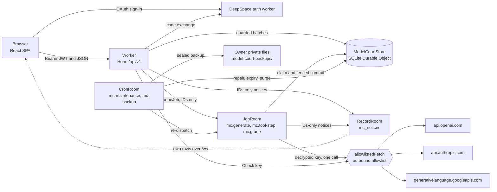
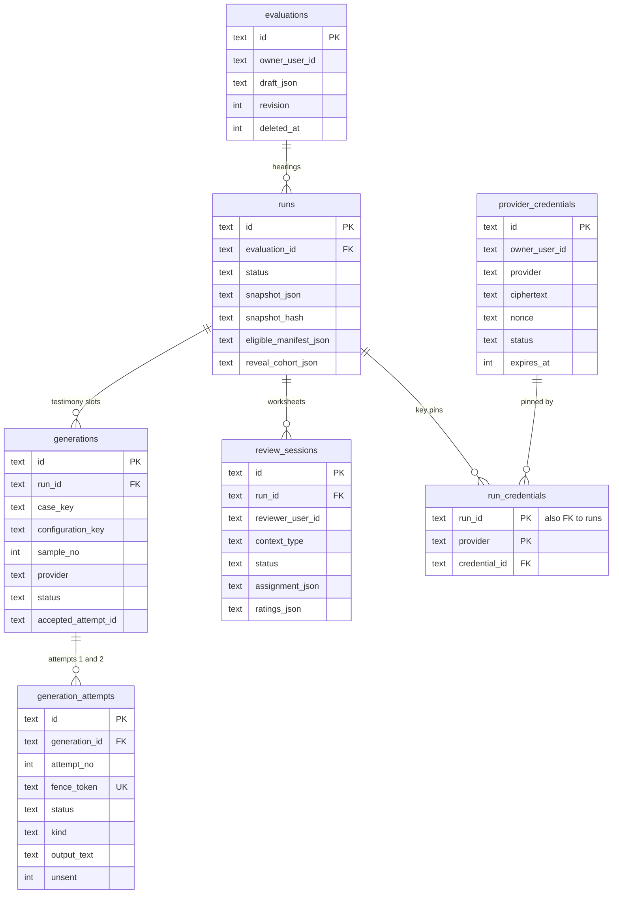
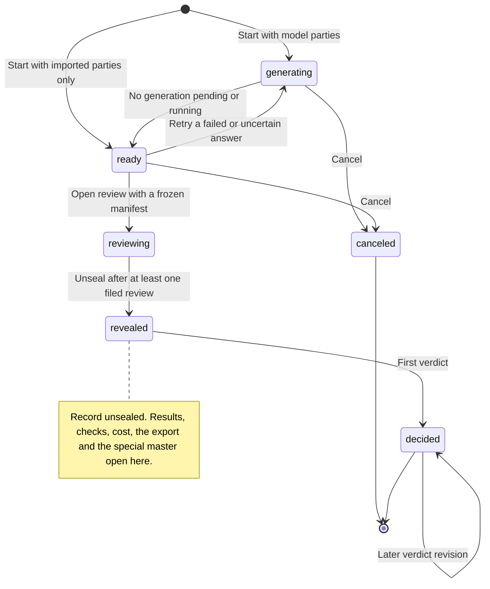
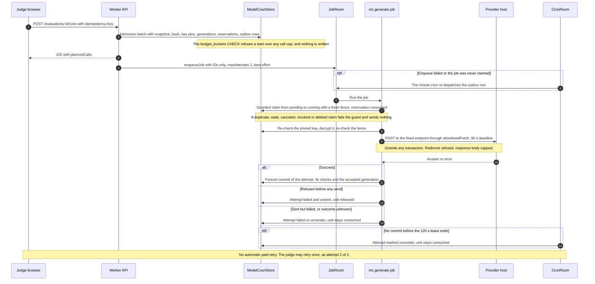
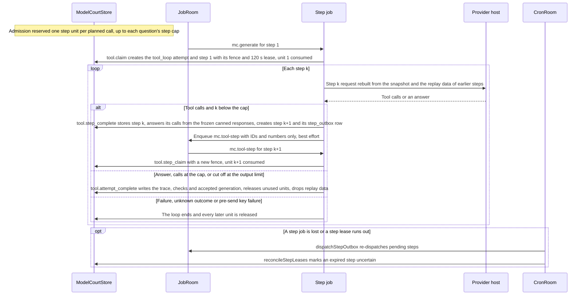
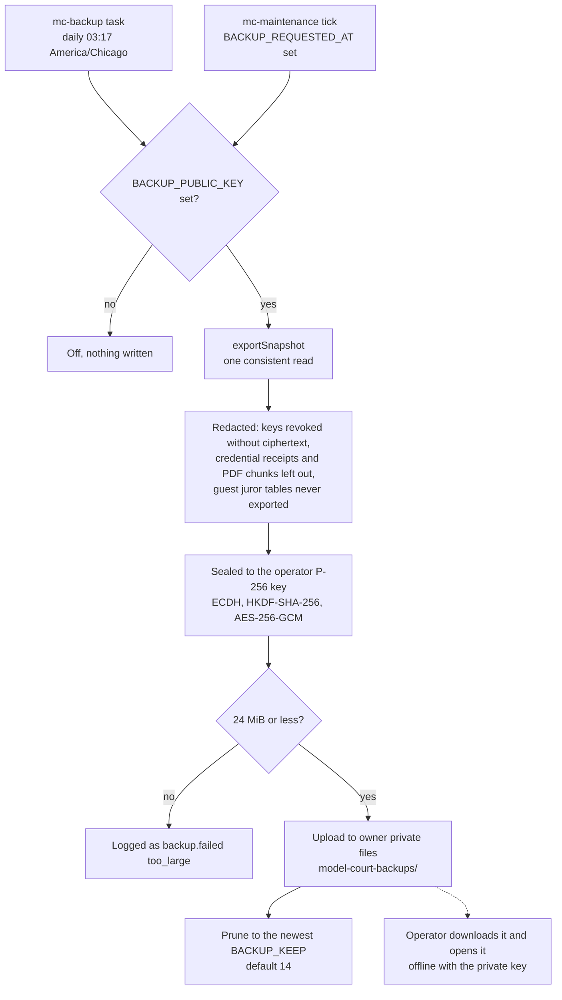

# Architecture

Model Court is a blind human-review app for AI responses, built on DeepSpace (SDK `deepspace@0.44.2`)
and deployed as one Cloudflare Worker. A Hono API in [`worker.ts`](../worker.ts) serves a React SPA
and `/api/v1`. All relational data lives in one app-owned SQLite Durable Object, `ModelCourtStore`.
Paid provider calls run as JobRoom jobs that are claimed, sent and committed under fencing tokens and
call-count reservations. A CronRoom repairs anything left half-done, and a RecordRoom carries IDs-only
change notices to signed-in browsers. Generation is strictly BYOK: the judge's own OpenAI, Anthropic or
Google key pays for every call, and only those three fixed hosts can be reached.

> [!NOTE]
> [decisions.md](decisions.md) is the source of truth for what was decided and why; the `D-nn` numbers
> below point into it. The original specs, plans and design notes in [archive/](archive/) are history,
> not the reference: where they differ from this document or the code, the code wins.

## At a glance

| Component | Where it lives | What it owns |
|---|---|---|
| Browser SPA | [`src/pages`](../src/pages), [`src/components`](../src/components), [`src/lib`](../src/lib) | Screens and local drafts only. React 19, Vite 8, Tailwind v4, shadcn/ui (`base-nova` on Base UI), file routes by generouted. |
| Worker and API | [`worker.ts`](../worker.ts), [`src/server/api.ts`](../src/server/api.ts) | The HTTP boundary: identity, origin checks, rate limits, body caps, security headers, error mapping. |
| Services | [`src/server/services`](../src/server/services) | Use cases and their SQL: admission, generation, reviews, results, keys, backups. |
| Domain rules | [`src/domain`](../src/domain) | Pure, browser-safe rules: contracts, limits, kits, checks, scoring, registry. No React, SDK or I/O (lint-enforced). |
| `ModelCourtStore` | [`src/server/db/store-object.ts`](../src/server/db/store-object.ts) | Every relational row: cases, hearings, testimony, reviews, keys, quotas, receipts, audit. |
| `AppJobRoom` | [`worker.ts`](../worker.ts), [`src/jobs.ts`](../src/jobs.ts) | The durable queue for `mc.generate`, `mc.tool-step` and `mc.grade` jobs. IDs-only payloads. |
| `AppCronRoom` | [`worker.ts`](../worker.ts), [`src/cron.ts`](../src/cron.ts) | `mc-maintenance` every minute and `mc-backup` daily. |
| `AppRecordRoom` | [`worker.ts`](../worker.ts), [`src/schemas/notices-schema.ts`](../src/schemas/notices-schema.ts) | `mc_notices` invalidation notices (and the `users` profile collection). |
| Provider adapters | [`src/server/providers`](../src/server/providers) | Fixed-endpoint transports per adapter version, the outbound allowlist, the key check. |
| Platform auth worker | DeepSpace | Sign-in and JWT issuance. Model Court has no auth of its own. |
| Owner's private files | DeepSpace `appFiles`, `scope: 'self'` | Sealed store backups under `model-court-backups/` (D-117). |

The scaffold's `YjsRoom`, `CanvasRoom` and `PresenceRoom` classes stay in the Durable Object manifest,
because removing a class needs a data-deleting migration, but no route reaches them (D-04).

## Terms

The court words are display strings only. Code, the API, the database and the specs keep the original
names, and this document uses the code names from here on.

| Shown in the app | In code and the API |
|---|---|
| Judge | Owner of an evaluation (`owner_user_id`, `context_type = 'owner'`) |
| Juror | Invited reviewer (`context_type = 'invited'`), or a guest juror principal (`mcj_<id>`) |
| Case | Evaluation (`evaluations`) |
| Question | A case inside the draft or snapshot (`cases[]`, `case_key`) |
| Party | Configuration (`configuration_key`) |
| Hearing | Run (`runs`) |
| Testimony | Generation (`generations`) and its accepted attempt |
| Record unsealed | Reveal (`status = 'revealed'`) |
| Judgment | Verdict (`verdict_revisions`) |
| Special master | Advisory AI grader (`grader_*` tables) |

## System context

Every browser request goes to the Worker; only the Worker and its jobs touch the store, and only the
outbound allowlist lets a judge's key leave the Worker.

What the Worker does, in registration order ([`worker.ts`](../worker.ts)):

- **Security headers** on every response: `nosniff`, `X-Frame-Options: DENY`, a strict referrer policy,
  and on HTML outside Vite dev a CSP with `script-src 'self'`, `frame-ancestors 'none'` and `connect-src`
  limited to `'self'`, `wss:` and the auth worker's origin (D-18).
- **Arms the CronRoom** from the request path (`armCronRoom`), because a Durable Object exists only
  once something fetches it.
- **`/healthz`**: build id, `ready`, `storeOk` (a `SELECT 1` through the store) and `generationEnabled`.
  No secrets or provider configuration.
- **`/api/v1`** ([`api.ts`](../src/server/api.ts)), then the platform auth routes, then `/ws/:roomId`
  ([`realtime-routes.ts`](../src/server/realtime-routes.ts)), then the static and SPA fallback
  ([`http-routes.ts`](../src/server/http-routes.ts)). Public pages are prerendered at build time
  ([`prerender.ts`](../prerender.ts)); other client routes get the empty SPA shell.

Removed scaffold surfaces (D-04): AI chat and agent tool routes, server actions, the integration proxy
(owner-billed by default), the files proxy, the payments proxy, the debug proxy, and the Yjs, canvas,
presence, cron and job sockets. The only socket is the app RecordRoom's, for one room id
(`app:<DEEPSPACE_APP_ID>`); identity on it comes only from a verified JWT, never from query parameters
or headers, and an anonymous socket can read neither notices nor users (neither schema grants the anonymous role anything, and the SDK denies a role a schema doesn't list).

## Code layout

Layering is `src/domain` (pure rules) ← `src/server/services` (use cases and SQL) ← `src/server/api.ts`
(HTTP). Browser code may import server modules as types only, and UI primitives may not import
business modules ([`eslint.config.js`](../eslint.config.js)).

| Path | Responsibility |
|---|---|
| [`src/domain/*`](../src/domain) | Zod contracts, limits, rubrics and scoring, run and generation transitions, message templates (`qa-v1`, `chat-v1` and the kit templates), canonical hashing, snapshot and readiness, the model registry and price tables, setup metrics, consistency, the blinding lint for imported answers. |
| [`src/domain/scenario*.ts`](../src/domain/scenario.ts) | Scenario and party fingerprints and diffs (`scenario.ts`), the hearing comparison (`scenario-compare.ts`) and the scenario file parser (`scenario-file.ts`) (D-67–D-71). Nothing is stored: versions are recomputed from immutable snapshots. |
| [`src/domain/kits/*`](../src/domain/kits) | Task kits (D-75–D-79): the kit contract (`types.ts`), the registry (`KITS`, `kitFor`, kit and field schemas), versioned text helpers, the pure check runner, per-party check counts (`summary.ts`), and one file per kit. Templates live in [`messages.ts`](../src/domain/messages.ts) (`MESSAGE_TEMPLATES`, `buildKitRequest`). |
| [`src/domain/extraction/*`](../src/domain/extraction) | Structured extraction (D-85–D-90): the portable JSON Schema subset and wire compiler (`schema.ts`), an interpreting validator (`validate.ts`, no Ajv because Ajv needs `new Function`), comparison rules (`compare.ts`), the canonical rendering jurors see (`render.ts`), starters, base64 chunking and PDF byte checks (`bytes.ts`), the start-dialog estimate. |
| [`src/domain/grounded/*`](../src/domain/grounded) | Answers from supplied sources (D-92): the citation parser (`citations.ts`, one hand-written pass), quote and refusal matching with an offset map back to the original (`match.ts`), source fingerprints, the grounding key in words and the reading-time hint (`sources.ts`). The same parser drives the checks and the citation chips. The sources CSV is [`source-import.ts`](../src/domain/source-import.ts). |
| [`src/domain/tools/*`](../src/domain/tools) | Tool calling with mock tools (D-99): the question's tool task (`task.ts`), an interpreter for the arguments' JSON Schema subset (`json-schema.ts`, no Ajv), the pure, stateless mock answerer shared with the editor's "Try a call" (`mock.ts`), and the normalized trace with its juror allowlist (`trace.ts`). |
| [`src/server/api.ts`](../src/server/api.ts) | The `/api/v1` boundary: identity, origin checks, rate limits, body caps, guest-cookie routing, HTTP mapping. |
| [`src/server/access.ts`](../src/server/access.ts) | The caller's role per evaluation and run. Invisible, deleted and missing resources all return the same 404. |
| [`src/server/services/*`](../src/server/services) | Use cases: `evaluations`, `credentials`, `runs` (admission, retry, cancel, open review), `generation` (outbox, claim, commit, lease), `reviews` (invites, sessions, reveal), `results` (scoring, verdict), `checks`, `scenarios` and `comparison`, `export`, `special-master`, `guest-jurors`, `maintenance` (cron), `credential-ops`, `backup` and `store-backup`. |
| [`documents.ts`](../src/server/services/documents.ts), [`extraction.ts`](../src/server/services/extraction.ts) | Document blobs (content-addressed per owner, base64 chunks, byte quotas in the same guarded batch, swept by the cron when unreferenced), draft and hearing references, the job's read of the hearing's copy after the claim; juror projections of extraction answers, field flags and the record's Extraction section (D-87, D-89). |
| [`sources.ts`](../src/server/services/sources.ts) | `evaluation_sources` (draft) and `run_sources` (immutable hearing copy), the server-written `kitFields.sources` references, admission guarded on every source hash, and `verifiedPromptSources`, which recomputes each hash before a send or a check reads a source (D-93, D-94). |
| [`tool-loop.ts`](../src/server/services/tool-loop.ts), [`providers/tools.ts`](../src/server/providers/tools.ts) | The tool loop (one guarded claim, fence, lease and commit per step, the step outbox and its cron, the statements that cancel, delete and revoke add) and the tool-loop request bodies and parsers for OpenAI and Anthropic, reached only through `toolAdapterFor` (D-100, D-101). |
| [`src/server/db/*`](../src/server/db) | `ModelCourtStore`, the D1-compatible adapter ([`sql-batch-database.ts`](../src/server/db/sql-batch-database.ts)), migrations, the guarded-batch helper, budget and reservation statements, audit and rate buckets ([`sql.ts`](../src/server/db/sql.ts)). |
| [`src/server/providers/*`](../src/server/providers) | Three fixed-endpoint BYOK transports (OpenAI Responses, Anthropic Messages, Gemini `generateContent`), dispatched by the adapter version a snapshot records (D-48), the outbound allowlist ([`endpoints.ts`](../src/server/providers/endpoints.ts)), the key check, and shared transport rules: no redirects, a response byte ceiling, normalized outcomes, no retries. |
| [`credential-crypto.ts`](../src/server/credential-crypto.ts) | AES-256-GCM seal and open with canonical associated data, plus HMAC. Web Crypto only. |
| [`platform.ts`](../src/server/platform.ts) | Production wiring of [`Deps`](../src/server/deps.ts): `verifyJwt`, `enqueueJob`, RecordRoom notice writes, the allowlisted provider `fetch`, the owner's private files. Tests replace only these boundaries. |
| [`src/pages`](../src/pages), [`src/components`](../src/components) | UI on shadcn/ui. Route groups: `(site)` public pages, `(app)` signed-in shell, `(app)/(protected)` judge pages. PDFs are drawn by pdf.js ([`src/lib/pdf.ts`](../src/lib/pdf.ts), loaded lazily on PDF screens, eval, XFA and annotations off) on a canvas, never in an iframe or the browser's viewer. |

## The store

### Why a relational store (ADR-01, revised by D-20)

Unique submissions, atomic reveal-versus-submit ordering, frozen snapshots and quota reservations need
relational constraints and guarded multi-statement transactions. The spec chose managed D1; the free
DeepSpace tier refuses D1 bindings, so the same schema runs in an app-owned SQLite Durable Object,
`ModelCourtStore` (binding `MODEL_COURT_STORE`).

- One app-wide instance (`idFromName('model-court-store')`). Each adapter call runs inside
  `transactionSync`, so a batch commits or rolls back as a whole, and the object processes calls one at a
  time (a single writer, like D1).
- Only the Worker holds the binding. There is no client route to the object.
- A fresh stub is created per request, job or cron run, never cached per isolate; stubs are I/O objects
  bound to the context that made them (production incident, D-22).
- The object applies its own migrations in its constructor (`blockConcurrencyWhile`), so callers never
  need a shared handle (D-22).
- The integration suite runs against both local D1 and the real Durable Object.

### Guarded batches

Every state change is one guarded batch ([`runGuarded`](../src/server/db/sql.ts)). The first statement
inserts a `command_guards` row with `ok = CASE WHEN <preconditions> THEN 1 ELSE 0 END`, and its
`CHECK (ok = 1)` aborts the whole batch if any mutable precondition is false at commit time; the last
statement deletes the row (D-03). Condition SQL comes only from code; values are bound. No provider
call ever happens inside a batch.

Commands with an `Idempotency-Key` store a receipt in `command_receipts` in the same batch; a duplicate
replays the original response (D-14). Mutations that edit a row carry `If-Match` with its revision.

## Data model

The main tables and how they hang together; ratings are not a table of their own but the
`ratings_json` column of each review session.

Rules the schema enforces ([`migrations.ts`](../src/server/db/migrations.ts)):

- `one_active_run_per_evaluation`: at most one run per evaluation in `generating`, `ready` or `reviewing`.
- `generations` is unique on `(run_id, case_key, configuration_key, sample_no)`, and that slot is
  immutable. `accepted_attempt_id` is set once.
- An attempt's `output_text`, `status`, `finish_reason`, `trace_json`, `steps_used` and `unsent` are
  immutable once it is no longer `running`; `kind` is always immutable.
- A run's snapshot, hash, owner and evaluation never change; its manifest and reveal cohort are set once.
- A review session's `assignment_json` never changes, and its ratings freeze once it leaves `draft`.
- `provider_credentials`: one active key per owner and provider; an active row has ciphertext, nonce and
  root version, a revoked row has none of them, and revocation is one-way.
- `run_credentials` references keys with `ON DELETE RESTRICT`, and its trigger allows one move only (D-59).
- `budget_buckets.allocated_units <= limit_units`, so an over-cap reservation fails the batch.
- `verdict_revisions` and `testimony_checks` are append-only.

Other tables: `invites`, `verdict_revisions`, `outbox`, `attempt_reservations`, `budget_buckets`,
`rate_buckets`, `command_receipts`, `command_guards`, `audit_events`; imported evidence
(`evaluation_imports`, `run_imported_outputs`); the special master (`grader_*`); guest jurors
(`juror_principals`, `juror_devices`); checks (`testimony_checks`); documents (`document_*`,
`evaluation_documents`, `run_documents`); sources (`evaluation_sources`, `run_sources`); tool steps
(`generation_steps`, `step_reservations`, `step_outbox`).

## Hearing lifecycle

A run moves through six states ([`transitions.ts`](../src/domain/transitions.ts)); each arrow is one
guarded batch that re-checks the state it starts from, and the record is unsealed on entering `revealed`.

| Command | Allowed from | Notes |
|---|---|---|
| Start | (draft) | One guarded batch (see below). With only imported parties the run starts in `ready` and touches no budget. |
| Retry | `generating`, `ready` | Attempt 2 of 2 for failed or uncertain generations; may re-pin a removed or expired key to the judge's current one (D-59). |
| Cancel | `generating`, `ready` | Cancels queued and running work, so a late answer is refused at commit; releases unclaimed reservations. |
| Open review | `ready` | Freezes the eligible manifest and the position rotation (`positionBase`, D-110) and creates the judge's own session. Opens by itself once every planned answer has succeeded and nothing needs excluding (D-58). |
| Invite, redeem | `ready`/`reviewing`, `reviewing` | Up to three invited jurors, signed-in or guest (D-41). |
| Save, submit review | `reviewing` | A submit that loses the race with unsealing is refused, and the draft is not counted. |
| Reveal | `reviewing` | Needs one submitted session; closes open drafts and freezes `reveal_cohort_json`. A judge with no jury can file and unseal in one commit (`file-and-unseal`). |
| Verdict | `revealed`, `decided` | Each verdict is a new `verdict_revisions` row. |

Deleting a case sets `evaluations.deleted_at`. Every claim and commit checks it, so queued work is
fenced at once; the minute cron purges the tree once no attempt or step can still commit. Budget
counters keep counting what was consumed.

## Paid generation

One generation, from Start to a committed testimony. The provider call is the only step outside a
transaction, and it happens only after a guarded claim.

The steps in code ([`runs.ts`](../src/server/services/runs.ts) `startRun`,
[`generation.ts`](../src/server/services/generation.ts)):

1. **Admission.** One guarded batch writes the run, its snapshot and hash, the pinned `run_credentials`,
   every generation (questions × model parties × samples), one reservation per planned call, the outbox
   rows, the hearing's copies of documents, sources and imported answers, the imported answers' checks,
   and the audit row. The guard re-checks the draft revision, the 20-hearing cap, each key (active,
   unexpired, owned), each document and source hash, each imported answer's hash, and capacity: one
   generating run per judge and two per deployment. Sample *k* is first dispatched (*k* − 1) × 60 s later.
2. **Dispatch.** A best-effort `enqueueJob` right after the commit; the minute cron re-dispatches any
   outbox row still pending (with backoff) or dispatched but unclaimed after 5 minutes.
3. **Claim.** A conditional `pending → running` that needs the generation pending at this attempt
   number, the run `generating`, the case not deleted, the reservation `reserved` and the pinned key
   active. It creates the attempt with a fresh fencing token and a 120-second deadline and consumes the
   reservation.
4. **Send.** `withRunCredential` re-reads the pinned key, refuses it if revoked or expired, decrypts it
   and records `last_used_at`. The fence is re-checked immediately before the send (D-19). Document
   bytes and sources are read from the hearing's own copy only now, sources verified against the
   snapshot's hashes. The adapter for the recorded version sends one request under a 90-second deadline.
5. **Commit.** A success commits only if the fence, the run state, the case's deletion state and the key
   are all still current, and writes the automatic checks in the same batch. A failure commits only if
   the fence, run and case are current.
6. **Lease.** After 120 seconds without a commit, an attempt becomes `uncertain`. The cron applies this,
   and so does the judge's read of the run.

A stale commit changes nothing. A refusal before any send (outbound allowlist, missing document or
source, unusable key, an adapter that cannot carry the request, a fence before the send) marks the
attempt `unsent` and releases its unit, and setup metrics count it as zero provider calls (D-113).

> [!IMPORTANT]
> No automatic paid retry exists anywhere. Jobs use `maxAttempts: 1`, a provider failure is recorded
> and the job still returns successfully, and transports never retry. A manual retry is attempt 2 of 2.

### Budget

Call-count ceilings, not currency ([`sql.ts`](../src/server/db/sql.ts)). `budget_buckets` hold a
per-user daily counter, a global daily counter (both on UTC days) and a global lifetime counter, each
with `CHECK (allocated_units <= limit_units)`. Reservations (`attempt_reservations`,
`step_reservations`) are released exactly once and only when the call was provably never sent: cancel
or revoke before the claim, deletion, or a pre-send failure. Uncertain and consumed calls are never
refunded.

### Outbound allowlist

Every request made with a judge's key (generation, tool steps, the special master, Check key) goes
through `allowlistedFetch` ([`endpoints.ts`](../src/server/providers/endpoints.ts), D-107): https only,
an exact `URL.origin` match on `PROVIDER_ORIGINS`, no userinfo, no explicit port (`:443` included),
`redirect: 'manual'`, and, when a provider is named, only that provider's origin. Anything else is
refused before any network I/O as a definite, unsent `PROVIDER_REJECTED_REQUEST`, logged with fixed
tokens and never the URL. `platform.ts` wraps the Worker's fetch with it, and `adapterFor`,
`toolAdapterFor` and the key check wrap it again for the key's own provider.

## Tool loop

A tool-use answer is a loop of steps, and each step is a paid call with its own claim, fence, lease and
commit ([`tool-loop.ts`](../src/server/services/tool-loop.ts), D-101).

- Admission reserves the worst case, Σ step caps × parties × samples, through the same bucket CHECK, so
  a worst case that does not fit is `QUOTA_EXHAUSTED` with nothing reserved. `plannedCalls` is that sum,
  flagged `plannedCallsAreUpperBound`.
- Step 1 is the attempt's own `mc.generate` job; its claim creates the attempt (`kind = 'tool_loop'`)
  and step 1. Steps 2 to N are `mc.tool-step` jobs claimed from `step_outbox`.
- A step claim needs the step pending with no fence, the attempt a running tool loop, the generation
  running on that attempt, the run open, step *k*'s unit reserved and the key active.
- Each step is sent outside any batch, with the fence re-checked right before the POST. A commit needs
  the step's fence, the run, the case and the key to be current.
- Mock results are a pure function of the frozen task and the call. On a failure, only step *k*'s own
  unit is released, and only when it was provably unsent. No step is ever sent twice.
- `reconcileLeases` handles only `kind = 'single'` attempts, so a loop waiting between steps is never
  mistaken for an expired call.
- Cancel, delete and revoke release unclaimed steps' units, close queued steps and drop replay data. A
  step in flight becomes canceled (cancel, delete) or uncertain (revoke).
- A retry restarts at step 1 and reserves the step cap again for attempt 2.

## Blinding

Jurors never learn which party wrote which answer before the record is unsealed. The judge's own review
is context-aware (they chose the parties), so it is always scored separately and never mixed into the
jury's findings.

| Never shown to a juror before unsealing | Where it is kept |
|---|---|
| Provider, model, party label, configuration key, generation and attempt IDs | Server-only `review_sessions.assignment_json`; juror payloads are built by explicit allowlists (`getReview`, `reviewerRunView`, the reviewer view of `getEvaluation`) |
| Cost, tokens, latency, failures and other setup metrics | Results only |
| Automatic check results | `testimony_checks`, read only through results and the export after unsealing, for every role including the judge |
| Extraction answer keys, comparison rules, schema hash | Snapshot and kit fields, judge and results only |
| Tool-trace internals: provider call ids, finish reasons, reasoning, tokens, timing, which canned row answered | Stored trace; jurors get `jurorTrace` only |
| Source origin notes, hashes and quote highlights | Results and export after unsealing |
| Other raters' scores and the jury's findings | Results, after unsealing |

How the rules are kept:

- **Identity** comes only from a verified platform JWT (or a guest juror's device cookie on a fixed set
  of routes). Every route resolves the caller's role per evaluation in
  [`access.ts`](../src/server/access.ts).
- **Jobs and notices carry opaque IDs only.** Client sockets cannot touch the JobRoom. Notices are one
  coalesced `mc_notices` row per recipient and run, readable only by that recipient (`read: 'own'`).
  Guest jurors get no notices and poll every 20 seconds.
- **Order.** Testimony positions follow a balanced rotation frozen with the manifest (D-110), not each
  juror's random order.
- **Results** exist only after unsealing and use the cohort frozen in that transaction
  (`reveal_cohort_json`). Jurors, guests included, see the record then.
- **Re-hearing, comparing, copying and scenario files** are judge-only routes and fields; a hearing's
  parties appear in the case's hearing list only once it is unsealed, and jurors' projections are
  unchanged. Hearings of a case are compared side by side, never pooled; an anchor party (the same
  fingerprint in every hearing) is the only bridge ([`scenarios.ts`](../src/server/services/scenarios.ts),
  [`comparison.ts`](../src/server/services/comparison.ts)).
- **Checks** see testimony content, the question and the kit settings only, and never feed scores, the
  headline or the verdict. A source scan
  ([`checks-isolation.test.ts`](../src/server/services/checks-isolation.test.ts)) keeps every module
  but the checks service, the backup and the migrations from naming the table.
- **Extraction.** A juror sees an answer only as the server's canonical rendering in the field list's
  order (never the provider's bytes), or the same neutral line when it is not JSON, and the question's
  document, identical for every party. Document bytes never enter a job payload, log, audit row or
  notice. A document response always downloads (`Content-Disposition: attachment`, a `sandbox` CSP), and
  a guest cookie reaches exactly one more route: the GET of its own hearing's document.
- **Tool use.** Every party gets the same tools and, for each call, the canned response chosen by a pure
  function of the frozen task and that call, so parties cannot affect each other. Jurors see the tools
  and each trace through `jurorTrace`: Model Court's step and call numbers, canonical JSON arguments, the
  results, the final answer and how the loop ended. Provider-native replay data stays in
  `generation_steps.replay_json` until the attempt finishes, is never returned, exported or logged, and
  is dropped at the end.
- **Answers from sources.** Every party gets the same numbered sources in the judge's order under
  template `grounded-v1`. The job reads them after the claim from the hearing's own copy, verified
  against the snapshot's hashes; they never travel in a job payload. Jurors see the sources (without the
  judge's origin notes) and the grounding key.
- **Imported answers.** The judge sees blinding warnings (emails, links, greetings, sign-offs, unusual
  length) before sharing them ([`blinding-lint.ts`](../src/domain/blinding-lint.ts)); the text is never
  edited.
- **After unsealing**, a Gemini testimony notes when Google reports a different `modelVersion` than the
  model the hearing asked for (D-115), and the special master (an advisory AI grader on the judge's own
  key, judge only) becomes available (D-40).

## BYOK and key handling

Live generation is paid only by the judge's own key. There is no platform credit, sponsored call,
billing selector or fallback key, and keys never appear in logs, jobs, receipts, notices, URLs or
responses.

| Concern | How it works |
|---|---|
| Sealing | AES-256-GCM per key with a random 96-bit nonce ([`credential-crypto.ts`](../src/server/credential-crypto.ts)). The associated data is canonical JSON of app id, credential id, root version, owner, provider and schema version, so a ciphertext cannot be moved to another row. |
| Roots | `CREDENTIAL_ENCRYPTION_KEY_V1`/`_V2` and `CREDENTIAL_REQUEST_HMAC_KEY` live in the DeepSpace secrets store. A missing or malformed root turns generation and key saves off (fail closed). |
| Idempotent saves | The receipt holds an HMAC digest of the request, never the key. |
| Save rules | One active key per provider per user. Admin-prefix keys (`sk-admin-`, `sk-ant-admin`) are refused, and so is a key pasted on another provider's card (`KEY_PROVIDER_MISMATCH`, best effort, D-107). |
| Expiry and use | Keys expire `CREDENTIAL_TTL_DAYS` (default 7, 1–90) after saving or renewal, enforced at admission, retry and right before decryption; the cron revokes expired keys. Each decrypt records `last_used_at` and `last_used_run_id`, shown in Settings (D-23). |
| Pinning | A run pins one key per provider (`run_credentials`). The only allowed move is to another active key of the same owner and provider while the run is `generating` or `ready` (D-59). |
| Revocation | One-way, in one batch: deletes the ciphertext, nonce and root version, fails queued work pinned to the key (its units released), and marks work in flight `uncertain` so a late answer is refused at commit. |
| Check key | One GET to the provider's free list-models endpoint with the stored key: redirects refused, body never read, 10-second timeout, 6 a minute per user, not counted against the caps. Only the result (valid, invalid, restricted, unreachable) and a reason code are stored (D-59). |
| Operator operations | `CREDENTIAL_REKEY_TARGET_VERSION` re-encrypts up to 250 active keys per cron tick, guarded per row (D-31). `CREDENTIAL_REVOKE_CREATED_BEFORE` revokes every key created before a cutoff, for use after a restore (D-33). |
| Backups | Never contain key material: every credential row is exported revoked without ciphertext, and `credential.*` receipts are dropped (D-32). |

Encryption at rest does not hide keys from a trusted operator who holds both the store and the root
secret. See the key-hygiene guidance in the [README](../README.md).

## Task kits and checks

A kit decides a question's extra fields, its message template, its default rubric and its automatic
checks ([`src/domain/kits`](../src/domain/kits)). The draft records an optional kit; the snapshot
freezes the kit version, its settings and the template, so an old hearing always reads the same way.

| Kit | Shown as | Input | Template | Default rubric |
|---|---|---|---|---|
| `general-v1` | General answers | text, conversation | `qa-v1`, or `chat-v1` with an earlier conversation | `reference-qa-v1` |
| `summarization-v1` | Summaries | text | `summarize-v1` | `summary-v1` |
| `classification-v1` | Classification | text | `classify-v1` | `classification-v1` |
| `extraction-v1` | Pull fields from documents | document (text or PDF) | `extract-v1` | `extraction-v1` |
| `grounded-v1` | Answers from sources | numbered sources | `grounded-v1` | `grounded-v1` |
| `tools-v1` | Tool use (mock tools) | tools with canned responses | `tools-v1` | `tools-trajectory-v1` |

The other rubrics are `safety-v1` and `writing-v1` (D-35). Every rubric scores three lines on 0 to 2.

Checks are pure functions of the testimony text (or the juror projection of a tool trace), the question
and the kit settings. They cost nothing and call no provider. A generated testimony's checks are written
in the same batch that accepts it, so a fenced or revoked completion writes neither; an imported
answer's checks are written at admission. One `testimony_checks` row holds at most 20 results in 16 KiB.
Per-party check counts appear on the record after unsealing.

## Providers and adapter versions

Each route in the registry ([`registry.ts`](../src/domain/registry.ts), version `2026-11-17.3`)
names a provider, a model id and an adapter version. A snapshot records the adapter version, and the
server maps every version to a transport ([`providers/index.ts`](../src/server/providers/index.ts)), so a
retry of an old hearing sends exactly the body it recorded.

| Provider | Endpoint | Adapter versions |
|---|---|---|
| OpenAI | `POST https://api.openai.com/v1/responses` | `openai-responses-v1`, `-v2`, `-reasoning-low-v1`; with structured output and PDF `-v3`, `-reasoning-low-v2`; tool loop `-tool-loop-v1`, `-reasoning-low-tool-loop-v1` |
| Anthropic | `POST https://api.anthropic.com/v1/messages` | `anthropic-messages-v1`, `-v2`, `-between-tools-v1`, `-adaptive-low-v1`; with structured output and PDF `-v3`, `-between-tools-v2`, `-adaptive-low-v2`; tool loop `-tool-loop-v1`, `-between-tools-tool-loop-v1`, `-adaptive-low-tool-loop-v1` |
| Google | `POST https://generativelanguage.googleapis.com/v1beta/models/{model}:generateContent` | `google-generate-low-v1`, `-minimal-v1`, `-budget-off-v1`; no structured output, PDF or tools |

- A plain hearing records the route's plain version; an extraction hearing records its
  `FEATURE_SUCCESSOR` and a tool hearing its `TOOL_SUCCESSOR` (`adapterVersionFor`).
- `adapterFor` returns no transport, and so nothing is sent or charged, when the version is unknown,
  belongs to another provider than the key, is a tool-loop version (those go only through
  `toolAdapterFor`), cannot carry a multi-message request, or lacks a feature the request needs.
- Reasoning versions ask for low effort and add `LIMITS.reasoningHeadroomTokens` (8,192) to the 512
  output tokens (D-48).
- The registry has 37 routes: 14 OpenAI, 14 Anthropic and 9 Gemini. A hearing refuses a route until a
  real call is recorded (`verifiedAt`), and each capability has its own date (`multiTurnVerifiedAt`,
  `structuredVerifiedAt`, `pdfVerifiedAt`, `toolsVerifiedAt`). Documentation never sets them; only
  `npm run smoke:providers` does. Today only `gpt-6-luna` and `claude-haiku-5-5` have a `verifiedAt`,
  and no capability date is set.
- Dated list prices ([`prices.ts`](../src/domain/prices.ts), tables `2026-11-18.1` and `2026-11-19.1`)
  price setup metrics by the hearing's creation date; prices are never fetched at runtime (D-62, D-63).

Request bodies, normalization and the live smoke record are in
[provider-contracts.md](provider-contracts.md).

## Limits

Fixed limits are in [`limits.ts`](../src/domain/limits.ts); operators can lower some through `[vars]`
([`config.ts`](../src/server/config.ts)), never raise them past the fixed ones.

| Limit | Value |
|---|---|
| Questions per case | 1–5 |
| Parties per hearing | 2–5 in code; deployment cap `MAX_CONFIGURATIONS_PER_RUN`, default 3 (the live app runs 3) |
| Testimonies per hearing (parties × questions, imported included) | 15 |
| Samples per answer | 1–3 (`MAX_SAMPLES_PER_ANSWER`), sample *k* dispatched (*k* − 1) × 60 s after Start |
| Hearings per case, hearings per comparison | 20, 5 |
| Own cases per user | 10 |
| Output tokens | 512, plus 8,192 headroom where reasoning cannot be turned off; 2,048 for extraction |
| Attempts per generation | 2 |
| Provider deadline, attempt and step lease | 90 s (`PROVIDER_TIMEOUT_MS` may shorten it), 120 s |
| Invited jurors per hearing, invite lifetime | 3, 24 hours |
| Provider calls | 20 per user per day, 100 per day and 500 in total per deployment (`MAX_DAILY_CALLS_PER_USER`, `MAX_DAILY_CALLS_GLOBAL`, `MAX_LIFETIME_CALLS_GLOBAL`) |
| Generating hearings at once | 1 per judge, 2 per deployment |
| Rate limits | 120 reads, 30 mutations, 5 generation requests, 5 key saves and 6 key checks per user per minute; guest join 10 and resume 5 per hour |
| Request bodies | 128 KiB; draft and snapshot 96 KiB each; stored provider output 16 KiB; provider response body 256 KiB |
| Documents | Text 64 KiB; PDF 4 MiB and 20 pages; storage 32 MiB per user and 256 MiB per deployment |
| Sources | 1–10 per question, 6,000 characters each, 24,000 per question, 60,000 per case |
| Tools | 8 per question; step cap 4 by default, at most 6; 8 calls per step, 24 per trace |
| Saved keys | Expire after 7 days by default (`CREDENTIAL_TTL_DAYS`, 1–90) |

## Background work

`mc-maintenance` runs every minute ([`maintenance.ts`](../src/server/services/maintenance.ts)) in
bounded batches, using the same conditional SQL as the request paths so overlapping runs are harmless:

- re-dispatches pending outbox rows for generations, tool steps and the special master;
- expires leases (single attempts, tool steps, grader attempts) to `uncertain`;
- revokes expired keys;
- purges up to 10 deleted cases whose work can no longer commit, and their notices;
- sweeps unreferenced document blobs;
- deletes expired receipts, stale invites, old rate and budget rows, revoked keys no run references, and
  unscoped audit rows older than 30 days;
- then runs the operator key operations and, if `BACKUP_REQUESTED_AT` is set, a requested backup.

### Backups (D-117)

The Worker can write sealed backups but never read them: it holds only the operator's public key.

- [`store-backup.ts`](../src/server/services/store-backup.ts) runs it, [`backup.ts`](../src/server/services/backup.ts)
  exports and restores, and [`backup-seal.ts`](../src/server/services/backup-seal.ts) seals with a fresh
  ephemeral key per file and an authenticated header.
- A requested backup is skipped when one at or after the requested time already exists, so setting the
  variable takes one backup, not one a minute.
- There is no HTTP route that exports or restores. `npm run backup -- keygen | open | trial-restore`
  makes the key pair, opens a downloaded file, and restores it into a fresh local store.
- A restore loads into an empty, migrated store, revokes every credential again and fences pinned work,
  so nothing restored can spend money.
- The path is deployed but off until `BACKUP_PUBLIC_KEY` is set (it is not a secret). See
  [runbook.md](runbook.md) for turning it on and for restores.

## Migrations

Model Court runs its own migration runner ([`migrations.ts`](../src/server/db/migrations.ts), D-02),
because the SDK's `runMigrations` splits on `;` and breaks trigger bodies. Each migration is a list of
statements run one at a time, together with its row in the `mc_schema_migrations` ledger, as one batch
on D1 and one `transactionSync` in the Durable Object, so a failed migration leaves nothing applied.

- Migrations are append-only: never edit or reorder an applied one. Ids are names and order is array
  order.
- A migration that adds a table must add it to `BACKUP_TABLES`; the backup tests fail otherwise (D-32).
- Neither store lets a migration turn foreign keys off, and dropping a parent table cascades into its
  children. A rebuild therefore copies the parent and every table that references it into `_next`
  tables, drops the old ones leaves first, renames the copies (which rewrites their references) and
  re-creates indexes and triggers verbatim.

| Id | What it does | Rebuild |
|---|---|---|
| `0001_initial` | The core schema: evaluations, runs, generations and attempts, review sessions, invites, verdicts, receipts, guards, outbox, budget and rate buckets, reservations, keys and pins, audit, with their immutability triggers | No |
| `0002_credential_expiry_and_last_use` | Key expiry and last use; keys saved earlier expire 7 days after creation (D-23) | No |
| `0003_imported_evidence` | `evaluation_imports` and immutable `run_imported_outputs` (D-38) | No |
| `0004_special_master` | The six `grader_*` tables (D-40) | No |
| `0005_accountless_jurors` | `juror_principals`, `juror_devices`; secrets stored only as SHA-256, never backed up (D-41) | No |
| `0006_key_checks_and_repin` | Key-check result columns; the `run_credentials` trigger now allows one re-pin move (D-59) | No |
| `0007` | Not used: the id was held for roadmap item 2, which landed as `0010` | — |
| `0008_attempt_usage_details` | Cached-input and reasoning tokens on attempts (D-64) | No |
| `0009_generation_samples` | `sample_no` and the new unique slot (D-65) | Yes: `generations`, `generation_attempts`, `outbox`, `attempt_reservations` |
| `0010_case_origin` | Where a case came from, set once (D-71) | No |
| `0011_task_kit_checks` | Append-only `testimony_checks` (D-76) | No |
| `0012_extraction_documents` | `document_blobs`, `document_blob_chunks`, `evaluation_documents`, `run_documents`, `document_storage_buckets` (D-87) | No |
| `0013_grounded_sources` | `evaluation_sources` and immutable `run_sources` (D-93) | No |
| `0014_tool_steps` | Attempt `kind`, `trace_json`, `steps_used`; `generation_steps`, `step_reservations`, `step_outbox` (D-101) | No |
| `0015_provider_google` | Provider CHECK `('openai','anthropic','google','openrouter')`; `openrouter` stays unusable because every write validates against `PROVIDERS` (D-106) | Yes: 11 tables, the 8 generation tables (with `testimony_checks` and the 3 step tables), `provider_credentials`, `run_credentials`, `grader_credentials` |
| `0016_attempt_unsent` | `generation_attempts.unsent`, set in the attempt's final commit (D-113) | No |

> [!WARNING]
> A migration that rebuilds live tables (`0009`, `0015`) needs Avery's explicit OK and a sealed backup
> first. Follow [runbook.md](runbook.md) before deploying one. Additive migrations need neither.

## Testing layers

`npm run check` runs typecheck, lint, unit tests, both integration suites and the smoke suite. It needs
no network and no keys, and no paid call is possible from it.

| Layer | Command | What it covers |
|---|---|---|
| Unit | `npm run test:unit` | Pure rules: scoring, validation, prompt construction, adapter bodies and mappings, kits and checks, setup metrics, sealing. Also source scans: check-table isolation, guest routes, no hard-coded provider hosts, every backed-up table has a creating migration. |
| Integration, D1 | `npm run test:integration` | The real Hono API, real local D1 and real JWT verification ([`tests/integration`](../tests/integration)). Stubbed: the auth issuer key, the JobRoom queue, notices and provider HTTP. |
| Integration, store | `npm run test:integration:store` | The same suite against the real `ModelCourtStore` Durable Object, plus stores held before `0009` and `0015` (`PreSamplesStore`, `PreProvidersStore`) for the rebuild migration tests. |
| Smoke | `npm run test:smoke` | Playwright against a local dev server on port 5197 (D-61): public pages, landing links, the sample, axe accessibility checks in light and dark (D-55). |
| Signed-in | `npx deepspace test run all` | Also the signed-in and two-account specs, which need DeepSpace test accounts. |
| Paid provider smoke | `npm run smoke:providers` | Manual and paid: real calls per provider and mode (`single`, `multi`, `json`, `pdf`, `tools`), run by Avery with keys typed into a hidden prompt. Its results set the registry's verified dates. |

Evidence from each run is kept in [verification.md](verification.md).

## Related documents

- [api.md](api.md): routes, payloads and error codes.
- [provider-contracts.md](provider-contracts.md): request bodies, models, prices and live checks.
- [runbook.md](runbook.md): configuration, deploys, rebuild migrations, backups and restores.
- [decisions.md](decisions.md): every decision and deviation.
- [roadmap.md](roadmap.md): what is delivered and what is gated on a live check.
- History: the original specs in [archive/specs/](archive/specs/) and the earlier plans and design notes
  in [archive/](archive/).
