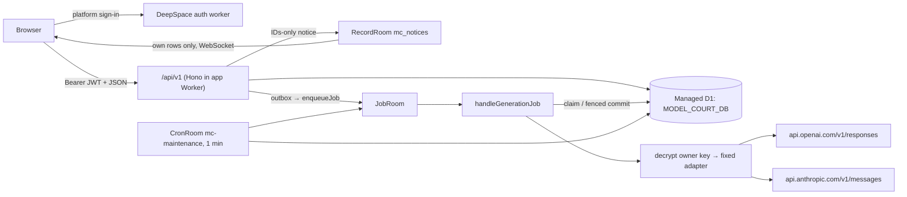

# Architecture

## Modules

| Path | Responsibility |
|---|---|
| `src/domain/*` | Pure, browser-safe rules: Zod contracts, limits, rubric and scoring, transitions, prompt template `qa-v1`, canonical hashing, snapshot/readiness, registry. No React, SDK, or I/O (lint-enforced). |
| `src/server/api.ts` | `/api/v1` boundary: identity, origin check, rate limits, body caps, HTTP mapping. |
| `src/server/services/*` | Use cases: evaluations, credentials, runs (admission/retry/cancel/open review), generation (outbox/claim/commit/lease), reviews (invites/sessions/reveal), results (scoring/verdict), maintenance (cron). |
| `src/server/db/*` | Migrations, guarded-batch helper, budget/reservation statements, audit, rate buckets. |
| `src/server/providers/*` | Two fixed-endpoint BYOK adapters plus shared transport rules (no redirects, byte ceiling, normalized outcomes, no retries). |
| `src/server/credential-crypto.ts` | AES-256-GCM seal/open with canonical AAD, plus HMAC. Web Crypto only. |
| `src/server/platform.ts` | Production wiring: `verifyJwt`, `enqueueJob`, RecordRoom notice writes, `fetch`. |
| `src/pages`, `src/components` | UI on shadcn/ui (`base-nova`, Base UI). Imports server modules for types only. |

## Trust boundaries and blinding

- Identity comes only from a verified platform JWT. Every route resolves the caller's role per evaluation (`src/server/access.ts`). Invisible, deleted, and missing resources all return the same 404.
- Pre-reveal reviewer payloads are built by explicit allowlists (`getReview`, `reviewerRunView`, reviewer `getEvaluation`). Generation and attempt IDs, configuration keys, and provider/model identity stay in the server-only `assignment_json`.
- Jobs and notices carry opaque IDs only. Client sockets cannot touch the JobRoom.
- Results exist only after reveal and use the cohort frozen in the reveal transaction (`reveal_cohort_json`).

## State and durability

Run states: `generating → ready → reviewing → revealed → decided`; `canceled` from generating or ready.
Every transition is one guarded D1 batch that re-checks the mutable preconditions at commit time
(`src/server/db/sql.ts`). No provider call happens inside a batch.

Generation sequence:
1. **Admission:** snapshot, hash, pinned `run_credentials`, generations, reservations, and outbox commit atomically (one guarded batch).
2. **Dispatch:** best-effort `enqueueJob`; cron re-dispatches anything left pending.
3. **Claim:** a conditional `pending → running` with a fresh fencing token consumes the reservation.
4. **Call:** the job re-checks the credential, decrypts it, and calls the fixed endpoint under a 90-second deadline.
5. **Commit:** only if the fence, run state, deletion state, and credential are all still current.
6. **Lease:** after 120 seconds an attempt becomes `uncertain`, applied by cron and on owner reads.

No automatic paid retry exists. A manual retry is attempt 2 of 2.

## Budget

Call-count ceilings, not currency. `budget_buckets` hold per-user daily, global daily, and global
lifetime counters with `CHECK (allocated ≤ limit)`. Reservations are released exactly once and only
when the call was provably never sent (cancel or revoke before claim, deletion, pre-send credential failure).
Uncertain and consumed calls are never refunded.

## Why D1 (ADR-01)

Unique submissions, atomic reveal-versus-submit ordering, frozen snapshots, and quota reservations
need relational constraints and guarded multi-statement transactions. RecordRoom carries only safe
invalidation notices.
