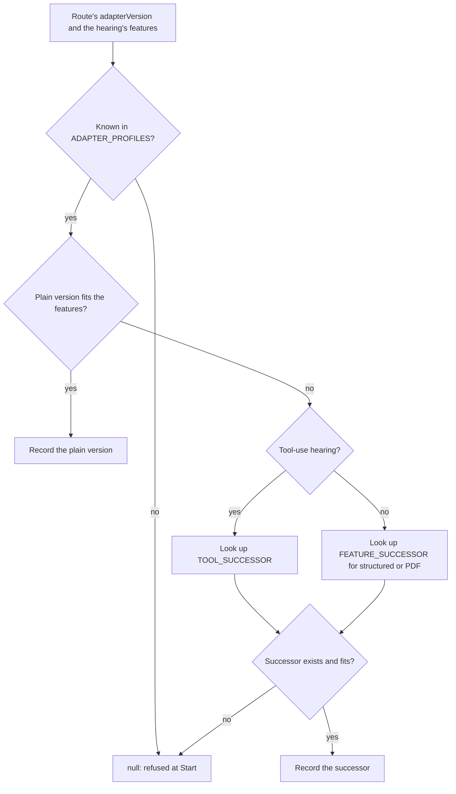

# Provider contracts (BYOK)

What Model Court sends to each provider, how it reads the answer, and which parts have been confirmed by a real,
paid call. Every call uses the judge's own key (BYOK); there is no platform-billed route. The tables here are
evidence: dates, request IDs and results are recorded as they happened and are never rewritten.

Status: **documented from the providers' official docs on 2026-11-16; one real call per original route recorded
on 2026-11-17 ([results](#results-recorded-so-far)). 26 more routes documented 2026-11-17 (D-48), unverified.
Nine Gemini routes documented 2026-11-18 and 2026-11-19 (D-108), unverified.** The original two routes have
`verifiedAt: '2026-11-17'` in the registry (version `2026-11-17.1`). The deployed check (V12) is still pending.

Code: routes and adapter versions in [`src/domain/registry.ts`](../src/domain/registry.ts), transports in
[`src/server/providers/`](../src/server/providers/), prices in [`src/domain/prices.ts`](../src/domain/prices.ts),
the smoke test in [`scripts/provider-smoke.ts`](../scripts/provider-smoke.ts). History:
[spec 04](./archive/specs/04-structured-extraction.md), [spec 06](./archive/specs/06-mock-tools.md),
[spec 07](./archive/specs/07-providers-and-parties.md).

## Contents

- [Summary](#summary)
- [When a route may be used](#when-a-route-may-be-used)
- [Adapter versions](#adapter-versions)
  - [How a hearing's adapter version is chosen](#how-a-hearings-adapter-version-is-chosen)
- [OpenAI and Anthropic](#openai-and-anthropic)
  - [Original routes](#original-routes)
  - [Full lineup (D-48)](#full-lineup-d-48-registry-2026-11-173-documented-live-checks-pending)
  - [Normalization](#normalization-srcserverproviders)
  - [Multi-message requests (D-39)](#multi-message-requests-d-39)
  - [Structured output and PDF input (D-86)](#structured-output-and-pdf-input-d-86)
  - [Tool loop (D-100)](#tool-loop-d-100)
- [Google Gemini (D-108)](#google-gemini-spec-07-d-108-registry-2026-11-173-unchanged-documented-live-checks-pending)
- [Prices (D-62)](#prices-d-62-price-table-2026-11-181)
- [Smoke test](#smoke-test)
  - [Modes](#modes)
  - [Results recorded so far](#results-recorded-so-far)
- [Deployed check (V12): pending](#deployed-check-v12-pending)

## Summary

| | OpenAI | Anthropic | Google Gemini |
|---|---|---|---|
| Host | `https://api.openai.com` | `https://api.anthropic.com` | `https://generativelanguage.googleapis.com` |
| Auth header | `Authorization: Bearer <owner key>` | `x-api-key: <owner key>`, `anthropic-version: 2026-10-21` | `x-goog-api-key: <judge's AI Studio key>`; **never** `?key=` |
| Generation endpoint | `POST /v1/responses` | `POST /v1/messages` | `POST /v1beta/models/{modelId}:generateContent` |
| Check key endpoint (free) | `GET /v1/models` | `GET /v1/models?limit=1` | `GET /v1beta/models?pageSize=1` |
| Request ID | `x-request-id` header | `request-id` header | `responseId` in the body |
| Routes in the registry | 14 | 14 | 9 |
| Verified live | Single message on `gpt-6-luna`, 2026-11-17 | Single message on `claude-haiku-5-5`, 2026-11-17 | Nothing yet |
| Still pending | multi, json, pdf, tools on every route; single on the other 13 | multi, json, pdf, tools on every route; single on the other 13 | Every check (spec 07 §11.4) |

Every request goes through the outbound allowlist ([`endpoints.ts`](../src/server/providers/endpoints.ts),
D-107): https only, one of the three fixed origins above, the key only to its own provider's origin, no userinfo,
no explicit port, and redirects refused (`redirect: 'manual'`). Anything else is refused before any network I/O
as a definite, unsent `PROVIDER_REJECTED_REQUEST`. There is no generic proxy, base URL setting or caller-chosen
endpoint.

## When a route may be used

Documentation alone never makes a route runnable. Each capability has its own date in the registry, set only
after the matching smoke row is recorded here. Until then the catalog lists the route ("awaiting its live
check"), a draft may choose it, and Start refuses it.

| Registry field | Set after | Needed by | Start refusal while null |
|---|---|---|---|
| `verifiedAt` | mode `single` | Every hearing | `model_unavailable` |
| `multiTurnVerifiedAt` | mode `multi` | Questions with a conversation | `history_unverified` |
| `structuredVerifiedAt` | mode `json` | Extraction hearings | `structured_unverified` |
| `pdfVerifiedAt` | mode `pdf` | Native-PDF questions | `pdf_unverified` |
| `toolsVerifiedAt` | mode `tools` | Tool-use hearings | `tools_unverified` |

A route whose adapter version cannot carry a kit's feature at all (today every Gemini route, for extraction and
tool use) is refused with `feature_unsupported` before any of these checks.

## Adapter versions

A hearing records the adapter version of each party. The request body of a version never changes once a hearing
has recorded it; a different body is a new version (D-39, D-48). Retries send the recorded version's body.
Every version in `ADAPTER_PROFILES`:

| Version | Provider | Multi-turn | Reasoning | Structured | PDF | Tools |
|---|---|---|---|---|---|---|
| `openai-responses-v1` | openai | no | off | no | no | no |
| `openai-responses-v2` | openai | yes | off | no | no | no |
| `openai-responses-reasoning-low-v1` | openai | yes | low | no | no | no |
| `anthropic-messages-v1` | anthropic | no | off | no | no | no |
| `anthropic-messages-v2` | anthropic | yes | off | no | no | no |
| `anthropic-messages-between-tools-v1` | anthropic | yes | off | no | no | no |
| `anthropic-messages-adaptive-low-v1` | anthropic | yes | low | no | no | no |
| `openai-responses-v3` | openai | yes | off | yes | yes | no |
| `openai-responses-reasoning-low-v2` | openai | yes | low | yes | yes | no |
| `anthropic-messages-v3` | anthropic | yes | off | yes | yes | no |
| `anthropic-messages-between-tools-v2` | anthropic | yes | off | yes | yes | no |
| `anthropic-messages-adaptive-low-v2` | anthropic | yes | low | yes | yes | no |
| `openai-responses-tool-loop-v1` | openai | yes | off | no | no | yes |
| `openai-responses-reasoning-low-tool-loop-v1` | openai | yes | low | no | no | yes |
| `anthropic-messages-tool-loop-v1` | anthropic | yes | off | no | no | yes |
| `anthropic-messages-between-tools-tool-loop-v1` | anthropic | yes | off | no | no | yes |
| `anthropic-messages-adaptive-low-tool-loop-v1` | anthropic | yes | low | no | no | yes |
| `google-generate-low-v1` | google | yes | low | no | no | no |
| `google-generate-minimal-v1` | google | yes | low | no | no | no |
| `google-generate-budget-off-v1` | google | yes | off | no | no | no |

Reasoning `off` means reasoning or thinking is turned off and the whole output cap is the answer. `low` means the
model always reasons and the API refuses to turn it off, so the request asks for the lowest effort the model
accepts and adds 8,192 tokens (`LIMITS.reasoningHeadroomTokens`) to the 512-token cap. `google-generate-minimal-v1`
is recorded as `low` because Google says the model may still think.

The `-v1` versions predate conversations (D-39) and accept a single user message only. Routes now record the
`-v2` (or reasoning) versions; with one user message their bodies are byte-identical to v1 (unit-tested).

Plain versions differ from `-v2` only in how reasoning is turned down:

| Version | Body difference from v2 | Used by |
|---|---|---|
| `openai-responses-v2` | none (`reasoning: {effort: "none"}`, `max_output_tokens: 512`) | models that accept effort `none` |
| `openai-responses-reasoning-low-v1` | `reasoning: {effort: "low"}`, `max_output_tokens: 512 + 8192` | models that reject `none` (HTTP 400) |
| `anthropic-messages-v2` | none (`thinking: {type: "disabled"}`, `max_tokens: 512`) | models that accept `disabled` at their default effort |
| `anthropic-messages-between-tools-v1` | `thinking: {type: "between_tools"}` | Claude Sonnet 5.5 (rejects `disabled`; with no tools the reply is text only) |
| `anthropic-messages-adaptive-low-v1` | `thinking: {type: "adaptive", display: "omitted"}`, `output_config: {effort: "low"}`, `max_tokens: 512 + 8192` | models that cannot turn thinking off |

The feature versions (`FEATURE_SUCCESSOR`) and tool-loop versions (`TOOL_SUCCESSOR`) of each plain version:

| Plain version | `FEATURE_SUCCESSOR` (structured and PDF) | `TOOL_SUCCESSOR` (tool loop) |
|---|---|---|
| `openai-responses-v2` | `openai-responses-v3` | `openai-responses-tool-loop-v1` |
| `openai-responses-reasoning-low-v1` | `openai-responses-reasoning-low-v2` | `openai-responses-reasoning-low-tool-loop-v1` |
| `anthropic-messages-v2` | `anthropic-messages-v3` | `anthropic-messages-tool-loop-v1` |
| `anthropic-messages-between-tools-v1` | `anthropic-messages-between-tools-v2` | `anthropic-messages-between-tools-tool-loop-v1` |
| `anthropic-messages-adaptive-low-v1` | `anthropic-messages-adaptive-low-v2` | `anthropic-messages-adaptive-low-tool-loop-v1` |
| `openai-responses-v1`, `anthropic-messages-v1`, all three `google-*` | none | none |

### How a hearing's adapter version is chosen

`adapterVersionFor` in [`src/domain/registry.ts`](../src/domain/registry.ts) takes the route's recorded version
and the features the hearing needs, and returns the version the hearing records, or null:

A version fits when it has structured output if the hearing needs it, PDF input if the hearing needs it, and its
tool flag equals the hearing's (so a tool-loop version never fits a plain hearing, and a plain version never
fits a tool hearing). Extraction hearings ask for structured output and PDF input together. Plain hearings keep
recording the plain version, so an older hearing's comparison never shows an adapter change.

The server applies the same checks again when it sends ([`index.ts`](../src/server/providers/index.ts)
`adapterFor`): an unknown version, a key for another provider, too many messages for a `-v1` version, a missing
feature, or a tool-loop version on the single-call path gets no transport, so nothing is sent or charged.

## OpenAI and Anthropic

### Original routes

| Registry key | Endpoint | Model | Request specifics | Auth |
|---|---|---|---|---|
| `openai-gpt-6-luna` | `POST https://api.openai.com/v1/responses` | `gpt-6-luna` | `instructions`, one user `input_text`, `max_output_tokens: 512`, `reasoning: {effort: "none"}`, `store: false` | `Authorization: Bearer <owner key>` |
| `anthropic-claude-haiku-5-5` | `POST https://api.anthropic.com/v1/messages` | `claude-haiku-5-5` | `system`, one user message, `max_tokens: 512`, `thinking: {type: "disabled"}` | `x-api-key: <owner key>`, `anthropic-version: 2026-10-21` |

Why reasoning and thinking are off: both providers count reasoning tokens against the output cap; with 512 tokens
a reasoning model can return no visible text (`EMPTY_OUTPUT`).

### Full lineup (D-48, registry `2026-11-17.3`): documented, live checks pending

Read from the providers' own model pages on 2026-11-17; no paid call was made. Every route below has
`verifiedAt: null` except the two above, so the catalog lists it, a draft may choose it, and run admission refuses
it until its smoke row is recorded here. `npm run smoke:providers` asks for route keys and sends each through the
adapter version that route records.

Reasoning and thinking tokens count toward the output cap and are billed as output on both providers. OpenAI notes
a reasoning model can hit the cap before writing any text and suggests reserving far more (25,000) while
experimenting. 8,192 at low effort is this app's guess for short answers and is what the live check must confirm.
The visible answer of these routes is not held to 512 tokens; the 16 KiB stored-text cap still applies.

| Key | Model | Context / provider max output | Version | Source |
|---|---|---|---|---|
| `openai-gpt-6-2-astra` | `gpt-6.2-astra` | 1.05M / 128K | reasoning-low | developers.openai.com/api/docs/models/gpt-6.2-astra ("rejects … `none`") |
| `openai-gpt-6-2-sol` | `gpt-6.2-sol` | 1.05M / 128K | reasoning-low | …/models/gpt-6.2-sol ("rejects … `none`") |
| `openai-gpt-6-1-terra` | `gpt-6.1-terra` | 1.05M / 128K | v2 | …/models/gpt-6.1-terra (none … max) |
| `openai-gpt-6-1-sol` | `gpt-6.1-sol` | 1.05M / 128K | reasoning-low | …/models/gpt-6.1-sol (low … max) |
| `openai-gpt-6-astra` | `gpt-6-astra` | 1.05M / 128K | reasoning-low | …/models/gpt-6-astra (low … max) |
| `openai-gpt-6-sol` | `gpt-6-sol` | 1.05M / 128K | v2 | …/models/gpt-6-sol (none … max) |
| `openai-gpt-6-luna` | `gpt-6-luna` | 1.05M / 128K | v2 | …/models (verified 2026-11-17) |
| `openai-gpt-5-6-sol` | `gpt-5.6-sol` | 1.05M / 128K | v2 | …/models/gpt-5.6-sol |
| `openai-gpt-5-6-terra` | `gpt-5.6-terra` | 1.05M / 128K | v2 | …/models/gpt-5.6-terra |
| `openai-gpt-5-6-luna` | `gpt-5.6-luna` | 1.05M / 128K | v2 | …/models/gpt-5.6-luna |
| `openai-gpt-5-5` | `gpt-5.5` | 1.05M / 128K | v2 | …/models/gpt-5.5 |
| `openai-gpt-5-4` | `gpt-5.4` | 1.05M / 128K | v2 | …/models/gpt-5.4 |
| `openai-gpt-5-4-mini` | `gpt-5.4-mini` | 400K / 128K | v2 | …/models/gpt-5.4-mini |
| `openai-gpt-5-2` | `gpt-5.2` | 400K / 128K | v2 | …/models/gpt-5.2 |
| `anthropic-claude-fable-5-2` | `claude-fable-5-2` | 1M / 128K | adaptive-low | platform.claude.com models overview; thinking page (rejects `disabled`) |
| `anthropic-claude-fable-5-1` | `claude-fable-5-1` | 1M / 128K | adaptive-low | same |
| `anthropic-claude-fable-5` | `claude-fable-5` | 1M / 128K | adaptive-low | same |
| `anthropic-claude-opus-5-5` | `claude-opus-5-5` | 1M / 128K | adaptive-low | same |
| `anthropic-claude-opus-5` | `claude-opus-5` | 1M / 128K | v2 | same (`disabled` at `high` or below; default `high`) |
| `anthropic-claude-opus-4-8` | `claude-opus-4-8` | 1M / 128K | v2 | same |
| `anthropic-claude-opus-4-7` | `claude-opus-4-7` | 1M / 128K | v2 | same |
| `anthropic-claude-opus-4-6` | `claude-opus-4-6` | 1M / 128K | v2 | same |
| `anthropic-claude-opus-4-5-20251101` | `claude-opus-4-5-20251101` | 200K / 64K | v2 | same; deprecations page: retirement not sooner than 2026-11-24 |
| `anthropic-claude-sonnet-5-5` | `claude-sonnet-5-5` | 1M / 128K | between-tools | same (rejects `disabled`; `between_tools` at `high` or below) |
| `anthropic-claude-sonnet-5` | `claude-sonnet-5` | 1M / 128K | v2 | same |
| `anthropic-claude-sonnet-4-6` | `claude-sonnet-4-6` | 1M / 128K | v2 | same |
| `anthropic-claude-haiku-5-5` | `claude-haiku-5-5` | 1M / 128K | v2 | verified 2026-11-17 |
| `anthropic-claude-haiku-4-5-20251001` | `claude-haiku-4-5-20251001` | 200K / 64K | v2 | same; retirement not sooner than 2026-10-15 (still listed Active) |

Left out: deprecated models (OpenAI's deprecated list, `claude-sonnet-4-5-20250929` retiring 2026-11-30),
limited-access models (Claude Mythos 5.x, GPT-Rosalind), Pro models (`gpt-5.5-pro`, `gpt-5.4-pro`, `gpt-5.2-pro`:
minutes per request and background mode, beyond the 90-second deadline), `gpt-oss-120b`/`-20b` (0 RPM at default
tiers, no listed price; only the 120b page was read), and `chat-latest` ("not recommended for API use").
Temperature is never sent: Anthropic API version `2026-10-21` rejects it, and OpenAI's pages do not document it.

### Normalization (`src/server/providers`)

| Topic | Rule |
|---|---|
| Transport | No redirects followed (`redirect: 'manual'` → `PROVIDER_REDIRECT_REFUSED`). Response body capped at 256 KiB before parsing; stored text capped at 16 KiB (`OUTPUT_TOO_LARGE`). |
| OpenAI | Text = `output[].content[type=output_text]`; a refusal-only reply is kept as text. `status: incomplete` + `max_output_tokens` → kept, `truncated: true`. 429 with `insufficient_quota` → `PROVIDER_QUOTA_EXHAUSTED`, any other 429 → `PROVIDER_RATE_LIMITED`. |
| Anthropic | Text = joined `content[type=text]`. `stop_reason: max_tokens` → truncated. `refusal` with no text → `PROVIDER_BLOCKED`. 529 → `PROVIDER_UNAVAILABLE`. A "credit balance" message or `billing_error` → `PROVIDER_QUOTA_EXHAUSTED`. |
| Usage and request ID | Usage is `null` when unknown (never 0). The request ID comes from the `x-request-id` / `request-id` header. |
| Uncertain sends | Network failure or timeout after send → `uncertain` (possibly billed); no automatic retry. |

Usage details (D-64, read 2026-11-18; request bodies unchanged, so no adapter version changes):

- OpenAI `usage.input_tokens_details.cached_tokens` (already inside `input_tokens`) and
  `usage.output_tokens_details.reasoning_tokens` (inside `output_tokens`), from
  <https://developers.openai.com/api/docs/guides/prompt-caching> and the reasoning guide.
- Anthropic `usage.cache_read_input_tokens` (separate from `input_tokens`) and
  `usage.output_tokens_details.thinking_tokens` (inside `output_tokens`, "always less than or equal to"), from
  <https://platform.claude.com/docs/en/build-with-claude/prompt-caching> and
  <https://platform.claude.com/docs/en/build-with-claude/thinking-steering-and-cost#pricing>.
- Each goes through `nonNegativeInt`; anything missing or malformed is `null`.
- Cache-write counts (`input_tokens_details.cache_write_tokens`, `cache_creation_input_tokens`) are not stored:
  hearings send no cache controls, and OpenAI counts writes inside `input_tokens`, so the estimate prices them at
  the full input rate.

### Multi-message requests (D-39)

Routes use `openai-responses-v2` and `anthropic-messages-v2`. With one user message their bodies are
byte-identical to v1 (unit-tested), so the single-message smoke results still apply. A conversation sends
alternating turns: OpenAI assistant turns as `{role: "assistant", content: [{type: "output_text", text}]}`,
Anthropic as `{role: "assistant", content}`. Each route's `multiTurnVerifiedAt` stays null until
`npm run smoke:providers` in `multi` mode succeeds for it and the result is
[recorded](#multi-message-checks-d-39-pending).

### Structured output and PDF input (D-86)

Extraction hearings record each route's feature successor (`openai-responses-v3`,
`openai-responses-reasoning-low-v2`, `anthropic-messages-v3`, `anthropic-messages-between-tools-v2`,
`anthropic-messages-adaptive-low-v2`). Without a schema or a PDF each successor's body is byte-identical to its
predecessor's (unit-tested), and plain hearings keep recording the plain versions. With features:

- OpenAI Responses: `text: {format: {type: "json_schema", name: "extraction", strict: true, schema}}`; a PDF as
  `{type: "input_file", filename: "document.pdf", file_data: "data:application/pdf;base64,…"}` before the first
  `input_text`; `detail` unset (decision 5).
- Anthropic Messages: `output_config: {format: {type: "json_schema", schema}}` (merged with `effort: "low"` on
  adaptive-low into one object; no beta header, never `output_format`); a PDF as
  `{type: "document", source: {type: "base64", media_type: "application/pdf", data}}` before the first text
  block. Citations stay off.
- A 400 whose message names the schema is `PROVIDER_SCHEMA_REJECTED`, one that names the PDF
  `PROVIDER_DOCUMENT_REJECTED` (both definite); hints pinned in `adapters-v3.test.ts` from the documented
  messages, to revise after the live check.

`structuredVerifiedAt` and `pdfVerifiedAt` stay null until `npm run smoke:providers` succeeds in mode `json` or
`pdf` and the output parses and fits the schema ([modes](#modes)). Record input tokens for `pdf`: the per-page
estimate (4,500 tokens) is corrected from it. Until then an extraction hearing is refused at Start
(`structured_unverified`).

### Tool loop (D-100)

Tool-use hearings record each route's tool-loop version (`openai-responses-tool-loop-v1`,
`openai-responses-reasoning-low-tool-loop-v1`, `anthropic-messages-tool-loop-v1`,
`anthropic-messages-between-tools-tool-loop-v1`, `anthropic-messages-adaptive-low-tool-loop-v1`), each its plain
predecessor's reasoning profile plus `tool-protocol-v1`. One step is one non-streaming POST to the same fixed
endpoint; no single-call hearing ever uses these versions, and every recorded body is unchanged.

- OpenAI Responses: the plain fields (`instructions`, `max_output_tokens`, `reasoning`, `store: false`) plus
  `tools: [{type: "function", name, description, parameters, strict: false}]`, `tool_choice: "auto"`,
  `parallel_tool_calls: true`; reasoning-low routes add `include: ["reasoning.encrypted_content"]`. `input` is the
  `tools-v1` user message, then every earlier step's output items exactly as returned (reasoning, message,
  function_call; an `incomplete` call is dropped), each call followed by
  `{type: "function_call_output", call_id, output}` with the mock result (no error flag exists there).
- Anthropic Messages: the plain fields plus `tools: [{name, description, input_schema}]` and
  `tool_choice: {type: "auto"}`; each earlier step's content blocks go back unmodified as the assistant turn
  (thinking and redacted-thinking blocks included), then one user turn with
  `{type: "tool_result", tool_use_id, content, is_error}` per call, in order. `between_tools` gets the
  8,192-token headroom on tool steps (it may write progress text between calls).
- Parsing: no text and no calls is `EMPTY_OUTPUT`; a call without an id, `pause_turn`, `server_tool_use` or any
  unexpected item or block is `TOOL_PROTOCOL_ERROR`; replay data over 64 KiB or a request body over 512 KiB is
  `TOOL_TRACE_TOO_LARGE` (the latter refused before sending); OpenAI's `max_output_tokens` incompleteness and
  Anthropic's `max_tokens` end the loop as "cut off" (a trailing Anthropic call without an object input is
  dropped).

`toolsVerifiedAt` stays null until `npm run smoke:providers` succeeds in mode `tools` on that route
([modes](#modes)). Until then a tool-use hearing is refused at Start (`tools_unverified`).

## Google Gemini (spec 07, D-108, registry `2026-11-17.3`, unchanged): documented, live checks pending

Read from aistudio.google.com (generate-content reference, models, each model's page, thinking, api-key,
api-errors, pricing) on 2026-11-18 and 2026-11-19; no paid call was made. Every Gemini route has
`verifiedAt: null`, so a draft may choose it ("awaiting its live check") and run admission refuses it until its
smoke row is [recorded](#google-gemini-live-check-spec-07-114-not-run). None of the three versions sends
structured output, a PDF or tools, and none has a successor, so extraction and tool-use hearings refuse Gemini
parties with a plain readiness message (`feature_unsupported`); a later spec would add `google-*` versions with
`responseMimeType`/`responseJsonSchema` and `functionDeclarations`.

### Request

| | |
|---|---|
| Endpoint | `POST https://generativelanguage.googleapis.com/v1beta/models/{modelId}:generateContent` (stateless; not the Interactions API, which stores requests by default) |
| Auth | `x-goog-api-key: <judge's AI Studio key>`; **never** `?key=` in the URL (unit-tested) |
| Body | `systemInstruction.parts[0].text`, `contents[]` (`assistant` → `model`), `generationConfig.maxOutputTokens`, `generationConfig.thinkingConfig` (one of `thinkingLevel` / `thinkingBudget`, never both), `store: false` (top level; overrides the project's request logging). No `temperature`, `safetySettings`, `tools`, `toolConfig`, `cachedContent` or `includeThoughts`. |
| Model IDs | registry only, `/^[a-z0-9][a-z0-9.-]*$/` (unit-tested), checked again in the adapter and `encodeURIComponent`-ed |
| Request ID | no header is documented; `responseId` from the body |
| Redirects | refused (`redirect: 'manual'`); matters for `x-goog-api-key`, which fetch does not strip cross-origin |

| Version | Thinking | Output cap sent |
|---|---|---|
| `google-generate-low-v1` | `thinkingLevel: "low"` | 512 + 8,192 |
| `google-generate-minimal-v1` | `thinkingLevel: "minimal"` (thinking unlikely, not impossible; recorded as reasoning `low`) | 512 + 8,192 |
| `google-generate-budget-off-v1` | `thinkingBudget: 0` (off) | 512 |

### Routes

| Key | Model | Context / max output | Version | Notes |
|---|---|---|---|---|
| `google-gemini-4-carbon` | `gemini-4-carbon` | 1,048,576 / 65,536 | low | thinking levels low/medium/high |
| `google-gemini-4-argon` | `gemini-4-argon` | 1,048,576 / 65,536 | low | low/medium/high |
| `google-gemini-4-neon` | `gemini-4-neon` | 1,048,576 / 65,536 | low | low/medium/high/xhigh; confirm `low` live |
| `google-gemini-4-hydrogen` | `gemini-4-hydrogen` | 1,048,576 / 65,536 | low | low/medium/high/xhigh; confirm `low` live |
| `google-gemini-3-8-flash` | `gemini-3.8-flash` | 1,048,576 / 65,536 | low | "`minimal` is not supported and returns an error" |
| `google-gemini-3-6-flash` | `gemini-3.6-flash` | 1,048,576 / 65,536 | minimal | |
| `google-gemini-3-5-flash-lite` | `gemini-3.5-flash-lite` | 1,048,576 / 65,536 | minimal | |
| `google-gemini-3-1-flash-lite` | `gemini-3.1-flash-lite` | 1,048,576 / 65,536 | minimal | |
| `google-gemini-2-5-flash-lite` | `gemini-2.5-flash-lite` | 1,048,576 / 65,536 | budget-off | optional (spec 07 Q1); "served until further notice" |

Left out: previews (`gemini-3.1-pro-preview`, `gemini-3-flash-preview`; previews get shut down), the deprecated
`gemini-2.5-flash` and `gemini-2.5-pro` (silently routed to other models from 2026-12-01, so a record would name a
model that did not answer), and Live, TTS, image, robotics and `-image` models. Gemini 4's page prints an output
limit of "64K / 1M" (65,536 synchronous, up to 1,048,576 with long decode); hearings send far less.

### Response mapping

- Text = `candidates[0].content.parts[].text` where `thought !== true` (thought signatures ignored).
- `finishReason` verbatim, `MAX_TOKENS` → truncated.
- No candidates with `promptFeedback.blockReason` → `PROVIDER_BLOCKED`.
- `SAFETY`, `RECITATION`, `BLOCKLIST`, `PROHIBITED_CONTENT`, `SPII`, `LANGUAGE` with no text → `PROVIDER_BLOCKED`,
  with text → kept and marked truncated.
- `MALFORMED_RESPONSE`, `OTHER`, unspecified with no text → `EMPTY_OUTPUT`.
- Usage: `promptTokenCount` → input; `candidatesTokenCount + thoughtsTokenCount` → output (billed output, like the
  other providers' `output_tokens`; null when `candidatesTokenCount` is missing); `cachedContentTokenCount` →
  cached input (included in the prompt count; implicit caching only, this app never sends `cachedContent`);
  `thoughtsTokenCount` → reasoning; `modelVersion` → observed model.

### Errors

Only `error.code`, `error.status` and `error.details[].reason` are read, against fixed lists; `message` is never
read, stored or logged.

| Google answer | Code |
|---|---|
| 401, `authentication`, or a 400 with reason `API_KEY_INVALID`/`API_KEY_EXPIRED` | `PROVIDER_AUTH_FAILED` |
| 402 / `payment_required`, and 429 `quota_exceeded` | `PROVIDER_QUOTA_EXHAUSTED` |
| 403, and 400 `FAILED_PRECONDITION` | `PROVIDER_ACCESS_DENIED` |
| 404 / `model_not_found` | `PROVIDER_MODEL_UNAVAILABLE` |
| Other 429 | `PROVIDER_RATE_LIMITED` |
| 500 and 503 | `PROVIDER_UNAVAILABLE` |
| 504 `DEADLINE_EXCEEDED` and 499 | `PROVIDER_UNAVAILABLE` with `definite: false` (Google may already have spent thinking tokens) |
| Other 4xx | `PROVIDER_REJECTED_REQUEST` |

### Check key, key format and where content goes

Check key: `GET https://generativelanguage.googleapis.com/v1beta/models?pageSize=1` with `x-goog-api-key` (free,
generates nothing). 200 → valid, 401 → invalid, 403 → restricted ("make sure the key's project has the Gemini API
turned on and billing set up"). For a Google 400 only, at most 4 KiB of the body is read and searched for the
reason tokens `API_KEY_INVALID`/`API_KEY_EXPIRED` → invalid; anything else → unreachable. The live check must try
one deliberately broken key (typed in the Settings form) to settle 400 vs 401.

Key format: Google publishes none, so the Google card requires no prefix; it refuses keys starting `sk-` (OpenAI,
Anthropic, OpenRouter), and the other cards refuse `AIza` (D-107).

Where content goes: `store: false` asks Google not to keep requests in the project's AI Studio request logs (from
2026-10-26, new projects log `generateContent` for 55 days by default). Google's abuse-monitoring copy cannot be
turned off. On free-tier ("Unpaid Services") projects Google may use content to improve its products, with human
review; Model Court cannot see a key's tier, so the key card, the Start dialog and the privacy page say so.

## Prices (D-62, price table `2026-11-18.1`)

Read by hand on **2026-11-18** from the providers' official pricing pages. No paid call was needed. The numbers
live in [`src/domain/prices.ts`](../src/domain/prices.ts), which is append-only: a price change is a new dated
table, never an edit (a unit test pins each published table's hash). The record labels every amount an estimate
at list prices; the provider bill is the authority.

- OpenAI: <https://developers.openai.com/api/docs/pricing>, Standard tier, short context ("≤272K input tokens").
  GPT-5.4 mini and GPT-5.2 are listed without a context split.
- Anthropic: <https://platform.claude.com/docs/en/about-claude/pricing>, "Model pricing" table (base input, cache
  hits and refreshes, output). The page lists model names; the API IDs were matched by name (for example Opus 4.5
  → `claude-opus-4-5-20251101`). Claude 4.6 and later, except Haiku 5.5, are priced flat across the 1M window.
  Haiku 5.5 costs more for prompts over 100,000 tokens; hearing prompts are at most about 24K characters, so the
  table records the lower tier.

USD per 1M tokens:

| Route key | Input | Cached input | Output |
|---|---|---|---|
| `openai-gpt-6-2-astra` | 8.00 | 0.40 | 40.00 |
| `openai-gpt-6-2-sol` | 2.00 | 0.10 | 10.00 |
| `openai-gpt-6-1-terra` | 1.00 | 0.05 | 5.00 |
| `openai-gpt-6-1-sol` | 2.00 | 0.10 | 10.00 |
| `openai-gpt-6-astra` | 10.00 | 1.00 | 50.00 |
| `openai-gpt-6-sol` | 2.00 | 0.20 | 10.00 |
| `openai-gpt-6-luna` | 0.10 | 0.01 | 0.50 |
| `openai-gpt-5-6-sol` | 4.00 | 0.40 | 20.00 |
| `openai-gpt-5-6-terra` | 2.00 | 0.20 | 12.00 |
| `openai-gpt-5-6-luna` | 0.20 | 0.02 | 1.20 |
| `openai-gpt-5-5` | 5.00 | 0.50 | 30.00 |
| `openai-gpt-5-4` | 2.50 | 0.25 | 15.00 |
| `openai-gpt-5-4-mini` | 0.75 | 0.075 | 4.50 |
| `openai-gpt-5-2` | 1.75 | 0.175 | 14.00 |
| `anthropic-claude-fable-5-2` | 8 | 0.20 | 40 |
| `anthropic-claude-fable-5-1` | 10 | 0.25 | 50 |
| `anthropic-claude-fable-5` | 10 | 1 | 50 |
| `anthropic-claude-opus-5-5` | 4 | 0.20 | 20 |
| `anthropic-claude-opus-5`, `-4-8`, `-4-7`, `-4-6`, `-4-5-20251101` | 5 | 0.50 | 25 |
| `anthropic-claude-sonnet-5-5` | 2 | 0.10 | 10 |
| `anthropic-claude-sonnet-5` | 2 | 0.20 | 10 |
| `anthropic-claude-sonnet-4-6` | 3 | 0.30 | 15 |
| `anthropic-claude-haiku-5-5` | 0.10 | 0.01 | 0.50 |
| `anthropic-claude-haiku-4-5-20251001` | 1 | 0.10 | 5 |

Not recorded, because hearings never use them: batch and flex/priority tiers, long-context tiers, cache-write
prices (both providers now charge for cache writes: OpenAI 1.25× input for 30 minutes and 2.5× for 12 hours on
GPT-5.6 and later; Anthropic 1.25× for 5 minutes and 2× for 1 hour), and Anthropic's 1.1× US-only routing
(`inference_geo`). Hearings send no cache controls and no `inference_geo`. Reasoning and thinking tokens are billed
as output on both providers.

How cached input is counted (from the prompt-caching guides, read the same day): OpenAI's `usage.input_tokens`
**includes** `input_tokens_details.cached_tokens` (<https://developers.openai.com/api/docs/guides/prompt-caching>);
Anthropic's `usage.input_tokens` **excludes** `cache_read_input_tokens` and `cache_creation_input_tokens`
(<https://platform.claude.com/docs/en/build-with-claude/prompt-caching>). The estimate subtracts or adds
accordingly (`callCostMicroUsd`).

### Gemini prices (D-108)

Read 2026-11-19 from <https://aistudio.google.com/docs/pricing>: Standard paid tier, text input, output including
thinking, "Context caching" as the cached rate. Google counts cached tokens inside `promptTokenCount`, like OpenAI.
Tables `2026-11-19.1` (from 2026-11-19), `2026-11-19.2` (from 2026-12-01) and `2026-11-19.3` (from 2027-01-01)
carry every OpenAI and Anthropic row of `2026-11-18.1` unchanged.

| Route | Input | Cached input | Output | Notes |
|---|---|---|---|---|
| `google-gemini-4-carbon`, `-argon` | 2.00 | 0.10 | 10.00 | 4.00 / 0.20 / 20.00 from 2026-12-01 (Google: "through November 30, 2026") |
| `google-gemini-4-neon` | 3.00 | 0.15 | 15.00 | |
| `google-gemini-4-hydrogen` | 1.50 | 0.075 | 7.50 | |
| `google-gemini-3-8-flash`, `-3-6-flash` | 0.75 | 0.075 | 3.75 | 1.50 / 0.15 / 7.50 from 2027-01-01 ("through December 31, 2026") |
| `google-gemini-3-5-flash-lite` | 0.30 | 0.03 | 2.50 | |
| `google-gemini-3-1-flash-lite` | 0.25 | 0.025 | 1.50 | |
| `google-gemini-2-5-flash-lite` | 0.10 | 0.01 | 0.40 | |

Storage charges for explicit caches do not apply (no `cachedContent` is sent). A hearing created before 2026-11-19
uses `2026-11-18.1`, which has no Gemini rows (cost unknown, never 0).

## Smoke test

`npm run smoke:providers` ([`scripts/provider-smoke.ts`](../scripts/provider-smoke.ts)) is **paid** and manual.
Avery runs it in Avery's own terminal; the agent may read the output. It lists every route with its `verifiedAt`,
asks which route keys to test and which mode, then for each route asks for a `y` before sending and asks for the
provider's key at a hidden prompt (per route, so a key is held only for its own request; never argv, env or a
file). Each route is sent through the adapter version it records (`adapterVersionFor`), so a success is evidence
for that route's request body, not just its provider. It prints the normalized outcome as JSON (never the key):
date, route key, mode, adapter version and the outcome; for Google also `storeSent: false` and the observed model.

It verifies direct API access from Avery's machine. It does not replace the [deployed check
(V12)](#deployed-check-v12-pending).

### Modes

| Mode | What it sends | Paid requests per route | Evidence for |
|---|---|---|---|
| `single` (blank) | One user message: the example policy and first example case | 1 | `verifiedAt` |
| `multi` | A short conversation: a user turn, an assistant turn and a follow-up question (D-39) | 1 | `multiTurnVerifiedAt` |
| `json` | A fixed six-field schema on a short invoice text, through the route's structured successor | 1 | `structuredVerifiedAt`, when the output parses and fits the schema (`structured.parsed`, `structured.fitsSchema`) |
| `pdf` | The same schema on `tests/fixtures/extraction/invoice-1p.pdf` | 1 | `pdfVerifiedAt`, on the same condition; record its input tokens |
| `tools` | One short tool loop with the two example tools (`lookup_order`, `refund_shipping`), answered by the Worker's own mock answerer, capped at 3 steps | up to 3 | `toolsVerifiedAt`: at least one call, step 2 accepted the replayed step and its result, and a final answer |

A route whose version cannot carry the mode is skipped without sending (today every Gemini route in `json`, `pdf`
and `tools`).

After a successful row, set the matching date (`verifiedAt: 'YYYY-MM-DD'` and so on) on that route in
[`src/domain/registry.ts`](../src/domain/registry.ts). If the mapping differs (for example, a field name), fix the
adapter and add a regression to `src/server/providers/adapters.test.ts` first.

### Results recorded so far

#### Live smoke record (single message; paid; run by you)

| Date | Provider | Model | Outcome kind | finishReason | tokens in/out | Observed model | Recorded by |
|---|---|---|---|---|---|---|---|
| 2026-11-17 | openai | gpt-6-luna | success | `completed` | 153 / 24 | `gpt-6-luna` | Run by you from your terminal; output read by the agent. Request `req_b8ce2d2cf26f4e918d30f6d084a5cf48`, 2655 ms, not truncated. |
| 2026-11-17 | anthropic | claude-haiku-5-5 | success | `end_turn` | 228 / 151 | `claude-haiku-5-5` | Run by you from your terminal; output read by the agent. Request `req_011Ch8kvC1Mwg93murTW4rHJ`, 1457 ms, not truncated. An earlier attempt with a different key returned `PROVIDER_AUTH_FAILED` (definite, `req_011Ch8kkRREaXWyzX1znA7hr`), which is normalized as designed. |

#### Multi-message checks (D-39): pending

| Date | Provider | Model | Mode | Outcome | Recorded by |
|---|---|---|---|---|---|
| | openai | gpt-6-luna | multi | | |
| | anthropic | claude-haiku-5-5 | multi | | |

#### Structured and PDF checks (spec 04 §6.5, D-86): pending

| Date | Provider | Model | Mode | Outcome | Parsed / fits | Tokens in/out | Recorded by |
|---|---|---|---|---|---|---|---|
| | openai | gpt-6-luna | json | | | | |
| | anthropic | claude-haiku-5-5 | json | | | | |
| | openai | gpt-6-luna | pdf | | | | |
| | anthropic | claude-haiku-5-5 | pdf | | | | |

#### Tool checks (spec 06 §6.4, D-100): pending

Record the finish reason and tokens per step, and whether `include: ["reasoning.encrypted_content"]` was accepted
on a reasoning-low route.

| Date | Provider | Model | Steps | Stops (per step) | Replay accepted | Tokens in/out (per step) | Recorded by |
|---|---|---|---|---|---|---|---|
| | openai | gpt-6-luna | | | | | |
| | anthropic | claude-haiku-5-5 | | | | | |

#### Google Gemini live check (spec 07 §11.4): not run

> [!IMPORTANT]
> Avery only, in Avery's own terminal; paid.

1. Run `npm run smoke:providers`, choose `google-gemini-3-6-flash` and `google-gemini-4-carbon`, mode `single`,
   then again in mode `multi`. The script asks for a "Google AI Studio key" at a hidden prompt and prints
   `storeSent: false` and the observed model.
2. Record for each route: outcome, `finishReason`, tokens in/out and reasoning, observed model, `responseId`,
   duration, truncated.
3. Open the project's AI Studio **Logs** page: the smoke requests must not appear. If they do, stop; the adapter
   must not be enabled.
4. Save the key in Settings with Check key on ("Valid"), then a deliberately broken copy, and record 400 or 401.
5. Only after rows exist here: set `verifiedAt` and `multiTurnVerifiedAt` on those routes, then run the deployed
   check (V12) with one Gemini party.

| Date | Route | Mode | Outcome | Finish | Tokens in / out (reasoning) | Observed model | Logs page empty | Notes |
|---|---|---|---|---|---|---|---|---|
| | | | | | | | | |

## Deployed check (V12): pending

A real run in the deployed app, using keys saved through Settings, with the browser closed during generation.
