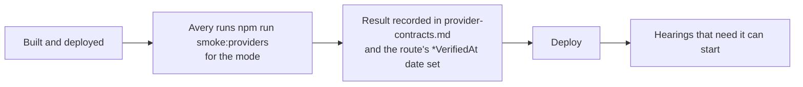

# Roadmap

What has been delivered, what is still gated on a live check, and what comes next.

## Goal

Let a team take one real scenario (their prompts, inputs, scoring guide), run it across the setups they
are considering, and decide which setup is best for **that** use case. The decision rests on blind human
review, with automatic checks, cost and speed alongside. Model Court stays a decision aid on your own
cases: no public leaderboard, no platform-paid calls, no fully automatic verdicts.

## Delivered

All seven "use-case kit" items were built from their specs (now in [archive/specs/](archive/specs/)),
reviewed, and deployed on Nov 19, 2026. Each one had its open spec questions answered with the spec's
proposed defaults, and those defaults are still for Avery to confirm.

| # | Item | What a judge gets | Decisions | Live state |
|---|---|---|---|---|
| 1 | Setup comparison | Cost estimate, latency, tokens and failures per party; optional repeats for consistency | D-62–D-66 | On; cost labelled as an estimate |
| 2 | Scenarios and re-hearing | Save a case as a scenario; re-hear it with new parties; compare hearings over time | D-67–D-72 | On |
| 3 | Task kits and checks | Summarization and classification kits with free automatic checks shown after unsealing | D-75–D-80 | On |
| 4 | Structured extraction | Field lists (JSON Schema), answer keys, text and PDF documents | D-85–D-91 | Off until a route passes the paid `json` (and `pdf`) smoke modes |
| 5 | Answers from sources | Numbered sources, citation and quote checks, refusal when the sources lack the answer | D-92–D-98 | On |
| 6 | Mock tools | Tools with canned responses, a step-capped tool loop, trace checks | D-99–D-105 | Off until a route passes the paid `tools` smoke mode |
| 7 | Providers and parties | Google Gemini as a third BYOK provider; up to 5 parties within 15 answers per juror | D-106–D-112 | Gemini off until Avery's live check; 3 parties live, 5 in code |

Follow-ups delivered after the roadmap:
- D-113–D-116: only calls actually sent count in the metrics; the plain over-limit message at Start; a
  note when Google answers from another model; smoke tests pass in linked worktrees.
- D-117: the live backup path, built and deployed; off until `BACKUP_PUBLIC_KEY` is set.
- D-118–D-120: fixes from the first signed-in test run and a full UI review.

## How a gated feature turns on

| Feature | Smoke mode | Routes |
|---|---|---|
| Questions with a conversation | `multi` | OpenAI, Anthropic |
| Structured extraction | `json` | OpenAI, Anthropic |
| PDF documents | `pdf` | OpenAI, Anthropic |
| Tool use | `tools` | OpenAI, Anthropic |
| Google Gemini | `single`, then `multi` | Gemini 3.6 Flash, Gemini 4 Carbon |

## Next

1. **Avery's live checks**, which unblock most of the table above: the paid smoke modes, a full signed-in
   hearing with a juror, and confirming each spec's defaults.
2. **Turn backups on:** `npm run backup -- keygen`, set `BACKUP_PUBLIC_KEY`, deploy, then take one
   on-demand backup and run a trial restore ([runbook.md](runbook.md#the-live-backup-path-d-117)).
3. **Review the 4–5 party screens** with the party cap raised locally. The UI review could not reach them,
   because the test runner keeps the local cap at 3.
4. **Raise the live party cap** to 5 once those screens are reviewed (`MAX_CONFIGURATIONS_PER_RUN`).

## Ground rules for new work

- BYOK only. Keys never leave the server, and jurors never need keys. Paid calls keep the existing
  shape: outbox, then job, then guarded claim, then the send outside a transaction, then a fenced
  commit. There is no automatic paid retry, and budget is reserved up front.
- Blinding before unsealing never weakens. Anything that could identify a party (cost, latency, model
  names, provider-specific formatting, check results that differ by party) stays hidden from jurors
  until the record is unsealed.
- Recorded data is versioned and immutable. New message templates, rubric versions and kit versions are
  added, never edited, and old hearings keep reading their own versions.
- Keys, cost, consent and deletion are always explained in plain words. Court terms are display strings only.
- Tests come with each feature: unit tests for pure rules, integration tests on both stores, Playwright
  for flows.
- Work lands on a branch and deploys only when Avery says so.

## Deferred

- Running generated code against tests (needs a sandbox that Workers doesn't offer).
- Autonomous agents in live environments (unbounded cost, large safety surface).
- Retrieval pipelines run by Model Court (indexing, embeddings).
- Text-to-SQL against a fixture database (a good later kit).
- An OpenAI-compatible route such as OpenRouter (the provider check already accepts `'openrouter'`; not
  scheduled).
- Public leaderboards or cross-customer aggregation.
