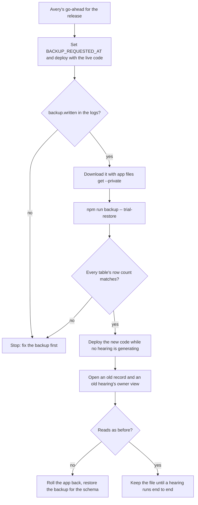
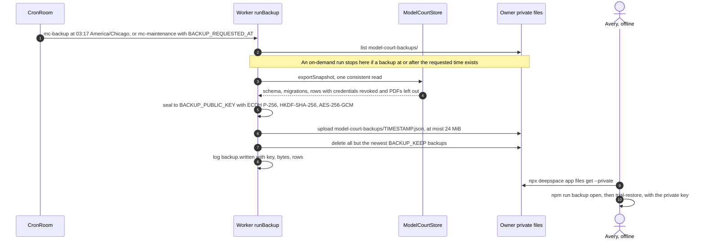
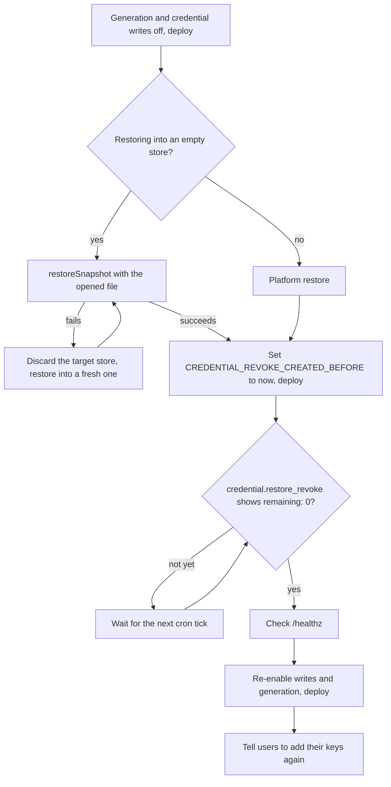

# Operator runbook

How to configure, deploy, operate, back up and restore the live Model Court app. Run every command from the
app directory, signed in to the DeepSpace CLI as the app owner (Avery). Never paste secret values into
commands, chats or documents.

Model Court is a DeepSpace app: a Hono Worker ([`worker.ts`](../worker.ts)), one SQLite Durable Object store
(`ModelCourtStore`), the platform's JobRoom for generation and CronRoom for scheduled work
([`src/cron.ts`](../src/cron.ts)), deployed with `npx deepspace deploy`. Live generation is strictly BYOK:
every provider call uses a key the judge saved in Settings.

## Contents

- [Configuration reference](#configuration-reference)
  - [`[vars]` in `wrangler.toml`](#vars-in-wranglertoml)
  - [Secrets](#secrets)
  - [Platform bindings](#platform-bindings)
  - [What `/healthz` reports](#what-healthz-reports)
- [First deployment](#first-deployment)
- [Verification after deploy](#verification-after-deploy)
- [Disable generation (kill switch)](#disable-generation-kill-switch)
- [Symptoms](#symptoms)
- [Root-key rotation](#root-key-rotation)
- [Migrations](#migrations)
  - [Deploying a release that rebuilds tables](#deploying-a-release-that-rebuilds-tables)
  - [Deploying migration 0009 (repeats, D-65)](#deploying-migration-0009-repeats-d-65)
  - [Deploying migration 0015 (Google provider, D-106)](#deploying-migration-0015-google-provider-d-106)
  - [Additive migrations: 0010, 0012, 0016](#additive-migrations-0010-0012-0016)
- [pdf.js updates](#pdfjs-updates)
- [Backup and restore (V9)](#backup-and-restore-v9)
  - [What a backup holds](#what-a-backup-holds)
  - [The live backup path (D-117)](#the-live-backup-path-d-117)
  - [Restore procedure (any method)](#restore-procedure-any-method)
- [Rollback](#rollback)

## Configuration reference

Configuration is parsed on every request by [`src/server/config.ts`](../src/server/config.ts). An invalid or
missing value turns the capability it controls off (fail closed) instead of falling back to a value that spends
money. Plain settings live in [`wrangler.toml`](../wrangler.toml) `[vars]`; the two credential roots and the
HMAC key live in the DeepSpace secrets store. Change a `[vars]` value by editing `wrangler.toml`, committing and
running `npx deepspace deploy`.

### `[vars]` in `wrangler.toml`

"Unset" means the name is absent or empty. "Problem" means the value is listed in the config's problems, which
makes `/healthz` report `ready:false` (see [What `/healthz` reports](#what-healthz-reports)).

| Name | Unset (code default) | In `wrangler.toml` today | Effect | Malformed value |
|---|---|---|---|---|
| `GENERATION_ENABLED` | off | `"true"` | The spending switch. Only the exact string `"true"` turns generation on, and only while the active credential root and the HMAC key are ready. | Anything but `"true"` is off. `"true"` without ready credentials stays off and is a problem. |
| `CREDENTIAL_WRITES_ENABLED` | on | `"true"` | `"false"` pauses adding and replacing saved keys. Removal always works. | Anything but `"false"` is on, still only while credentials are ready. |
| `CREDENTIAL_ACTIVE_KEY_VERSION` | `v1` | `"v1"` | The root new saves are sealed under (`v1` or `v2`). | A version whose root is not configured is a problem: no active root, so saving keys and generation are off. |
| `CREDENTIAL_TTL_DAYS` | 7 | `"7"` | Saved keys expire this long after saving or renewal (D-23). Clamped to 1–90. | Not a non-negative integer: problem, 7 is used. `"0"` also means 7. |
| `MAX_DAILY_CALLS_PER_USER` | 20 | `"20"` | Provider calls one user may make per day. | Not a non-negative integer: problem, 0 is used (generation blocked). |
| `MAX_DAILY_CALLS_GLOBAL` | 100 | `"100"` | Provider calls for the deployment per day. | Same: problem, 0. |
| `MAX_LIFETIME_CALLS_GLOBAL` | 500 | `"500"` | Provider calls for the deployment in total. | Same: problem, 0. |
| `MAX_DOCUMENT_BYTES_PER_USER` | 33554432 (32 MiB) | not set | Extraction document bytes one user may store (spec 04, D-87). | Same: problem, 0. |
| `MAX_DOCUMENT_BYTES_GLOBAL` | 268435456 (256 MiB) | not set | Extraction document bytes for the deployment (spec 04, D-87). | Same: problem, 0. |
| `MAX_CONFIGURATIONS_PER_RUN` | 3 | not set | Parties per hearing, 2–5 (D-110). The live app stays at 3 until Avery raises it. | Outside 2–5: problem, 2 is used. |
| `MAX_SAMPLES_PER_ANSWER` | 3 | not set | Repeats per answer, 1–3; 1 turns repeats off (D-65). | Outside 1–3: problem, 1 is used. |
| `PROVIDER_TIMEOUT_MS` | 90000 | not set | Provider deadline. It can only shorten the 90-second limit, never lengthen it. | Not a non-negative integer: problem, 90 seconds is used. `"0"` also means 90 seconds. |
| `PUBLIC_APP_ORIGIN` | the request origin | `""` | Exact origin used in invitation links. | Not an https origin (`localhost` and `127.0.0.1` are allowed over http), or not a URL: problem, the request origin is used. |
| `APP_COMMIT` | `unknown` | `"274470e"` | The shipped commit, shown as `build` in `/healthz` and recorded in run snapshots. Set it to the commit you deploy. | Any text is used as is. |
| `CREDENTIAL_REKEY_TARGET_VERSION` | off | not set | Operator only, during [rotation](#root-key-rotation): the cron re-encrypts active keys to this root. | A root that is not configured: problem, re-keying is paused. |
| `CREDENTIAL_REKEY_REVOKE_UNREADABLE` | off | not set | Operator only: `"true"` revokes keys that fail authentication during re-keying. Applies only while the re-key target is valid. | Anything but `"true"` is off. |
| `CREDENTIAL_REVOKE_CREATED_BEFORE` | off | not set | Operator only, after a [restore](#restore-procedure-any-method): epoch ms; the cron revokes every active key created before it. | Not a positive epoch-ms integer: problem, ignored. |
| `BACKUP_PUBLIC_KEY` | off | commented out | Operator P-256 public key (base64 SPKI, from `npm run backup -- keygen`). Set means daily sealed backups are on. Public, not a secret. | Not a base64 P-256 public key: backups are off, logged as `backup.config_problem`. |
| `BACKUP_KEEP` | 14 | commented out | How many backups to keep in the owner's private folder, 1–60. | Outside 1–60: 14 is kept, logged as `backup.config_problem`. |
| `BACKUP_REQUESTED_AT` | off | commented out | Operator only: take one backup now (epoch ms) unless one at or after that time exists. | Not a positive epoch-ms integer: ignored, logged as `backup.config_problem`. |
| `DEEPSPACE_APP_ID` | none | `app_01M7M0ATC59NFTPZSJJS47J0BX` | The app's immutable identity, minted by `npx deepspace app init`. Backups name it and restore refuses another app's file. | Never edit it. |
| `APP_NAME` | none | `"model-court"` | Platform subdomain label. Renames are safe. | Platform setting. |
| `NATIVE_AUTH_REDIRECT_URIS` | none | `""` | Comma-separated native-client callback URIs (scaffold setting). Unused by Model Court today. | Platform setting. |

The three credential operator settings (`CREDENTIAL_REKEY_TARGET_VERSION`, `CREDENTIAL_REKEY_REVOKE_UNREADABLE`,
`CREDENTIAL_REVOKE_CREATED_BEFORE`) are read only by the maintenance cron
([`src/server/services/credential-ops.ts`](../src/server/services/credential-ops.ts)). No HTTP route reaches
them. A malformed value turns the operation off; a malformed target or cutoff also shows up in `/healthz` as
`ready:false`.

The backup settings are read only by the backup tasks. Their problems are logged as `backup.config_problem` by
the daily `mc-backup` task and never make `/healthz` unready.

### Secrets

Secrets live in the DeepSpace secrets store, never in `wrangler.toml`. List names with
`npx deepspace secrets list` (never print values).

| Name | Created by | Effect | Missing or malformed |
|---|---|---|---|
| `CREDENTIAL_ENCRYPTION_KEY_V1` | `npm run secrets:provision -- --apply` | AES-256-GCM root that seals saved provider keys (base64 of 32 bytes). | Problem. If it is the active root, saving keys and generation are off. |
| `CREDENTIAL_REQUEST_HMAC_KEY` | `npm run secrets:provision -- --apply` | Keyed digest of credential requests (base64 of 32 bytes). | Problem; saving keys and generation are off. |
| `CREDENTIAL_ENCRYPTION_KEY_V2` | `npm run secrets:provision -- --rotation-root v2 --apply` | Absent until a [rotation](#root-key-rotation). The Worker reads only `v1` and `v2`. | Problem. If it is the active root, saving keys and generation are off. |

[`scripts/provision-app-secrets.mjs`](../scripts/provision-app-secrets.mjs) generates the values in memory,
pipes them to `npx deepspace secrets upload -` over stdin, and refuses to overwrite a name that already exists.

> [!WARNING]
> Never overwrite a credential root. Replacing a root that sealed saved keys makes every one of those keys
> undecryptable.

### Platform bindings

| Binding | Source | Notes |
|---|---|---|
| `MODEL_COURT_STORE` | Durable Object binding (`ModelCourtStore`, migration `v2`) | Created on first deploy; one app-wide instance. Holds all Model Court data. |
| `RECORD_ROOMS`, `YJS_ROOMS`, `CANVAS_ROOMS`, `PRESENCE_ROOMS`, `CRON_ROOMS`, `JOB_ROOMS` | Durable Object bindings (migration `v1`) | Scaffold classes, all kept: removing a class needs a data-deleting migration. |
| `OWNER_USER_ID` | Supplied by the platform | The owner whose private files receive backups. Without it backups are off. |

### What `/healthz` reports

`GET /healthz` returns `build` (`APP_COMMIT`), `ready`, `storeOk` and `generationEnabled`, with no secrets or
provider settings.

- `ready` is `false` when any `[vars]` value or secret above lists a problem, or when the store does not answer.
- `generationEnabled` is `true` only when `GENERATION_ENABLED` is `"true"` and the active root and the HMAC key
  are ready. Other problems make `ready` false without turning generation off; they fall back as the table says
  (a malformed call cap becomes 0, which blocks every call).
- `storeOk` means the store answered. The store applies its migrations before serving, so after a deploy
  `storeOk:true` also means the release's migrations ran.

## First deployment

> [!IMPORTANT]
> Avery does the sign-in in step 1 (browser OAuth). `wrangler.toml` currently holds the live value
> `GENERATION_ENABLED = "true"`; a new deployment must start with generation off (step 4).

1. Run `npx deepspace auth whoami`. If needed, Avery runs `npx deepspace auth login` (browser OAuth).
2. Run `npx deepspace app init`. It registers the app and mints `DEEPSPACE_APP_ID`. Commit `wrangler.toml`
   afterwards.
3. Run `npm run secrets:provision` (dry run), then `npm run secrets:provision -- --apply`. The values are
   generated in memory and piped over stdin.
4. Set `GENERATION_ENABLED = "false"` in `wrangler.toml`. Keep generation off on a new deployment until the
   providers pass `npm run smoke:providers` ([provider contracts](./provider-contracts.md#smoke-test)).
5. Run `npm run check`, then commit. Set `APP_COMMIT` to that commit, commit again, and run
   `npx deepspace deploy`.
6. Check `/healthz`: `ready: true`, `generationEnabled: false`.
7. Run step 1 and step 6 of [Verification after deploy](#verification-after-deploy). Once the providers
   pass the smoke test, set `GENERATION_ENABLED = "true"`, redeploy, and run steps 2–5, which need
   generation on.

## Verification after deploy

Run these after a deploy.

1. Signed out: `/` and `/sample` work and make no `/api` requests; `/healthz` shows the new build.
2. Account A: add keys in Settings, create a case, start a hearing, and close the browser. Generation completes.
3. Account A: open review, create an invite. Account B (a different browser) redeems it and submits. Confirm B
   never sees model names, cost or check results before unsealing.
4. Account A: unseal, then record a verdict. B sees the results.
5. Remove a key while a hearing is queued: nothing further is sent.
6. Check `npx deepspace logs --level error` and the CSP header on the deployed origin.

## Disable generation (kill switch)

1. Set `GENERATION_ENABLED = "false"` in `wrangler.toml`.
2. Run `npx deepspace deploy`.

New runs and retries then return 503. The sample, reviews, results and credential removal keep working. Jobs
already queued still claim; to stop those, the owner cancels the run.

## Symptoms

| Symptom | Action |
|---|---|
| `CREDENTIAL_UNAVAILABLE` on many attempts | Disable generation. Check `npx deepspace secrets list` for the root name and version (never print values). **Never overwrite a root as a fix**: that makes every saved key undecryptable. |
| Suspected user-key exposure | Disable generation. The affected users remove their keys in Settings (or the operator revokes the rows). Tell them to rotate the key **at the provider**. Fix the leak before re-enabling. |
| Unusual spend | Disable generation. Inspect `budget_buckets`, `attempt_reservations` and `audit_events`. The Durable Object store has no console yet, so this needs a temporary read-only operator query. Re-enable only after a bypass test passes. |
| Run stuck generating | `npx deepspace logs --search outbox` / `attempt.`. The cron re-dispatches pending outbox rows and expires leases after 120 seconds. Never resend all calls by hand. |
| Provider failing repeatedly | Set the route's `verifiedAt` to `null` in [`src/domain/registry.ts`](../src/domain/registry.ts) and deploy. Old evidence stays readable. |
| `/healthz` shows `storeOk:false`, or API 500s mention "different Durable Object" | A Durable Object stub was reused across contexts. Stubs must be created per request, job or cron run (D-22). Roll back to the previous release if needed. |
| `/healthz` shows `ready:false` with `storeOk:true` | A `[vars]` value or secret is missing or malformed. Check each against the [configuration reference](#configuration-reference). |
| Live updates stale | The UI falls back to a 15-second authorized refetch and refetches on focus. Check RecordRoom logs and the `mc_notices` schema. |
| Deletion not finishing | The tombstone already blocks access. Check `[cron] mc-maintenance` log lines; cleanup retries every minute in batches of 10. |
| Identity leak suspected | Disable review routes by deploying a fix, mark the affected runs as potentially unblinded, and rerun the evaluation if needed. |
| No `backup.written` after setting `BACKUP_REQUESTED_AT` | Check `npx deepspace logs --search backup.` for `backup.failed` and its reason word (`list`, `export`, `seal`, `too_large`, `upload`). A malformed `BACKUP_PUBLIC_KEY` turns backups off silently on the on-demand path; its `backup.config_problem` line is written only by the daily run. |

## Root-key rotation

Re-keying runs in the maintenance cron, once a minute, on up to 250 active keys per tick. Each key is decrypted
under the root its row records. It is then sealed under the target root with a fresh nonce and the same
canonical AAD, which now names the target version. The new ciphertext is opened once as a check before a
guarded update replaces the old one. The update changes only `ciphertext`, `nonce` and `encryption_key_version`.
Revision, expiry and last use stay the same, so owners notice nothing and `If-Match` values stay valid. Revoked
rows are never selected.

The job keeps no state: every tick picks up the active rows that are not on the target yet, so it can be
stopped, redeployed or run twice safely. Each re-keyed row writes a `credential.rekey` audit event. Log lines
carry counts and opaque ids only, never key material.

> [!WARNING]
> Never overwrite a root as a fix, at any step. Removing v1 (step 5) is the only step that cannot be undone.

1. Set `CREDENTIAL_WRITES_ENABLED="false"` and `GENERATION_ENABLED="false"`, then deploy. Re-keying tolerates
   concurrent saves, renewals and removals; pausing writes keeps the window short and the counts easy to read.
2. Run `npm run secrets:provision -- --rotation-root v2` (dry run), then add `--apply`. This generates
   `CREDENTIAL_ENCRYPTION_KEY_V2` in memory and refuses to overwrite an existing root. The Worker reads only
   `v1` and `v2`, so a third root needs a code change in [`src/server/config.ts`](../src/server/config.ts).
3. Set `CREDENTIAL_ACTIVE_KEY_VERSION="v2"` (new saves use v2) and `CREDENTIAL_REKEY_TARGET_VERSION="v2"`, then
   deploy. Watch `npx deepspace logs --search credential.rekey`. Each tick logs `rekeyed`, `unreadable`,
   `revokedUnreadable`, `rootMissing`, `skipped` and `remaining`.
   - `remaining: 0` means every active key is on v2. Continue with step 4.
   - If every row is `unreadable` and none is `rekeyed`, the v1 root in the secrets store is not the one that
     sealed the keys. Nothing was changed. Clear the target, deploy, and investigate.
     **Never overwrite a root as a fix.**
   - If a few rows are `unreadable` (ids in `unreadableIds`), those rows were altered or corrupted. They are
     already unusable: generation fails them with `CREDENTIAL_UNAVAILABLE`. To finish, set
     `CREDENTIAL_REKEY_REVOKE_UNREADABLE="true"` and deploy. The next tick revokes them through the normal path
     (fences their runs, deletes ciphertext). Then clear the flag. **Never set this flag while the first case
     above is possible: it would revoke every key.**
   - `rootMissing > 0` means a row records a root this Worker does not have. Restore that secret, never a new
     value under its name.
4. Clear `CREDENTIAL_REKEY_TARGET_VERSION`, re-enable writes and generation, deploy, and run one verification run
   ([Verification after deploy](#verification-after-deploy)).
5. Retire v1 only once `remaining` has been 0 and a backup exists.
   - A rollback to an older release keeps the live secrets (`deepspace rollback`), and every v1 release already
     reads `CREDENTIAL_ENCRYPTION_KEY_V2`, so v2 rows stay readable after a rollback.
   - Releases built before the rotation still set `CREDENTIAL_ACTIVE_KEY_VERSION="v1"`. Rolling back to one of
     them after v1 is removed fails closed: saving keys and generation stay off until v2 is made active again.
   - Removing v1 is the only step that cannot be undone.

**Verified locally** on both stores (`tests/integration/credential-rekey.test.ts`): fresh nonces, AAD bound to
v2, generation after v1 removal, resumable batches, idempotent reruns, revoked rows unchanged, tampered and
swapped ciphertext refused, wrong-root no-op, no plaintext anywhere. **Not yet run on the live platform.** The
cron tick and the `deepspace logs` output need a live check the first time this runs.

## Migrations

The store runs its own migration runner ([`src/server/db/migrations.ts`](../src/server/db/migrations.ts),
ledger `mc_schema_migrations`, D-02) the first time it starts on new code. Most migrations are additive. Two
rebuild tables in place (0009 and 0015); any later rebuild follows the same rules.

### Deploying a release that rebuilds tables

> [!IMPORTANT]
> A release that rebuilds tables needs Avery's explicit go-ahead before it is deployed.

> [!WARNING]
> Take and check a backup with the release that is live now, before the new code starts the store. Keep that
> file until a hearing has run end to end on the new version. The schema is never rolled back by a code
> rollback; only the backup brings the old schema back.

The order of the steps, with the checks that stop the deploy:

1. Get Avery's explicit go-ahead.
2. Take an on-demand backup with the release that is live now: set `BACKUP_REQUESTED_AT` and deploy the current
   code ([Taking and checking a backup](#taking-and-checking-a-backup)).
3. Confirm `backup.written` in `npx deepspace logs --search backup.`.
4. Download the file and run `npm run backup -- trial-restore <file>.json`. Every table's row count must match.
   For a large store, this is also the trial restore into a fresh store on the new schema.
5. Deploy the new code when no hearing is generating.
6. Open an old record and an old hearing's owner view, plus anything the migration's own section names. They
   must read as before.
7. Keep the backup file until a hearing has run end to end on the new version.

### Deploying migration 0009 (repeats, D-65)

> [!IMPORTANT]
> Needs Avery's OK. Do not deploy it without Avery's explicit go-ahead.

> [!WARNING]
> `0009_generation_samples` rebuilds `generations`, `generation_attempts`, `outbox` and `attempt_reservations`
> in place, in one transaction, the first time the store starts on the new code.

Status: 0009 ran on the live store on 2026-11-19 (release `rel_01M7V1E6V2T96FRGDDQ3P6PSZ7`, build `fbe5c5c`),
deployed without a backup on Avery's choice because no live backup path existed yet
([verification.md](./verification.md)). The steps stay for any store that has not run it.

1. Take a sealed V9 backup ([the live backup path](#the-live-backup-path-d-117)) and keep it until the new
   version has run a hearing end to end.
2. If the store is large, restore that backup into a fresh store and start it on the new code first; check that
   the row counts of the four tables match.
3. Deploy when no hearing is generating. A claim or commit that races the rebuild waits for it, but there is no
   reason to test that live.
4. After the deploy, open an old record and an old hearing's owner view: testimony, findings and Cost and speed
   must read as before, with every generation at sample 1.

If the migration fails, the transaction rolls back and the store keeps the old schema. The new code then cannot
serve hearings (it writes `sample_no`), so roll the app back (`npx deepspace rollback`). Once it has succeeded,
rolling the app back is also safe: the older code never names `sample_no`, and its inserts get the default of 1.
The schema itself is not rolled back; restore the backup for that.

### Deploying migration 0015 (Google provider, D-106)

> [!IMPORTANT]
> Needs Avery's OK. Do not deploy it without Avery's explicit go-ahead.

> [!WARNING]
> `0015_provider_google` rebuilds eleven tables in place, in one transaction, the first time the store starts on
> the new code: `generations`, `generation_attempts`, `outbox`, `attempt_reservations`, `testimony_checks`,
> `generation_steps`, `step_reservations`, `step_outbox`, `provider_credentials`, `run_credentials` and
> `grader_credentials`. Only the provider CHECK changes.

Status: 0015 ran on the live store on 2026-11-19 in the same release as 0009, also without a backup on Avery's
choice ([verification.md](./verification.md)). The steps stay for any store that has not run it.

Follow the 0009 steps:

1. Take a sealed V9 backup and keep it until a hearing has run end to end on the new version.
2. If the store is large, do a trial restore into a fresh store first and compare the eleven tables' row counts.
3. Deploy when no hearing is generating.
4. Afterwards, an old record, an old hearing's owner view and Settings → API keys must read as before.

If the migration fails, the transaction rolls back and the old schema stays; roll the app back. Once it has
succeeded, rolling the app back is safe (older code never writes `'google'`), but a Google key saved since then
would be unusable by the older code; revoke such keys first.

### Additive migrations: 0010, 0012, 0016

None of these rebuilds a table. Each is safe to roll back from, because older code never names what it adds.

| Migration | What it adds | Backup first? | Notes |
|---|---|---|---|
| `0010_case_origin` (spec 02, D-71) | Four nullable columns on `evaluations` and one trigger that keeps them unchanged once set. | Follows the release it ships in | Additive and fast, but it ships after 0008/0009, so the 0009 rules apply to the release that carries it. Backups taken before it restore after it. |
| `0012_extraction_documents` (spec 04, D-87) | Five tables, three indexes and three triggers. No existing table changes. | No (unlike 0009) | A store backup (D-32) now carries text documents whole and leaves PDF bytes out (`redactions.pdfChunksOmitted`). After a restore those PDFs read "Source file not restored" until the judge uploads the same file again on the draft, which restores the hearing's copy too. |
| `0016_attempt_unsent` (D-113) | One column, `generation_attempts.unsent` (default 0), and one trigger. | No | Backups taken before it restore after it (the column takes its default). |

## pdf.js updates

`pdfjs-dist` is pinned to an exact version (6.5.438) and loaded only on PDF screens, from the app's own origin
(spec 04 decision 9, D-90). Treat every update as a security change:

1. Read the release notes for security fixes.
2. Keep the options in [`src/lib/pdf.ts`](../src/lib/pdf.ts): XFA off, annotations not rendered, no scripting
   (6.x has no eval path).
3. Run `npm run check`. `src/lib/pdf.test.ts` opens the fixture with the real library.
4. Look at a PDF worksheet before deploying.

Check for a new release at least once a month while extraction is live.

## Backup and restore (V9)

All data lives in the one `ModelCourtStore` SQLite Durable Object.

### What a backup holds

[`src/server/services/backup.ts`](../src/server/services/backup.ts) provides the parts that can be tested
locally:

- `exportSnapshot` reads every Model Court table in one store call, so the snapshot is consistent. It includes
  the schema, the migration ledger and all rows. Credential secrets never leave the store: every
  `provider_credentials` row is exported **revoked with no ciphertext, nonce or root version**. Receipts of
  `credential.*` commands are dropped, because they hold a keyed digest of the submitted key. PDF bytes are left
  out (`redactions.pdfChunksOmitted`). Export refuses a table that is missing from `BACKUP_TABLES`, so a new
  migration cannot be left out of a backup without anyone noticing.
- `sealSnapshot` / `openSnapshot` are the older symmetric format (D-32): AES-256-GCM under a dedicated 32-byte
  backup key, with the header authenticated. The live path seals to a public key instead
  ([`backup-seal.ts`](../src/server/services/backup-seal.ts)). Either way the snapshot still holds user content
  (prompts, responses, ratings, verdicts), so never store it unsealed. Never use a credential root as a backup
  key.
- `restoreSnapshot` loads into an **empty**, migrated store and refuses anything else. It also refuses another
  app's file, a digest mismatch, unknown tables, column names that are not identifiers, and migrations the target
  lacks. It forces every credential row revoked without ciphertext again, even for a file that was not made by
  `exportSnapshot`. It drops credential receipts and fences all queued or in-flight work pinned to a restored key
  (`CREDENTIAL_REVOKED`, reservations released). It writes a `store.restore` audit event. It is not one
  transaction across tables: if it fails, discard the target store and restore into a fresh one.
- `CREDENTIAL_REVOKE_CREATED_BEFORE` (cron) revokes every active key created before a cutoff, through the normal
  revocation path. Use it after any restore that may have brought back ciphertext, such as a platform
  point-in-time restore. A key the user removed after the restore point would otherwise come back.

Verified locally on both stores (`tests/integration/backup-restore.test.ts`, and the post-restore cases in
`credential-rekey.test.ts`).

### The live backup path (D-117)

Sealed backups go to the app owner's **private** files folder (`appFiles`, `scope: 'self'`), sealed to an
operator P-256 public key ([`src/server/services/store-backup.ts`](../src/server/services/store-backup.ts),
[`backup-seal.ts`](../src/server/services/backup-seal.ts)). The Worker holds only the public key, so it can
write new backups but never read old ones, and there is no backup secret to upload. There is no HTTP route that
exports or restores.

Today `BACKUP_PUBLIC_KEY` is commented out in `wrangler.toml`, so no backup runs until the one-time setup below
is done.

How one backup travels from the cron to Avery's machine:

| Item | Behaviour |
|---|---|
| Daily | The `mc-backup` cron task runs at 03:17 America/Chicago once `BACKUP_PUBLIC_KEY` is set. |
| On demand | Set `BACKUP_REQUESTED_AT` to the current epoch ms and deploy. Within a minute the maintenance task takes one backup unless one at or after that time exists. Leaving it set is harmless. |
| Retention | The newest `BACKUP_KEEP` files (default 14) under `model-court-backups/`. Other files in the folder are never touched. Pruning never fails the backup just written. |
| Size | One upload is at most 24 MiB; a larger store logs `backup.failed` with reason `too_large`. |
| Logs | `backup.written` (key, bytes, rows), `backup.failed` (a reason word), `backup.prune_failed`, `backup.config_problem`. Backup settings never make `/healthz` unready. |
| Sealing | An ephemeral P-256 key per file, ECDH with the operator key, HKDF-SHA-256 to a fresh AES-256-GCM key, the header authenticated. The file names the operator key it is sealed to (`recipient`). |

#### One-time setup

> [!IMPORTANT]
> Avery only, on Avery's own machine. Without the private key no backup can be opened.

1. Run `npm run backup -- keygen`. It writes the private key to `~/.model-court/backup-private-key.txt` (never
   shown, and refused if the file exists) and prints the public key.
2. Move the private key into your password manager.
3. Put the public key in `wrangler.toml` `[vars]` as `BACKUP_PUBLIC_KEY` (it is not a secret) and deploy.

#### Taking and checking a backup

1. Set `BACKUP_REQUESTED_AT` (`node -e "console.log(Date.now())"`) and deploy, or wait for the daily run.
2. Run `npx deepspace logs --search backup.` and find `backup.written` with its key.
3. Run `npx deepspace app files list --private` to list `model-court-backups/…`, then
   `npx deepspace app files get --private model-court-backups/<file>.json --out <file>.json` to download one.
4. Run `npm run backup -- open <file>.json`. It checks the seal and the content digest and prints row counts.
5. Run `npm run backup -- trial-restore <file>.json`. It restores the file into a fresh, in-memory local store
   (never the live app) and compares every table's row count. The restore adds one `store.restore` audit event,
   which the comparison allows for.

Both `open` and `trial-restore` read the private key from a hidden prompt, or from a file with `--key <file>`.
[`scripts/backup.ts`](../scripts/backup.ts) makes no network call and never prints backup content or the key.

**Before a deploy that rebuilds tables** (0009, 0015 and any later rebuild): take an on-demand backup with the
release that is live now, confirm `backup.written`, download it and run `trial-restore`, then deploy the new code.
Keep that file until a hearing has run end to end on the new version. See
[Deploying a release that rebuilds tables](#deploying-a-release-that-rebuilds-tables).

#### Verification status

- **Verified:** sealing, opening, retention, the request logic and the restore on both local stores
  (`store-backup.test.ts`, `backup-seal.test.ts`), and `open` and `trial-restore` on a real sealed file.
- **Not yet verified live:** that `appFiles` writes from a cron context on DeepSpace, and that
  `app files get --private` reads what the Worker wrote. The first on-demand backup after deploying checks both.

Durable Object point-in-time recovery (`getBookmarkForTime`) is still not exposed by DeepSpace as far as we
know. If it is used, it brings back old ciphertext, so step 3 of the restore procedure is mandatory.

### Restore procedure (any method)

> [!WARNING]
> Saved keys never survive a restore, by design. Step 3 is mandatory after any restore that may bring back
> ciphertext, including a platform point-in-time restore. Revocation is one-way: a trigger blocks
> `revoked → active`.

The restore in order, including the path when `restoreSnapshot` fails:

1. Set `GENERATION_ENABLED="false"` and `CREDENTIAL_WRITES_ENABLED="false"`, then deploy.
2. Restore. For an empty store, `restoreSnapshot` with the opened file; otherwise, the platform restore. There
   is no HTTP route or CLI command that runs `restoreSnapshot` against the live store today
   (`trial-restore` targets only a local in-memory store).
3. Set `CREDENTIAL_REVOKE_CREATED_BEFORE` to the current epoch ms (`node -e "console.log(Date.now())"`) and
   deploy. Wait for `npx deepspace logs --search credential.restore_revoke` to show `remaining: 0`. Leaving the
   value set is harmless: keys saved after the cutoff are never touched.
4. Check `/healthz`. The `remaining` value in that log line counts the active keys created before the cutoff, so
   `0` is the check that none is left.
5. Re-enable writes and generation, deploy, and tell users to add their keys again. Saved keys never survive a
   restore by design. The schema also makes revocation one-way: a trigger blocks `revoked → active`.

## Rollback

1. Run `npx deepspace releases` to list the retained bundles.
2. Run `npx deepspace rollback` to the one you want.

A code rollback does not roll back the store, and it keeps the live secrets. Every migration so far keeps the
previous bundle working: most are additive, and the two rebuilds (0009, 0015) keep everything older code names.
After 0015, revoke any Google key before rolling back to code that predates it.

> [!WARNING]
> Never approve a rollback that deletes Durable Object classes.
