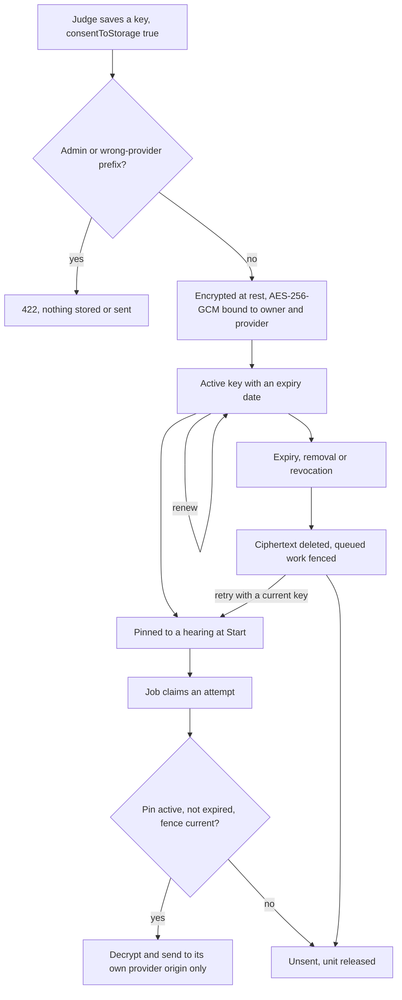

# Security

This page is the maintained overview of how Model Court protects provider keys, blinding and the record.
It states what the code does today and links to the code and to `docs/decisions.md`, which records why.
The two full security reviews are archived and summarised under [Review history](#review-history).

> [!IMPORTANT]
> Live generation is strictly BYOK: every provider call is paid with the judge's own OpenAI, Anthropic or
> Google key. There is no platform-billed AI route, billing selector or fallback payer, and provider keys
> never go into logs, jobs, receipts, notices, URLs or responses.

## Threat model in short

| Asset | Who might go after it | Main controls |
|---|---|---|
| Saved provider keys | Another user, a log or backup reader, a look-alike host | Encryption at rest bound to the owner, short expiry, outbound allowlist, nothing key-bearing in logs, jobs, receipts or backups |
| The judge's provider spend | Another user, a replayed or duplicated request | Keys pinned per hearing and owner, idempotency receipts, call caps, rate limits, fences before every send |
| Blinding (which model wrote which answer) | A juror, a guest, a curious judge before unsealing | Allowlisted juror projections, labels only, results and checks only after unsealing |
| Ratings, documents, sources | Another user, a juror of another hearing | Role checks per case, the same 404 for missing and not visible, per-question document access |
| Guest seats | A link holder, a cross-site page | Same-origin cookie routes, hashed single-use secrets, device expiry |
| The browser | A hostile PDF, model output or imported text | Strict CSP, download-only document responses, escaped rendering, CSV formula neutralization |

Out of scope by design: a trusted operator who holds both the store and the root secret can decrypt saved
keys ([`src/server/credential-crypto.ts`](../src/server/credential-crypto.ts)). Identity comes only from a
verified DeepSpace platform JWT; the scaffold's generic surfaces that could spend owner credits or bypass app
authorization (integration, files, payments and debug proxies, AI chat routes) were removed (D-04).

## BYOK and key handling

| Step | What happens | Where |
|---|---|---|
| Save | `POST /credentials` with `consentToStorage: true`. Admin keys (`sk-admin-`, `sk-ant-admin`) and keys that clearly belong to another provider are refused before anything is stored or sent (D-23, D-107). At most 5 saves a minute; a 16 KiB body cap; `CREDENTIAL_WRITES_ENABLED` can pause saving, never removal | [`contracts.ts`](../src/domain/contracts.ts), [`credentials.ts`](../src/server/services/credentials.ts) |
| Encrypt | AES-256-GCM with a random 12-byte nonce. The associated data binds the ciphertext to the app, credential id, owner, provider, root-key version and schema version, so a row copied to another owner or provider does not decrypt. The root key (`CREDENTIAL_ENCRYPTION_KEY_V1`) lives in the DeepSpace secrets store | [`credential-crypto.ts`](../src/server/credential-crypto.ts) |
| Receipts | The save receipt matches replays with an HMAC digest (`CREDENTIAL_REQUEST_HMAC_KEY`), never the key | `saveCredential` |
| Expiry | Keys expire `CREDENTIAL_TTL_DAYS` after saving or renewal (default 7, at most 90). Expiry is checked at Start, at retry and right before decryption; the minute cron revokes expired keys through the revocation path (D-23) | `expireCredentials` |
| Pin | Start pins exactly one of the judge's own active keys per provider to the hearing (`run_credentials`, immutable by trigger). The only move is on retry, from a removed or expired key to another active key of the same owner and provider (D-59). The special master pins its key the same way (`grader_credentials`, D-40) | [`runs.ts`](../src/server/services/runs.ts) |
| Use | A job re-reads the pin, re-checks owner, status and expiry, then decrypts inside `withRunCredential` or `withGraderCredential` and sends. The fence is checked again just before the send (D-19). Each decrypt records `last_used_at` and `last_used_run_id` | `withRunCredential` |
| Check | "Check key" makes one free list-models request server-side: redirects refused, body never read, 10 s timeout, 6 checks a minute. Only `valid`, `invalid`, `restricted` or `unreachable` and a reason code are stored or returned (D-59) | `checkCredential` |
| Remove or revoke | Deletes the ciphertext, nonce and key version, fences queued work, marks in-flight attempts uncertain and releases the units of work that provably was not sent. Commits from grader and hearing jobs require the pin to still be active (D-43) | `revokeCredentialStatements` |
| Rotate the root | `CREDENTIAL_REKEY_TARGET_VERSION` makes the cron re-encrypt active keys to a new root, guarded per row (D-31) | [`credential-ops.ts`](../src/server/services/credential-ops.ts), [runbook](runbook.md) |



## Blinding before unsealing

Jurors, guests and the judge's own worksheet see the parties only as labels (`A` to `E`, in a balanced
rotation) until the judge unseals the hearing.

- Juror payloads (`getReview`, the reviewer run view, the reviewer case view) are built from explicit
  allowlists. Generation and attempt ids, configuration keys, and provider and model identity stay in the
  server-only `assignment_json`. Jobs and notices carry opaque ids only.
- Results, exports and the special master exist only after reveal, and results use the cohort frozen in the
  reveal transaction.
- Automatic check results are read only through results and the export, after reveal, for every role; a
  source scan (`checks-isolation.test.ts`) keeps other modules from naming the table (D-76).
- Kit facts shown to jurors are identical for every party. Extraction answers are shown as the server's
  canonical rendering, never the provider's bytes. Tool traces go through the `jurorTrace` allowlist, without
  provider call ids, reasoning, tokens or timing. Grounded sources are shown without the judge's origin
  notes, and after unsealing those notes stay judge-only (D-98).
- Re-hearing, comparing, copying and scenario files are judge-only; a hearing's parties appear in the case's
  hearing list only once it is unsealed.
- Jurors can flag a suspected identity clue on any answer; the record counts potentially unblinded reviews.

Known residual cues, kept by design: a long imported answer can give a human party away by length (the
editor warns at 1.5 times a generated answer, D-38); a non-JSON extraction answer shows the provider's raw
text (D-91); jurors see the summarization phrases to avoid and the expected labels as jury instructions
(D-80).

## Outbound allowlist

Every provider request goes through `allowlistedFetch` in
[`src/server/providers/endpoints.ts`](../src/server/providers/endpoints.ts) (D-107).

| Provider | Only origin |
|---|---|
| OpenAI | `https://api.openai.com` |
| Anthropic | `https://api.anthropic.com` |
| Google | `https://generativelanguage.googleapis.com` |

- Refused before any network I/O: anything not https, not an exact allowlisted origin (look-alike hosts
  fail), with userinfo or an explicit port (`:443` included), another provider's origin, or a request that
  does not set `redirect: 'manual'`. The refusal logs fixed tokens only, never the URL.
- The Worker's fetch is wrapped once for any allowlisted origin, and each adapter and the key check wrap it
  again for their own provider, so a key only ever reaches its own provider.
- A refused request is a definite, unsent `PROVIDER_REJECTED_REQUEST` and its budget unit is released. A
  provider redirect is not followed (`PROVIDER_REDIRECT_REFUSED`).
- Every URL is built from `PROVIDER_ORIGINS`; a unit test fails if any other provider module spells out a
  scheme.

## Guest jurors

A juror without an account joins from an invitation link with a display name (D-41).

| Control | Detail |
|---|---|
| Cookie | `__Host-mcj-<runId>`, HttpOnly, Secure, SameSite=Strict, Path=/, no Domain; value `<deviceId>.<secret>`, never returned in a body |
| Scope | Only that hearing's run view, review, submit, results and question documents; every other route is 401 |
| Same origin | The two cookie-setting routes and every cookie-authenticated mutation need `Origin` to be ours, or `Sec-Fetch-Site: same-origin` |
| Secrets | 256-bit, stored only as SHA-256, kept out of logs, audit rows and URLs sent to the server |
| Limits | Join 10 an hour per IP; resume 5 an hour per IP and per guest; reads 120 a minute; at most 3 devices |
| Resume links | Need a click, are single-use and return a fresh link to the new device only; refused when the browser already holds another juror's seat for the hearing (D-43) |
| Expiry and removal | Devices stop working 14 days after they were added. The judge can sign out a guest's devices or remove the guest, which revokes every device |
| Identity | Guest ids use the reserved `mcj_` namespace, which no token can claim. A signed-in judge or seated juror cannot also take a guest seat. Guests are labelled "(guest, no account)" in the record and export |
| Backups | The guest tables are never exported, so a restore cannot revive guest access |

## Browser and documents

- Worker-served HTML gets a CSP with `script-src 'self'`, `frame-ancestors 'none'` and `connect-src 'self'
  wss:` plus the auth worker, and every response gets `X-Frame-Options: DENY`, `nosniff` and
  `Referrer-Policy: strict-origin-when-cross-origin` ([`worker.ts`](../worker.ts)).
- Uploaded documents always download: `Content-Disposition: attachment`, a `sandbox` CSP, `nosniff` and
  `Cross-Origin-Resource-Policy: same-origin`. PDFs are drawn by pdf.js on a canvas with decoded image and
  canvas size caps (D-91). The server checks PDF bytes only and never parses them.
- Model output, imported text and documents are rendered as escaped text.

## Exports and backups

| Output | Who gets it | What it never carries |
|---|---|---|
| Certified record (`/runs/:id/export`, JSON or CSV) | The judge, after unsealing; audited as `run.export` | Keys, ciphertext, credential, invite, user, session, response, generation or attempt ids (sentinel-scanned, D-28). CSV cells are formula-neutralized (D-29). The content hash is an integrity fingerprint, not a signature |
| Scenario file | The judge | Any id, key, imported answer, testimony, rating or judgment |
| Store backup | The app owner's private files | Usable keys: every credential row is revoked, ciphertext and `credential.*` receipts are dropped (D-32). PDF bytes and the guest tables are left out |

Backups (D-117): a daily cron task and an on-demand request export the store, seal it to an operator P-256
public key (`BACKUP_PUBLIC_KEY`, ECDH + HKDF-SHA-256 + AES-256-GCM, a fresh ephemeral key per file) and upload
it to the owner's private files, keeping the newest 14. The Worker holds only the public key, so it can write
backups but never read them. There is no HTTP export or restore route. A restore redacts keys again and fences
pinned work, and `CREDENTIAL_REVOKE_CREATED_BEFORE` revokes every key older than the restore (D-33). Any
migration that adds a table must add it to `BACKUP_TABLES`, and a test fails otherwise. Procedures are in the
[runbook](runbook.md).

## Repository settings

GitHub repository [avxryn/model-court](https://github.com/avxryn/model-court), set up on Nov 20, 2026.

| Setting | State |
|---|---|
| Visibility | Private until Avery says otherwise |
| Branch ruleset "Protect master and the release branch" | `master` (default) and `claude/roadmap-1-3`: no deletion, no force push. No bypass actors |
| Tag ruleset "Protect the submission tag" | `submission-candidate-*`: no deletion, no move |
| Dependabot alerts and security updates | On |
| Actions | No workflows. Default workflow token is read-only and cannot approve pull requests |
| Wiki, projects | Off |
| History scan | Every branch and tag, before each push: no real key, private key, token or secret file. The only key-shaped strings are test fakes |

> [!IMPORTANT]
> Every commit's author is `Avery Nguyen <averynguyen04@gmail.com>`. Making the repository public
> publishes that address. Hiding it would mean rewriting every commit, which breaks the DeepSpace deploy
> history, so it is Avery's call.

### Making it public (in this order)

1. Re-run the history scan: `git rev-list --all` piped into `git grep` for key formats (see
   [verification.md](verification.md)).
2. Change visibility to public in GitHub settings (Avery).
3. Right after, turn on what GitHub offers only for public repositories:

   ```bash
   gh api -X PATCH repos/avxryn/model-court -f 'security_and_analysis[secret_scanning][status]=enabled' -f 'security_and_analysis[secret_scanning_push_protection][status]=enabled'
   ```

   ```bash
   gh api -X PUT repos/avxryn/model-court/private-vulnerability-reporting
   ```

   ```bash
   gh api -X PUT repos/avxryn/model-court/actions/permissions/fork-pr-contributor-approval -f approval_policy=all_external_contributors
   ```

4. Check the Security tab: secret scanning, push protection and private reporting are on, and no alert is open.

## Review history

| Date | Review | Scope | Findings by severity | Resolution |
|---|---|---|---|---|
| 2026-11-17 | [v2 review](archive/security-reviews/v2.md) (D-43) | Branch `next`, three independent reviewer agents: guest-juror authentication, paid calls and imported evidence, the frontend | 0 critical, 0 high, 1 medium, 10 low, 1 consistency, 1 nit | Medium fixed (a resume link could plant another guest into a seat). 9 low fixed. 1 low unchanged by design (imported answer length, D-38). Consistency fixed. Nit left (a failed guest join keeps the single-use token in session storage until it expires) |
| 2026-11-18 | [Extraction review](archive/security-reviews/extraction.md) (D-91) | Structured extraction at `4c579aa`, three reviewer agents: upload and storage, access and blinding, the browser and pdf.js | 0 critical, 0 high, 2 medium, 6 low, 7 info | Both medium fixed (hostile PDFs exhausting a tab, backups reading every PDF chunk). 4 low fixed, 1 partly fixed (the server still trusts the page count), 1 open (the prerendered `/` CSP). Info: 3 fixed, 1 not applicable, 1 left as specified, 2 open (pdf.js wasm and fonts, the global document cap) |

Smaller single-reviewer passes are recorded only in `docs/decisions.md`: v1 (D-19, 3 low, fixed), task kits
(D-80, 2 low and 1 info, fixed), answers from sources (D-98, 1 high, 1 medium and 2 low, fixed), mock tools
(D-105, 2 low and 1 info, fixed) and more providers (D-112, 1 medium and 1 low fixed; the setup-metrics item
was fixed in D-113).

## Open risks

> [!NOTE]
> An Anthropic API key that was exposed earlier was rotated by Avery on Nov 20, 2026 (reported in the working
> session). Never paste a key into a document, chat or command; if one is exposed, revoke it at the
> provider, create a new one and replace the saved key in Settings.

| Risk | State | Source |
|---|---|---|
| No live backup yet | The backup path is deployed but does nothing until `BACKUP_PUBLIC_KEY` is set. Not yet verified live: writing to private files from a cron context, and downloading what the Worker wrote | D-117, [runbook](runbook.md) |
| Guest cookies at the edge | Not yet verified that the DeepSpace edge passes `Set-Cookie` and `CF-Connecting-IP` through unchanged | D-41 |
| Live key checks | 401 versus 403 for restricted project keys, against the real providers, is for Avery to verify | D-59 |
| Gemini and tool use | No Google call and no live tool call has been made; those routes stay unverified and no hearing can use them | D-100, D-108 |
| D1 bound-value cap | The 100-values-per-statement cap is not enforced by local workerd, so only the bound-value counts are tested | D-98, D-105 |
| PDF viewer limits | The canvas cap and render cancellation are not yet checked in a browser | D-91 |
| Page count | The server trusts the browser's `X-Page-Count`; only the judge's own key is spent | D-91 |
| Prerendered `/` | Served by the asset layer with a weaker CSP than worker-served pages (`public/_headers`) | D-91 |
| pdf.js without wasm, cMaps and fonts | Jurors may see some scanned images blank or some CJK text garbled while providers got the full file | D-91 |
| Global document cap | Eight accounts at 32 MiB fill the 256 MiB global cap | D-91 |
| Grader inputs | The special master still receives `expectedBehavior` | D-80 |
| Operator access | Whoever holds both the store and the root secret can decrypt saved keys | [`credential-crypto.ts`](../src/server/credential-crypto.ts) |
